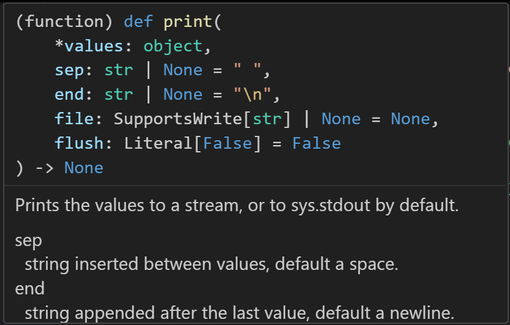
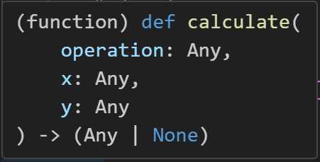
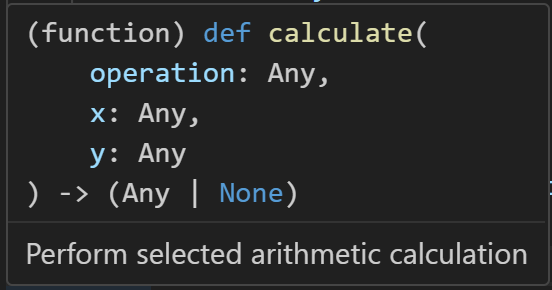
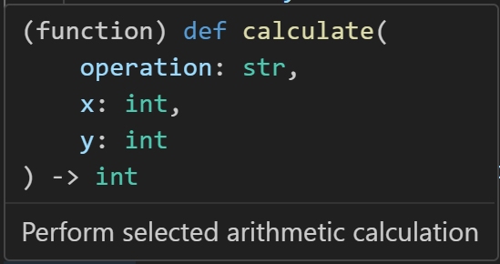
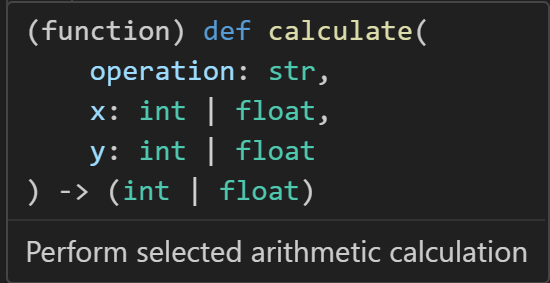
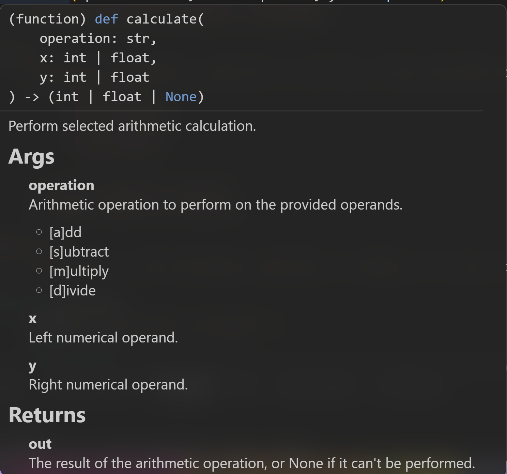

## Bonus: Type Hints and Function Documentation

> Note: This material goes a little beyond the main chapters. Because of that, examples in later
> chapters will mostly skip type hints and detailed doc strings.

In VS Code, when you hover over a function name, a pop-up shows you how to use the function. For
example, here is the helper for `print()`:



From this, we can tell a lot about the function and how we're expected to use it.

* The purpose: "*Prints the values to a stream or to sys.stdout by default.*"
* From `*values: object`, we can see that it accepts any number of arguments, of any type that inherits
  from `object`, and prints each one.
* From `sep: str | None = " "`, we can see that we can pass a keyword argument named `sep`.
    * It's the "*string inserted between values, default a space*".
    * If you pass it, it must be a `str`.
    * If you leave it out (`None`), it defaults to `" "`.
* The function returns `None`.
* And so on...

That's enormously useful to any developer who didn't write the function.

Let's look at how we can document our own functions, so that others get the same benefit from the
modules we write.

---

### A Function Without Hints

Suppose we've written this function:

```python
def calculate(operation, x, y):
    op = operation[0].lower()
    if op == "a":
        # add
        return x + y
    elif op == "s":
        # subtract
        return x - y
    elif op == "m":
        # multiply
        return x * y
    elif op == "d":
        # divide
        return x / y
    else:
        print(f"Operation [{operation}] not supported!")
        return None
```

The function works as expected, but its pop-up helper is sparse:



It doesn't tell us what the function does, what data it expects, or what type it returns.

---

### Adding a Doc String

Always include a doc string on your functions.

```python
def calculate(operation, x, y):
    """Perform selected arithmetic calculation"""
    # -- SNIP --
```

Now the helper tells us the purpose of the function:



---

### Adding Type Hints

You can declare the expected type of each parameter with this syntax:
`def function(param1: type1, ...):`

You can declare the return type like this:
`def function() -> return_type:`

Updating the signature gives us:

```python
def calculate(operation: str, x: int, y: int) -> int:
    """Perform selected arithmetic calculation"""
    # -- SNIP --
```

The helper now shows the expected types for the arguments and the return value:



---

### Type Hints with Multiple Possible Types

Starting in Python 3.10, a parameter or return value can allow more than one type. Separate the types
with a vertical pipe, `|`, which is also Python's bitwise OR operator:
`type1 | type2`

```python
def calculate(operation: str, x: int | float, y: int | float) -> int | float:
    """Perform selected arithmetic calculation"""
    # -- SNIP --
```

This tells the developer that either integers or floating-point numbers are valid:



---

### Documenting the Parameters and Return Value

Type hints say what types go in and come out. The doc string can say what the values mean.

The doc string is displayed as Markdown, so a few formatting rules apply:

* Square brackets have a meaning in Markdown, so escape them with a backslash, as in `\[a\]dd`.
* Leave a blank line between the description and the parameter list.
* Put double asterisks around a name to make it bold.

This version uses the Google docstring style, with `Args:` and `Returns:` sections:

```python
def calculate(operation: str, x: int | float, y: int | float) -> int | float | None:
    """Perform selected arithmetic calculation.

    Args:
        operation: Arithmetic operation to perform on the provided operands.
            * \[a\]dd
            * \[s\]ubtract
            * \[m\]ultiply
            * \[d\]ivide

        x: Left numerical operand.
        y: Right numerical operand.

    Returns:
        The result of the arithmetic operation, or None if it can't be performed.
    """
```

The helper now shows the parameters and the return value:



---

### The Finished Function

Here's the complete function, with the checks we've added along the way:

```python
def calculate(operation: str, x: int | float, y: int | float) -> int | float | None:
    """Perform selected arithmetic calculation.

    Args:
        operation: Arithmetic operation to perform on the provided operands.
            * \[a\]dd
            * \[s\]ubtract
            * \[m\]ultiply
            * \[d\]ivide

        x: Left numerical operand.
        y: Right numerical operand.

    Returns:
        The result of the arithmetic operation, or None if it can't be performed.
    """
    if not operation:
        print("No operation was given.")
        return None

    op = operation[0].lower()
    if op == "a":
        # add
        return x + y
    if op == "s":
        # subtract
        return x - y
    if op == "m":
        # multiply
        return x * y
    if op == "d":
        # divide
        if y == 0:
            print("Cannot divide by zero.")
            return None
        return x / y

    print(f"Operation [{operation}] not supported!")
    return None
```

The `#pylint` line at the top turns off two warnings in the code file. The backslashes in the docstring
would trigger `anomalous-backslash-in-string`, which is the cost of escaping the brackets. And the
function has more than six return statements, so Pylint raises `too-many-return-statements`. The
`.py` file turns off both warnings, because the clear structure is worth more than fewer returns.

---

