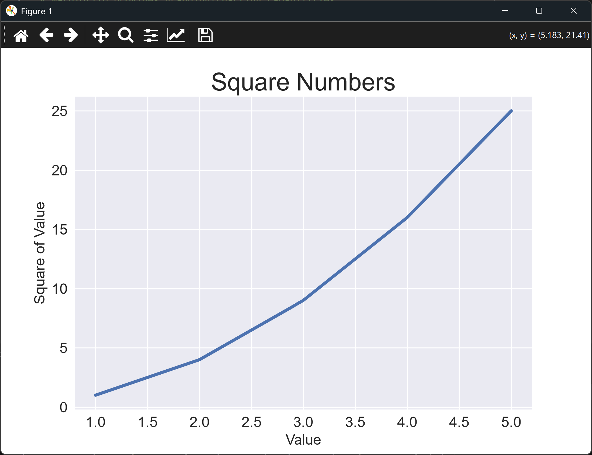

# Plotting a Simple Line Graph

## Matplotlib and pyplot

Data is much easier to understand as a picture than as a list of numbers.
**Matplotlib** is the Python library that draws those pictures. It can produce
everything from a quick chart to a publication-quality figure, and it's used
across science, finance, and engineering.

Matplotlib's most commonly used module is **pyplot**. It's imported with the short
name `plt`, which is what you'll see in every lesson in this chapter:

```python
import matplotlib.pyplot as plt
```

Pyplot works with a *figure* (the whole window or image) and one or more *axes* (the
area where the data is drawn). The usual pattern is:

1. Create a figure and an axes with `plt.subplots()`.
2. Draw on the axes, using methods such as `ax.plot()`.
3. Add a title and axis labels.
4. Show the result with `plt.show()`.

The samples in the matplotlib gallery at <https://matplotlib.org/gallery/> are a
good reference for the many other chart types the library supports.

You need to install matplotlib before running these lessons:

```bash
python -m pip install matplotlib
```

---

### The Line Graph

A **line graph** connects a series of data points with straight line segments. It's
the natural choice when:

* the x-axis is ordered, such as time, distance, or a sequence of trials,
* you want to see how a value *changes* from one point to the next, and
* you want to spot trends, such as steady growth, decline, or a sudden jump.

Typical examples are daily temperatures, a company's monthly sales, or the price of a
share over a year. The eye reads the slope of the line as the rate of change, so a
steep rise and a flat stretch are obvious at a glance.

In this lesson the data is the squares of the numbers 1 to 5. The points rise
faster and faster, so the line curves upwards. You can see that pattern even with
only five points, which is why this kind of chart is a good first example.

---

### The Code

Create the script and run it:

```python
"""Lesson 1.1 - Plotting a Simple Line Graph"""

# matplotlib provides graphing/charting capabilities
# Samples here: https://matplotlib.org/gallery/
# You may need to run the following to get this to work
# > python -m pip install matplotlib

import matplotlib.pyplot as plt

plt.style.use("seaborn-v0_8")
input_values = [1, 2, 3, 4, 5]
# squares = [1, 4, 9, 16, 25]
squares = [value ** 2 for value in input_values]

fig, ax = plt.subplots()
ax.plot(input_values, squares, linewidth = 3)

# Set chart title and label axes.
ax.set_title("Square Numbers", fontsize = 24)
ax.set_xlabel("Value", fontsize = 14)
ax.set_ylabel("Square of Value", fontsize = 14)

# Set size of tick labels.
ax.tick_params(axis = "both", labelsize = 14)

plt.show()
```

---

### Walking Through the Code

**Choosing a style.** `plt.style.use("seaborn-v0_8")` applies a built-in set of
colors and grid lines. It only changes how the chart looks, not the data.

**Preparing the data.** `input_values` holds the x-coordinates. The list
comprehension `[value ** 2 for value in input_values]` builds the y-coordinates by
squaring each one. The commented-out line shows the same list written out by hand.

**Drawing the line.** `plt.subplots()` returns a figure and a single axes. Then
`ax.plot(input_values, squares, linewidth = 3)` joins the points with a line, drawn
three points thick.

**Labeling the chart.** A chart without labels doesn't tell the reader what they're
looking at, so the title and both axis labels are set. `fontsize` controls the size
of the text.

**Sizing the tick labels.** `ax.tick_params()` changes the numbers along the axes.
Here it makes them 14 points, so they match the axis labels.

**Showing the chart.** `plt.show()` opens the chart in a window. The script doesn't
continue until you close that window.

---

### Output

Running the script opens a window titled **Figure 1**, showing a chart titled
"Square Numbers". The horizontal axis is labeled "Value" and runs from 1.0 to 5.0.
The vertical axis is labeled "Square of Value" and runs from 0 to 25. A thick blue
line joins the points (1, 1), (2, 4), (3, 9), (4, 16), and (5, 25), and it curves
upwards as the values grow.



The window has toolbar buttons for moving around the chart, zooming, and saving an
image. Close the window to finish the script.

---
