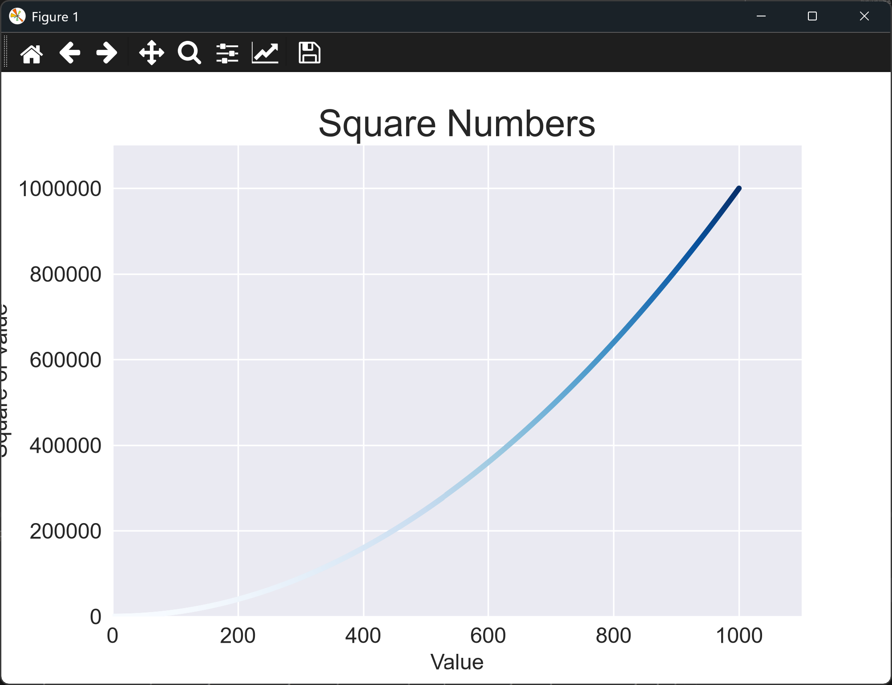

# Plotting a Simple Scatter Graph

## From Lines to Points

The previous lesson joined a few points with a line. Sometimes that isn't the right
picture. When you have many individual data points, and the connection between one
point and the next doesn't mean anything, a **scatter graph** is better. It plots each
point on its own, with no line between them.

Scatter graphs are the usual choice when you want to:

* see the **relationship** between two quantities, such as height and weight, or
  advertising spend and sales,
* spot **clusters** of points that behave alike,
* find **outliers**, the points that sit well away from everything else, and
* see how **spread out** the data is.

Because every point is visible, a scatter graph can show patterns a line would hide.
A line would make the data look smooth, even when the individual readings jump around.

In this lesson we plot 1,000 points, the squares of the numbers 1 to 1,000. With that
many points the curve is clear, and color is used to show how large each value is.

---

### The Code

Create the script and run it. The script saves its chart to a `files` folder beside
the script, so create that folder first.

```python
"""Lesson 1.2 - Plotting a Simple Scatter Graph"""

import os
import matplotlib.pyplot as plt

ROOT_DIR = os.path.dirname(__file__)

max_x = 1000

x_values = range(1, max_x + 1)
y_values = [x ** 2 for x in x_values]

plt.style.use("seaborn-v0_8")
fig, ax = plt.subplots()
ax.scatter(x_values, y_values, c=y_values, cmap=plt.cm.Blues, s=10)

# Set chart title and label axes.
ax.set_title("Square Numbers", fontsize = 24)
ax.set_xlabel("Value", fontsize = 14)
ax.set_ylabel("Square of Value", fontsize = 14)

# Set size of tick labels.
ax.tick_params(axis = "both", which = "major", labelsize = 14)
# Using the 'plain' ticklabel format will prevent expressing our y-axis in scientific notation
ax.ticklabel_format(style = "plain")

# Set the range for each axis.
ax.axis([0, 1100, 0, 1100000])

file_path = os.path.join(ROOT_DIR, "files", "squares_plot.png")
plt.savefig(file_path, bbox_inches = "tight")
plt.show()
```

---

### Walking Through the Code

**Finding the script's folder.** `os.path.dirname(__file__)` gives the folder that
holds this script. Using it, rather than a fixed path, means the file is saved in the
same place wherever the project is.

**Creating the data.** `range(1, max_x + 1)` gives the numbers 1 to 1,000, and the
list comprehension squares each one.

**Drawing the points.** `ax.scatter()` places one marker for each pair of values.

* `c=y_values` colors each point by its y-value, so larger values get a different
  color.
* `cmap=plt.cm.Blues` chooses the color scale, from pale blue for small values to
  dark blue for large ones.
* `s=10` sets the size of each marker in points.

**Controlling the axes.** `ax.axis([0, 1100, 0, 1100000])` sets the limits as
`[xmin, xmax, ymin, ymax]`. The limits leave a little room beyond the largest values.
`ax.ticklabel_format(style = "plain")` stops the y-axis labels being written in
scientific notation, so the numbers read as ordinary values.

**Saving the chart.** `plt.savefig()` writes the chart to `files/squares_plot.png`.
`bbox_inches = "tight"` trims the blank margin around the chart. The save must happen
before `plt.show()`, because closing the window can clear the figure. If the `files`
folder doesn't exist, the save fails with a `FileNotFoundError`, so create the folder
first.

---

### Output

Running the script opens the same kind of window as the last lesson, titled
"Square Numbers". The axes run from 0 to 1,100 along the bottom and from 0 to
1,100,000 up the side. The points form a smooth upward curve. Near the origin the
points are pale, and towards 1,000 they darken to deep blue.

Look at the top-right corner of the curve. The y-values there are very large compared
with the x-values near the start, which is why the curve steepens so sharply. You can
see the same effect in the line graph, but with 1,000 points the shape is much clearer.



A copy of the chart is also saved to `files/squares_plot.png`.

---
