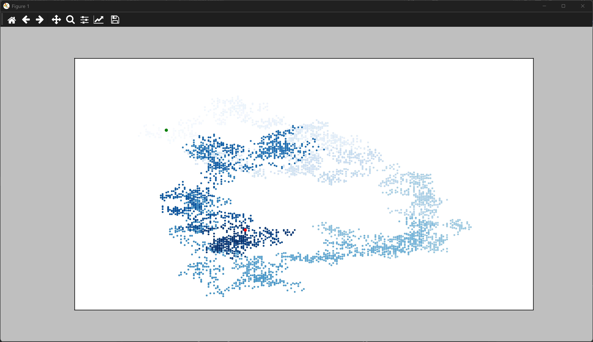

# Plotting a Random Walk

## What Is a Random Walk?

A **random walk** is a path made of many steps, where each step is chosen at random.
It sounds like a toy idea, but it's one of the most useful models in science. Pollen
grains drifting in water, molecules spreading through a gas, and the wandering of an
animal searching for food can all be modeled as random walks. In finance, the simplest
models of share prices are random walks too.

In this lesson we build a random walk, step by step, and then plot it. The walk is
made by a class that picks a random direction and distance for each step. A second
script draws the walk with matplotlib, so the path is easy to see.

Plotting a walk with a scatter graph, rather than a line, works well because each
point is a separate position on the path, with its own color. Those ideas come from
the scatter graph lesson in this chapter.

---

### The Random Walk Class

The `RandomWalk` class lives in `random_walk.py`. It stores the x and y coordinates
of every point in the walk, and it creates each new point at random:

```python
"""Lesson 2 - Random Walk Class"""

from random import choice

class RandomWalk:
    """A class to generate random walks"""

    def __init__(self, num_points = 5_000):
        """Initialize walk attributes"""
        self.num_points = num_points

        # Walks begin at coordinates (0, 0)
        self.x_values = [0]
        self.y_values = [0]

        self.fill_walk()

    def fill_walk(self):
        """Calculate points in the walk"""

        # Iterate until the walk list has enough points
        while len(self.x_values) < self.num_points:
            x = self.x_values[-1]
            y = self.y_values[-1]
            point = [x, y]
            while point == [x, y]:
                point = self.get_new_point(x, y)
            self.x_values.append(point[0])
            self.y_values.append(point[1])

    def get_new_point(self, x, y):
        """Create a new point"""
        return [self.get_new_num(x), self.get_new_num(y)]

    def get_new_num(self, num):
        """Compute a new number"""
        direction = choice([1, -1])
        distance = choice(list(range(0, 5)))
        step = direction * distance
        return num + step
```

#### How the Class Works

**Starting point.** Every walk starts at the origin, the point (0, 0). The two lists
`x_values` and `y_values` begin with a single 0 each.

**Taking a step.** `get_new_num()` moves one coordinate. It picks a direction, `1` or
`-1`, and a distance from 0 to 4, then adds the product to the current value. Each
coordinate changes independently, so a step can move diagonally.

**Avoiding standing still.** `fill_walk()` keeps picking new points until the point
differs from the last one. Without that check, a step of 0 in both directions would
leave the walker on the same spot.

**Building the walk.** The loop in `fill_walk()` keeps going until the walk has
`num_points` points. By default that is 5,000.

---

### The Visualization

The script `rw_visual.py` creates walks and draws them. It needs `random_walk.py` in
the same folder, because it imports the class from there:

```python
"""Lesson 2 - Random Walk (pyplot)"""

import matplotlib.pyplot as plt
from random_walk import RandomWalk

num_points = 5_000

while True:
    # Make a random walk
    rw = RandomWalk(num_points)

    # Plot the points
    plt.style.use("classic")
    fig, ax = plt.subplots(figsize=(19.2, 10.8), dpi=100)
    point_numbers = range(rw.num_points)
    ax.scatter(rw.x_values, rw.y_values, c=point_numbers,
               cmap=plt.cm.Blues, edgecolors="none", s=10)

    # Emphasize first and last points
    for i in [0, -1]:
        dot_color = "green"
        if i == -1:
            dot_color = "red"
        ax.scatter(rw.x_values[i], rw.y_values[i],
                   c=dot_color, edgecolors="none", s=30)

    # Remove the axes
    ax.get_xaxis().set_visible(False)
    ax.get_yaxis().set_visible(False)

    plt.show()

    keep_running = input("\nMake another walk? (y|n)\n> ")
    if keep_running.lower() != "y":
        break
```

#### How the Visualization Works

**Making a walk.** Each time round the loop, `RandomWalk(num_points)` creates a new
walk. Every run is different, because the steps are random.

**Coloring the points.** `c=point_numbers` colors each point by when it was reached.
The early points are pale, and the later points are dark blue, which shows the
direction the walk has taken over time.

**Marking the ends.** The loop draws the first point in green and the last point in
red. That makes it easy to see where the walk started and where it finished.

**Hiding the axes.** The walk itself is the picture, so the axes are hidden. The
numbers along the sides wouldn't add anything here.

**Asking to continue.** `input()` asks whether to make another walk. Anything other
than `y` ends the loop, so you can keep generating walks until you're finished.

---

### Output

Running `rw_visual.py` opens a window of about 1920 by 1080 pixels showing a single
random walk. The path is a tangle of dots that starts at a green point and finishes
at a red point. The walk spreads out over the window as the points accumulate.



After you close the window, the terminal asks:

```
Make another walk? (y|n)
>
```

Type `y` and press Enter to see another walk, or type anything else to stop. No two
walks look the same.

---
