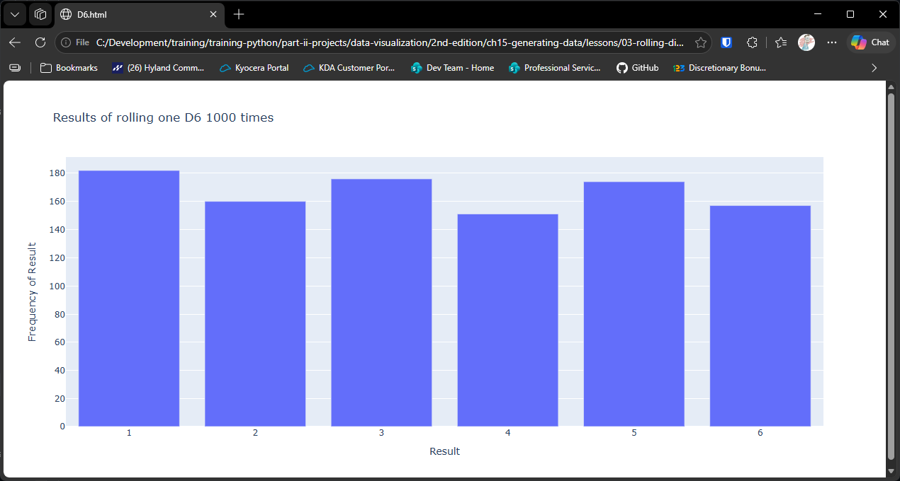

# Rolling a Six-Sided Die 1,000 Times

## Introduction

A fair six-sided die should land on each face one time in six. But any single roll
tells you nothing about that. Only when you roll the die many times and count the
results does a pattern appear. That's why counting results, and displaying the counts,
is such a useful tool. It's how you check that a die is fair, that a random number
generator behaves as expected, or that a game's odds are what the rules say.

In this lesson we roll a die 1,000 times, count how often each face comes up, and show
the counts as a **bar chart**. A bar chart is the right choice when the values are
separate categories, here the faces 1 to 6, and we want to compare how many times each
one occurred.

The chart is drawn with **plotly**, which creates interactive charts. You can hover
over a bar to see its value, and the chart is saved as an HTML file that opens in any
web browser. Install plotly before running this lesson:

```bash
python -m pip install plotly
```

---

### The Die Class

The `Die` class lives in `die.py`. It represents a die with a given number of sides,
and it can be rolled to produce a random result:

```python
"""Lesson 3 - Die Class"""

from random import randint

class Die:
    """Class representing a single die"""

    def __init__(self, num_sides: int=6):
        """Assume 6-sided die"""
        self.num_sides = num_sides

    def roll(self):
        """Return random number between 1 and number of sides"""
        return randint(1, self.num_sides)
```

#### How the Class Works

**Sides.** The number of sides is stored when the die is created. It defaults to 6,
so `Die()` is a standard six-sided die. `Die(10)` would be a ten-sided die.

**Rolling.** `randint(1, self.num_sides)` returns a whole number from 1 up to and
including the number of sides, with each face equally likely. Each call to `roll()`
is independent of the ones before it.

---

### The Visualization

The script `die_visual.py` rolls the die, counts the results, and draws the chart. It
needs `die.py` in the same folder, because it imports the `Die` class from there:

```python
"""Lesson 3 -Rolling a D6 1000 times"""

import os
from plotly.graph_objs import Bar, Layout
from plotly import offline
from die import Die

# Create a D6
die = Die()
roll_count = 1000

# Make some rolls and store the results in a list
results = []
for roll_num in range(roll_count):
    result = die.roll()
    results.append(result)

# Analyze the results
frequencies = []
for value in range(1, die.num_sides + 1):
    frequency = results.count(value)
    frequencies.append(frequency)

# Visualize the results
x_values = list(range(1, die.num_sides + 1))
data = [Bar(x = x_values, y = frequencies)]

x_axis_config = {"title": "Result"}
y_axis_config = {"title": "Frequency of Result"}
heading = f"Results of rolling one D{die.num_sides} {roll_count} times"
my_layout = Layout(title = heading, xaxis = x_axis_config, yaxis = y_axis_config)
ROOT_DIR = os.path.dirname(__file__)
file_path = os.path.join(ROOT_DIR, "files", f"D{die.num_sides}.html")
offline.plot({"data": data, "layout": my_layout}, filename = file_path)
```

#### How the Visualization Works

**Rolling.** The loop rolls the die `roll_count` times, which is 1,000, and stores
each result in the `results` list.

**Counting.** For each face from 1 to 6, `results.count(value)` counts how many
times that face came up. The counts go into the `frequencies` list, in the same
order as the faces.

**Building the chart.** `Bar(x = x_values, y = frequencies)` describes the bars: the
faces along the horizontal axis, and the counts as their heights. `Layout` sets the
title and the axis labels.

**Saving the chart.** `offline.plot()` writes the chart to `files/D6.html`, and it
opens the file in your browser. The name comes from the number of sides, so a
ten-sided die would be saved as `D10.html`. The `files` folder must exist beside the
script, because the save fails if it doesn't.

---

### Output

Running `die_visual.py` opens the chart in your web browser. It has the title
"Results of rolling one D6 1000 times", with "Result" along the bottom and "Frequency
of Result" up the side. There are six bars, one for each face.



The bars should be close to one another in height, but not identical. Each roll is random,
so some faces come up more often than others by chance. If you roll the die many more
times, the bars move closer to equal height. This tendency is called the law of large
numbers.

---
