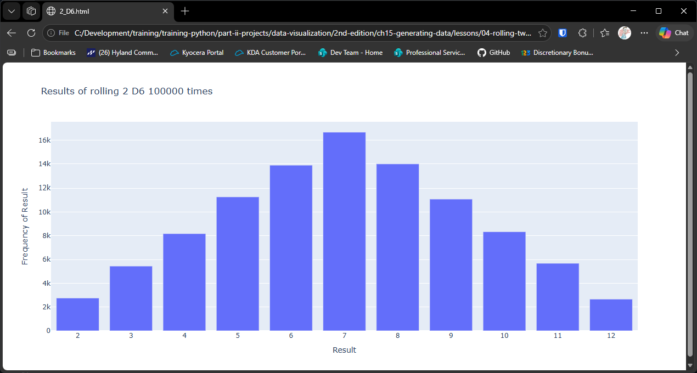

# Rolling Two Dice

## Introduction

Rolling one die gives each face the same chance of appearing. Rolling two dice
changes that, and the change is one of the most important ideas in probability.
When you add the two results together, some totals are much more likely than others.
A total of 7 can be made in six different ways, but a total of 2 can only be made one
way, with two 1s.

In this lesson we roll a pair of six-sided dice 100,000 times, add the two results on
each roll, and count how often each total appears. With that many rolls, the shape
of the results becomes clear. The totals form a hill, with 7 at the top, and that
shape reflects the probabilities exactly.

Board games such as Monopoly and the dice game craps depend on this pattern, and
it's the reason experienced players favor some moves over others. The chart is drawn
with plotly, the same library used in the previous lesson, so install it first if
you haven't already:

```bash
python -m pip install plotly
```

---

### The Die Class

Both dice in this lesson use the same `Die` class as the previous lesson. The file
`die.py` is identical, so you can copy it across, or keep one copy in each folder:

```python
"""Lesson 3 - Die Class"""

from random import randint

class Die:
    """Class representing a single die"""

    def __init__(self, num_sides: int=6):
        """Assume 6-sided die"""
        self.num_sides = num_sides

    def roll(self):
        """Return random number between 1 and number of sides"""
        return randint(1, self.num_sides)
```

---

### The Visualization

The script `dice_visual.py` rolls two dice, adds the results, and charts how often
each total occurs. It needs `die.py` in the same folder:

```python
"""Lesson 4 - Rolling Two Dice (plotly)"""

import os
from plotly.graph_objs import Bar, Layout
from plotly import offline
from die import Die

# Create a D6
dice = [Die(), Die()]
roll_count = 100_000

# Make some rolls and store the results in a list
results = []
for roll_num in range(roll_count):
    result = dice[0].roll() + dice[1].roll()
    results.append(result)

# Analyze the results
frequencies = []
max_result = 0
for die in dice:
    max_result += die.num_sides
for value in range(len(dice), max_result + 1):
    frequency = results.count(value)
    frequencies.append(frequency)

# Visualize the results
x_values = list(range(2, max_result + 1))
data = [Bar(x = x_values, y = frequencies)]

x_axis_config = {"title": "Result", "dtick": 1}
y_axis_config = {"title": "Frequency of Result"}
heading = f"Results of rolling {len(dice)} D{die.num_sides} {roll_count} times"
my_layout = Layout(title = heading, xaxis = x_axis_config, yaxis = y_axis_config)
ROOT_DIR = os.path.dirname(__file__)
file_path = os.path.join(ROOT_DIR, "files", f"{len(dice)}_D{dice[0].num_sides}.html")
offline.plot({"data": data, "layout": my_layout}, filename = file_path)
```

#### How the Visualization Works

**Rolling two dice.** `dice = [Die(), Die()]` creates two six-sided dice. On each of
the 100,000 rolls, `dice[0].roll() + dice[1].roll()` rolls both and adds the results.
The totals, which range from 2 to 12, go into the `results` list.

**Finding the range of totals.** The loop over `dice` adds up the sides of every die,
giving `max_result`, which is 12. The lowest possible total is one per die, which
is 2. Those two numbers set the range of values to count.

**Counting.** For each total from 2 to 12, `results.count(value)` counts how many
times it appeared. The counts go into `frequencies`.

**Building the chart.** The bars sit at the totals 2 to 12. `"dtick": 1` on the
horizontal axis makes plotly label every total, rather than skipping some.

**Titles and file names.** The heading reads "Results of rolling 2 D6 100000 times".
It says D6 because the script takes the side count from the loop variable `die`,
which still refers to the last die in the list. Both dice have six sides, so the
heading is correct here, but it would be wrong if the two dice had different sides.
The chart is saved as `files/2_D6.html`, using the number of dice and the side count.
The `files` folder must exist beside the script.

---

### Output

Running `dice_visual.py` opens the chart in your web browser. It has the title
"Results of rolling 2 D6 100000 times", with the totals from 2 to 12 along the bottom
and "Frequency of Result" up the side.



The bars form a hill, rising from 2 to a peak at 7 and falling again to 12. The
totals at the edges are rare: a 2 or a 12 each needs both dice to show the same
extreme face. Out of 100,000 rolls, you should see roughly 16,700 sevens, which is
one in six. You should see roughly 2,800 twos, which is one in thirty-six.

---
