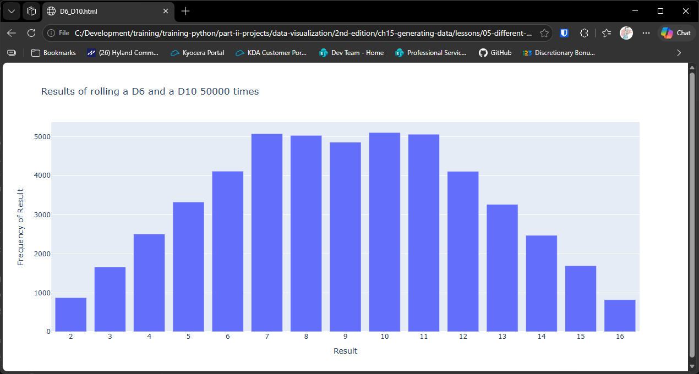

# Rolling Two Different Dice

## Introduction

In the last lesson, two six-sided dice produced a hill of totals, peaking at 7. The
shape of that hill depends on the dice. If you change one of them, the shape changes
too.

In this lesson we roll a six-sided die and a ten-sided die together 50,000 times,
add the two results on each roll, and chart how often each total appears. The
comparison with the last lesson is the point of this one. Two dice with different
numbers of sides don't produce the same pattern, and seeing why is a good way to
understand how probability combines.

Each total from 7 to 11 can be made in exactly six ways, so those totals should be
equally common. Outside that range, the counts fall away, because there are fewer
ways to reach a total that is very small or very large. You'll see that plateau in
the chart.

The chart uses plotly, as in the two previous lessons. Install it first if you
haven't already:

```bash
python -m pip install plotly
```

---

### The Die Class

The `Die` class is the same as in the previous two lessons. It represents a die with
a given number of sides, which defaults to 6:

```python
"""Lesson 3 - Die Class"""

from random import randint

class Die:
    """Class representing a single die"""

    def __init__(self, num_sides: int=6):
        """Assume 6-sided die"""
        self.num_sides = num_sides

    def roll(self):
        """Return random number between 1 and number of sides"""
        return randint(1, self.num_sides)
```

---

### The Visualization

The script `dice_visual.py` creates one six-sided die and one ten-sided die, rolls
both, and charts the totals. It needs `die.py` in the same folder:

```python
"""Lesson 5 - Rolling Two Different Dice (plotly)"""

import os
from plotly.graph_objs import Bar, Layout
from plotly import offline
from die import Die

# Create a D6
dice = [Die(), Die(10)]
roll_count = 50_000

# Make some rolls and store the results in a list
results = []
for roll_num in range(roll_count):
    result = dice[0].roll() + dice[1].roll()
    results.append(result)

# Analyze the results
frequencies = []
max_result = 0
for die in dice:
    max_result += die.num_sides
for value in range(len(dice), max_result + 1):
    frequency = results.count(value)
    frequencies.append(frequency)

# Visualize the results
x_values = list(range(2, max_result + 1))
data = [Bar(x = x_values, y = frequencies)]

x_axis_config = {"title": "Result", "dtick": 1}
y_axis_config = {"title": "Frequency of Result"}
heading = f"Results of rolling a D{dice[0].num_sides} and a D{dice[1].num_sides} {roll_count} times"
my_layout = Layout(title = heading, xaxis = x_axis_config, yaxis = y_axis_config)
ROOT_DIR = os.path.dirname(__file__)
file_path = os.path.join(ROOT_DIR, "files", f"D{dice[0].num_sides}_D{dice[1].num_sides}.html")
offline.plot({"data": data, "layout": my_layout}, filename = file_path)
```

#### How the Visualization Works

**Different dice.** `dice = [Die(), Die(10)]` creates a six-sided die and a ten-sided
die. The only difference from the previous lesson is the second argument to `Die()`.

**Rolling and adding.** On each of the 50,000 rolls, the two results are added
together. The totals range from 2, a 1 and a 1, up to 16, a 6 and a 10.

**Finding the range of totals.** The loop over `dice` adds the sides of both dice
to get `max_result`, which is 16. The lowest total is 2, one per die, so the chart
covers the totals 2 to 16.

**Counting.** `results.count(value)` counts each total, just as in the previous lesson.

**Building the chart.** The bars sit at the totals 2 to 16, with `"dtick": 1` so every
total is labeled.

**Titles and file names.** The heading reads "Results of rolling a D6 and a D10
50000 times". This version reads the side counts from `dice[0]` and `dice[1]`, so the
heading and the file name stay right whatever sizes the dice are. The chart is saved
as `files/D6_D10.html`, and the `files` folder must exist beside the script.

---

### Output

Running `dice_visual.py` opens the chart in your web browser, titled "Results of
rolling a D6 and a D10 50000 times". The totals run from 2 to 16 along the bottom,
and "Frequency of Result" runs up the side.



The bars rise from 2, reach a flat top from 7 to 11, and fall away to 16. The flat
top is the key feature. Each total from 7 to 11 has six combinations out of the sixty
possible, so each should appear about 5,000 times in 50,000 rolls. The totals at the
edges have fewer combinations. A total of 2 has only one, so it should appear about
830 times. Compare that with the rounded hill in the last lesson, where the two dice
had the same number of sides.

---
