# Chapter 15 Try-it-Yourself Assignments and Solutions

## Introduction

Here are my solutions for the chapter 15 try-it-yourself exercises.

Because the 2nd and 3rd editions of the textbook present data visualization in
different ways, each edition has its own solutions. This file covers the 2nd edition
answers, which use matplotlib for the cube and random walk exercises and plotly for
the dice exercises.

Each exercise shows the full assignment, then a solution with the code and its output.
The solution code is hidden until you expand it, so you can attempt each assignment
first.

Matplotlib charts open in a window, and you close the window to move on. Plotly
charts are saved to the `files` folder and open in your web browser. The screenshots
show what you should see.

---

### Assignment 15.1 - Cubes

Cubes: A number raised to the third power is a cube. Plot the first five cubic numbers, and then plot the first 5000 cubic numbers.

Solution:

<details>
<summary>Spoiler Code</summary>
<br>

```python
import matplotlib.pyplot as plt

print("Try-it-Yourself:")
print("Assignment 15.1")

# max_x = 5
max_x = 5_000

x_values = range(1, max_x + 1)
y_values = [value ** 3 for value in x_values]

plt.style.use("bmh")
fig, ax = plt.subplots()
# ax.scatter(x_values, y_values, c = y_values, cmap = plt.cm.Reds, s = 10)
ax.scatter(x_values, y_values, s = 5)

# Set chart title and label axes.
ax.set_title("Cube Numbers", fontsize = 16)
ax.set_xlabel("Value", fontsize = 10)
ax.set_ylabel("Cube of Value", fontsize = 10)

# Set size of tick labels.
ax.tick_params(axis = "both", which = "major", labelsize = 8)
# Using the 'plain' ticklabel format will prevent expressing our y-axis in scientific notation
ax.ticklabel_format(style = "plain")

# Set the range for each axis.
ax.axis([0, 5_000, 0, 125_000_000_000])

plt.show()
```

</details>
<br>

<details>
<summary>Output</summary>

```
Try-it-Yourself:
Assignment 15.1
```

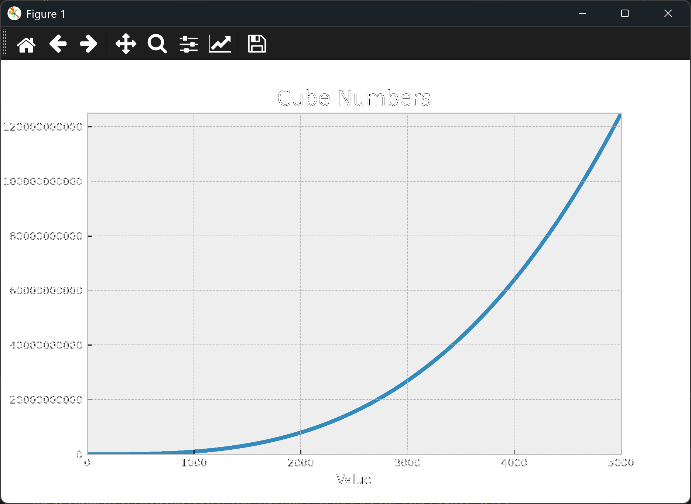

</details>
<br>

---

### Assignment 15.2 - Colored Cubes

Colored Cubes: Apply a colormap to your cubes plot.

Solution:

<details>
<summary>Spoiler Code</summary>
<br>

```python
import matplotlib.pyplot as plt

print("Try-it-Yourself:")
print("Assignment 15.2")

# max_x = 5
max_x = 5_000

x_values = range(1, max_x + 1)
y_values = [value ** 3 for value in x_values]

plt.style.use("bmh")
fig, ax = plt.subplots()
ax.scatter(x_values, y_values, c = y_values, cmap = plt.cm.Reds, s = 5)
# ax.scatter(x_values, y_values, c = y_values, s = 5)

# Set chart title and label axes.
ax.set_title("Cube Numbers", fontsize = 16)
ax.set_xlabel("Value", fontsize = 10)
ax.set_ylabel("Cube of Value", fontsize = 10)

# Set size of tick labels.
ax.tick_params(axis = "both", which = "major", labelsize = 8)
# Using the 'plain' ticklabel format will prevent expressing our y-axis in scientific notation
ax.ticklabel_format(style = "plain")

# Set the range for each axis.
ax.axis([0, 5_000, 0, 125_000_000_000])

plt.show()
```

</details>
<br>

<details>
<summary>Output</summary>

```
Try-it-Yourself:
Assignment 15.2
```

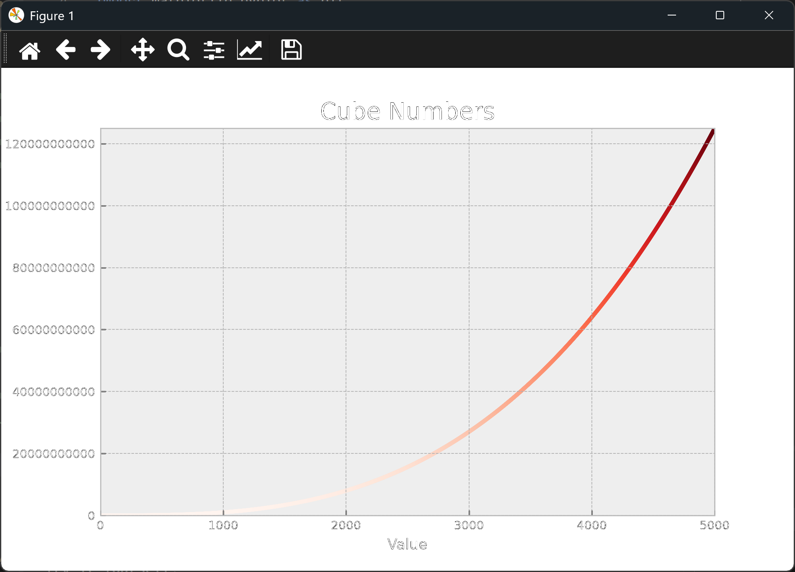

</details>
<br>

---

### Assignment 15.3 - Molecular Motion

Molecular Motion: Modify rw_visual.py by replacing ax.scatter() with ax.plot(). To simulate the path of a pollen grain on the surface of a drop of water, pass in the rw.x_values and rw.y_values, and include a linewidth argument. Use 5000 instead of 50,000 points.

Solution, which uses [random_walk.py](./random_walk.py):

<details>
<summary>Spoiler Code</summary>
<br>

```python
import matplotlib.pyplot as plt
from random_walk import RandomWalk

print("Try-it-Yourself:")
print("Assignment 15.3")

num_points = 5_000

while True:
    # Make a random walk
    rw = RandomWalk(num_points)

    # Plot the points
    plt.style.use("seaborn-v0_8")
    fig, ax = plt.subplots()
    ax.plot(rw.x_values, rw.y_values, color="gray", linestyle=":", linewidth=1, zorder=1)

    # Emphasize first and last points
    for i in [0, -1]:
        dot_color = "green"
        if i == -1 :
            dot_color = "red"
        ax.scatter(rw.x_values[i], rw.y_values[i], c=dot_color, edgecolors="none",
                   s=50, zorder=2)

    # Remove the axes
    ax.get_xaxis().set_visible(False)
    ax.get_yaxis().set_visible(False)

    plt.show()

    keep_running = input("\nMake another walk? (y|n)\n> ")
    if keep_running.lower() != "y":
        break
```

</details>
<br>

<details>
<summary>Output</summary>

```
Try-it-Yourself:
Assignment 15.3

Make another walk? (y|n)
>
```

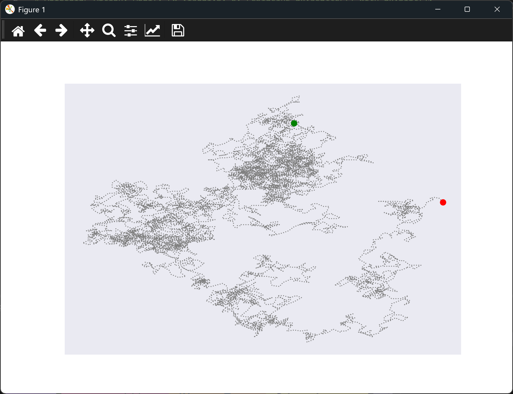

</details>
<br>

---

### Assignment 15.4 - Modified Random Walks

Modified Random Walks: In the RandomWalk class, x_step and y_step are generated from the same set of conditions. The direction is chosen randomly from the list [1, -1] and the distance from the list [0, 1, 2, 3, 4]. Modify the values in these lists to see what happens to the overall shape of your walks. Try a longer list of choices for the distance, such as 0 through 8, or remove the -1 from the x or y direction list.

Solution, which uses [modified_random_walk.py](./modified_random_walk.py):

<details>
<summary>Spoiler Code</summary>
<br>

```python
import matplotlib.pyplot as plt
from modified_random_walk import RandomWalk

print("Try-it-Yourself:")
print("Assignment 15.4")

num_points = 5_000

while True:
    # Make a random walk
    rw = RandomWalk(num_points)

    # Plot the points
    plt.style.use("classic")
    fig, ax = plt.subplots()
    point_numbers = range(rw.num_points)
    ax.scatter(rw.x_values, rw.y_values, c=point_numbers, cmap=plt.cm.Blues,
               edgecolors="none", s=10)

    # Emphasize first and last points
    for i in [0, -1]:
        dot_color = "green"
        if i == -1:
            dot_color = "red"
        ax.scatter(rw.x_values[i], rw.y_values[i], c=dot_color, edgecolors="none", s=30)

    # Remove the axes
    ax.get_xaxis().set_visible(False)
    ax.get_yaxis().set_visible(False)

    plt.show()

    keep_running = input("\nMake another walk? (y|n)\n> ")
    if keep_running.lower() != "y":
        break
```

</details>
<br>

<details>
<summary>Output</summary>

```
Try-it-Yourself:
Assignment 15.4

Make another walk? (y|n)
>
```

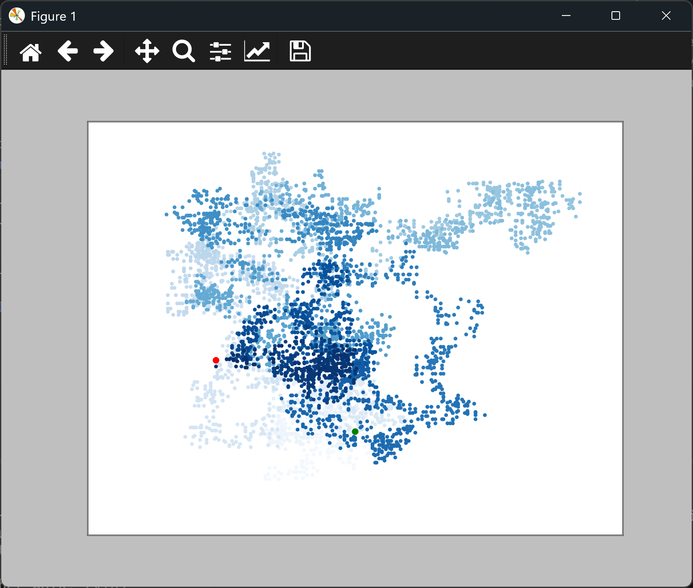

</details>
<br>

---

### Assignment 15.5 - Refactoring

Refactoring: The `fill_walk()` method is lengthy. Create a new method called `get_step()` to determine the direction and distance for each step, and then calculate the step. You should end up with two calls to `get_step()` in `fill_walk()`:

---

`x_step = self.get_step()`
`y_step = self.get_step()`

---

This refactoring should reduce the size of `fill_walk()` and make the method easier to read and understand.

The refactored class is in [refactored_random_walk.py](./refactored_random_walk.py).

Solution:

<details>
<summary>Spoiler Code</summary>
<br>

```python
import matplotlib.pyplot as plt
from modified_random_walk import RandomWalk

print("Try-it-Yourself:")
print("Assignment 15.5")

num_points = 5_000

while True:
    # Make a random walk
    rw = RandomWalk(num_points)

    # Plot the points
    plt.style.use("classic")
    fig, ax = plt.subplots()
    point_numbers = range(rw.num_points)
    ax.scatter(rw.x_values, rw.y_values, c = point_numbers, cmap=plt.cm.Blues,
               edgecolors="none", s=10)

    # Emphasize first and last points
    for i in [0, -1]:
        dot_color = "green"
        if i == -1:
            dot_color = "red"
        ax.scatter(rw.x_values[i], rw.y_values[i], c=dot_color, edgecolors="none", s=30)

    # Remove the axes
    ax.get_xaxis().set_visible(False)
    ax.get_yaxis().set_visible(False)

    plt.show()

    keep_running = input("\nMake another walk? (y|n)\n> ")
    if keep_running.lower() != "y":
        break
```

</details>
<br>

<details>
<summary>Output</summary>

```
Try-it-Yourself:
Assignment 15.5

Make another walk? (y|n)
>
```

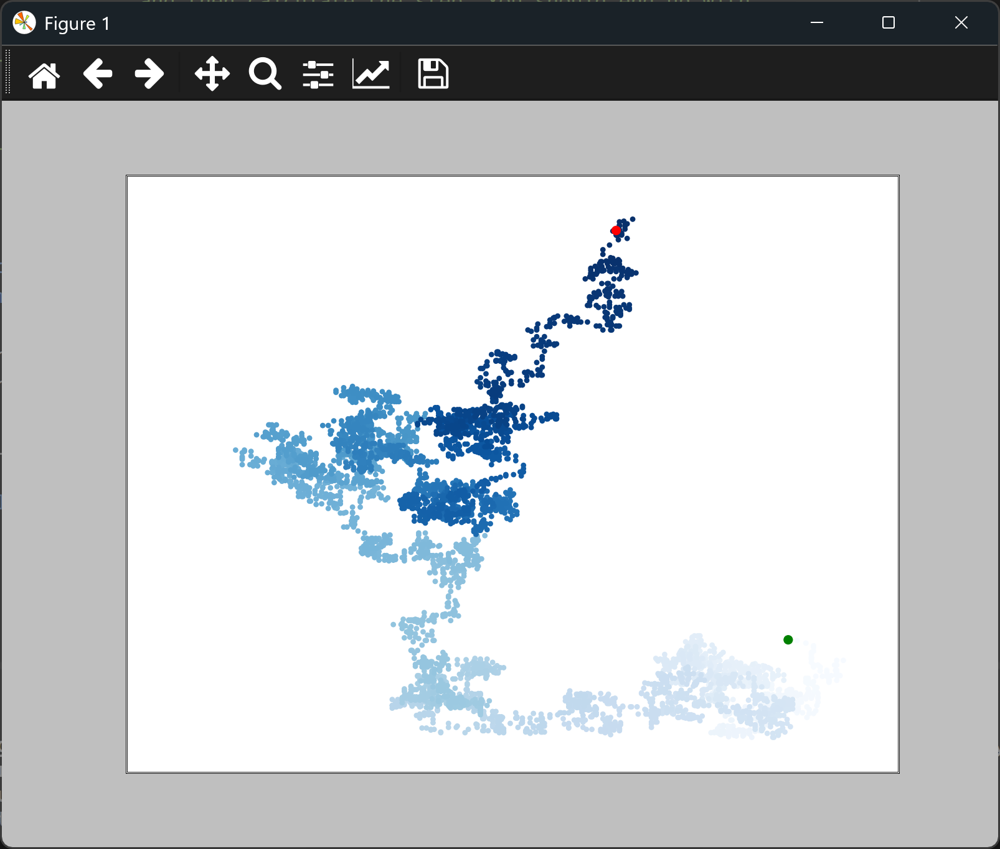

</details>
<br>

---

### Assignment 15.6 - Two D8s

Two D8s: Create a simulation showing what happens when you roll two eight-sided dice 1000 times. Try to picture what you think the visualization will look like before you run the simulation; then see if your intuition was correct. Gradually increase the number of rolls until you start to see the limits of your system's capabilities.

Solution, which uses [die.py](./die.py):

<details>
<summary>Spoiler Code</summary>
<br>

```python
import os
from plotly import offline
from plotly.graph_objs import Bar, Layout
from die import Die

print("Try-it-Yourself:")
print("Assignment 15.6")

# Create 2d8
dice = [Die(8), Die(8)]
roll_count = 1_000

# Make some rolls and store the results in a list
results = []
for roll_num in range(roll_count):
    result = 0
    for die in dice:
        result += die.roll()
    results.append(result)

# Analyze the results
frequencies = []
max_result = 0
for die in dice:
    max_result += die.num_sides
for value in range(len(dice), max_result + 1):
    frequency = results.count(value)
    frequencies.append(frequency)

# Visualize the results
x_values = list(range(2, max_result + 1))
data = [Bar(x=x_values, y=frequencies)]

x_axis_config = {"title": "Result", "dtick": 1}
y_axis_config = {"title": "Frequency of Result"}
heading = f"Results of rolling two D{dice[0].num_sides} {roll_count} times"
my_layout = Layout(title=heading, xaxis=x_axis_config, yaxis=y_axis_config)
ROOT_DIR = os.path.dirname(__file__)
file_path = os.path.join(
    ROOT_DIR, "files", f"D{dice[0].num_sides}_D{dice[1].num_sides}.html")
offline.plot({"data": data, "layout": my_layout}, filename=file_path)
```

</details>
<br>

<details>
<summary>Output</summary>

```
Try-it-Yourself:
Assignment 15.6
```

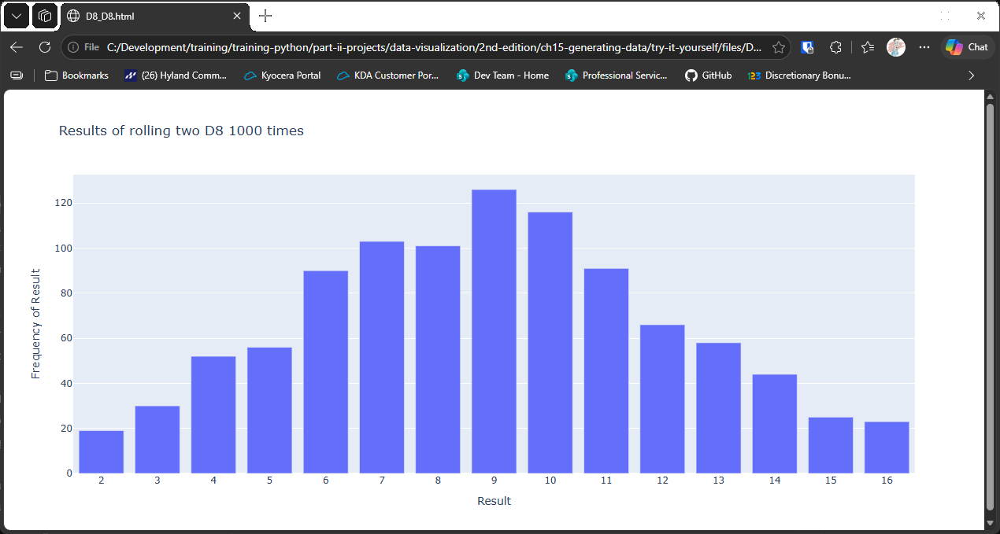

</details>
<br>

---

### Assignment 15.7 - Three Dice

Three Dice: When you roll three D6 dice, the smallest number you can roll is 3 and the largest number is 18. Create a visualization that shows what happens when you roll three D6 dice.

Solution, which uses [die.py](./die.py):

<details>
<summary>Spoiler Code</summary>
<br>

```python
import os
from plotly.graph_objs import Bar, Layout
from plotly import offline
from die import Die

print("Try-it-Yourself:")
print("Assignment 15.7")

# Create 3d6
settings = {"num": 3, "sides": 6, "rolls": 10_000}
dice = []
for n in range(settings["num"]):
    dice.append(Die(settings["sides"]))

# Make some rolls and store the results in a list
results = []
for roll in range(settings["rolls"]):
    results.append(sum([die.roll() for die in dice]))

# Analyze the results
frequencies = []
max_value = settings["num"] * settings["sides"]
frequencies = [results.count(value) for value in range(len(dice), max_value + 1)]

# Visualize the results
x_values = list(range(settings["num"], max_value + 1))
data = [Bar(x = x_values, y = frequencies)]

x_axis_config = {"title": "Result", "dtick": 1}
y_axis_config = {"title": "Frequency of Result"}
suffix = "" if settings["rolls"] == 1 else "s"
heading = f"Results of rolling {settings['num']} D{dice[1].num_sides} " + \
    f"{settings['rolls']} time{suffix}"
my_layout = Layout(title = heading, xaxis = x_axis_config, yaxis = y_axis_config)
ROOT_DIR = os.path.dirname(__file__)
file_path = os.path.join(ROOT_DIR, "files", f"sum_{settings['num']}_d{settings['sides']}.html")
offline.plot({"data": data, "layout": my_layout}, filename = file_path)
```

</details>
<br>

<details>
<summary>Output</summary>

```
Try-it-Yourself:
Assignment 15.7
```

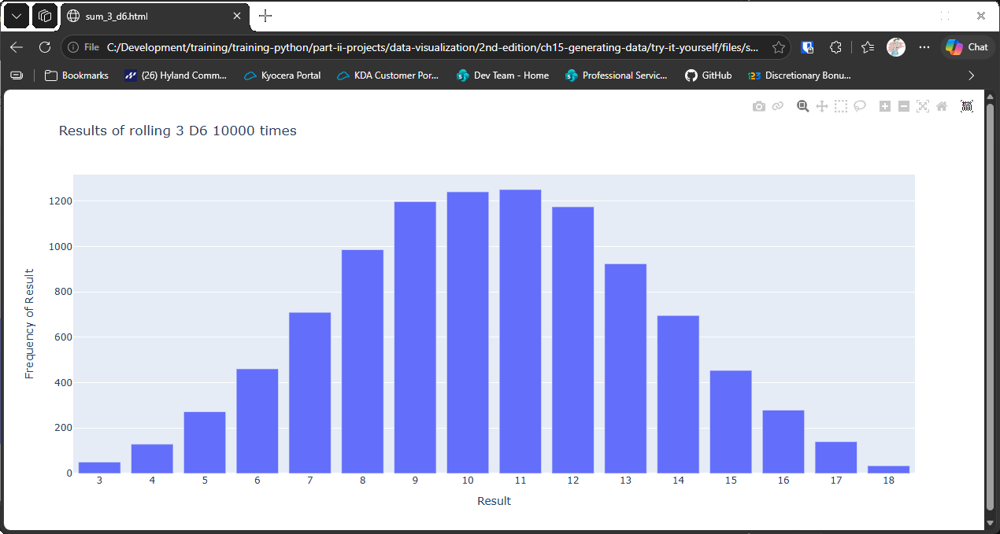

</details>
<br>

---

### Assignment 15.8 - Multiplication

Multiplication: When you roll two dice, you usually add the two numbers together to get the result. Create a visualization that shows what happens if you multiply these numbers instead.

Solution, which uses [die.py](./die.py):

<details>
<summary>Spoiler Code</summary>
<br>

```python
import os
from plotly.graph_objs import Bar, Layout
from plotly import offline
from numpy import prod
from die import Die

print("Try-it-Yourself:")
print("Assignment 15.8")

# Create 2d6
settings = {"num": 2, "sides": 6, "rolls": 10_000}
dice = []
for n in range(settings["num"]):
    dice.append(Die(settings["sides"]))

# Make some rolls and store the results in a list
results = []
for roll in range(settings["rolls"]):
    results.append(prod([die.roll() for die in dice]))

# Analyze the results
frequencies = []
max_value =  settings["sides"] ** settings["num"]
frequencies = [results.count(value) for value in range(len(dice) - 1, max_value + 1)]

# Visualize the results
x_values = list(range(settings["num"] - 1, max_value + 1))
data = [Bar(x = x_values, y = frequencies)]

x_axis_config = {"title": "Result", "dtick": 1}
y_axis_config = {"title": "Frequency of Result"}
suffix = "" if settings["rolls"] == 1 else "s"
heading = f"Results of rolling {settings['num']} D{dice[1].num_sides} " + \
    f"{settings['rolls']} time{suffix}"
my_layout = Layout(title = heading, xaxis = x_axis_config, yaxis = y_axis_config)
ROOT_DIR = os.path.dirname(__file__)
file_path = os.path.join(ROOT_DIR, "files", f"multiply_{settings['num']}_D{settings['sides']}.html")
offline.plot({"data": data, "layout": my_layout}, filename = file_path)
```

</details>
<br>

<details>
<summary>Output</summary>

```
Try-it-Yourself:
Assignment 15.8
```

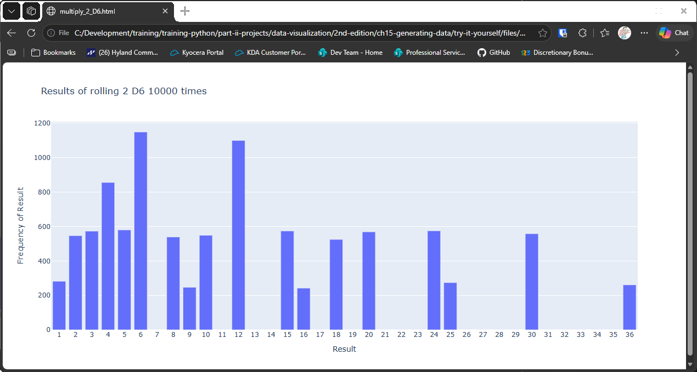

</details>
<br>

---

### Assignment 15.9 - Die Comprehensions

Die Comprehensions: For clarity, the listings in this section use the long form of for loops. If you're comfortable using list comprehensions, try writing a comprehension for one or both of the loops in each of these programs.

Solution, which uses [die.py](./die.py):

<details>
<summary>Spoiler Code</summary>
<br>

```python
import os
from plotly import offline
from plotly.graph_objs import Bar, Layout
from die import Die

print("Try-it-Yourself:")
print("Assignment 15.9")

# Dice settings
settings = {
    "num": 4,
    "sides": 6,
    "rolls": 10_000
}
settings["max_value"] = settings["num"] * settings["sides"]

# Create 4d6
dice = [Die(settings["sides"]) for _ in range(settings["num"])]

# Make some rolls and store the results in a list
results = [sum([die.roll() for die in dice]) for _ in range(settings["rolls"])]

# Analyze the results
frequencies = [results.count(value) for value in range(
    len(dice), settings["max_value"] + 1)]

# Visualize the results
x_values = list(range(settings["num"], settings["max_value"] + 1))
data = [Bar(x=x_values, y=frequencies)]

x_axis_config = {"title": "Result", "dtick": 1}
y_axis_config = {"title": "Frequency of Result"}
suffix = "" if settings["rolls"] == 1 else "s"
heading = f"Results of rolling {settings['num']} D{dice[1].num_sides} " + \
    f"{settings['rolls']} time{suffix}"
my_layout = Layout(title=heading, xaxis=x_axis_config, yaxis=y_axis_config)
ROOT_DIR = os.path.dirname(__file__)
file_path = os.path.join(
    ROOT_DIR, "files", f"multiply_{settings['num']}_D{settings['sides']}.html")
offline.plot({"data": data, "layout": my_layout}, filename=file_path)
```

</details>
<br>

<details>
<summary>Output</summary>

```
Try-it-Yourself:
Assignment 15.9
```

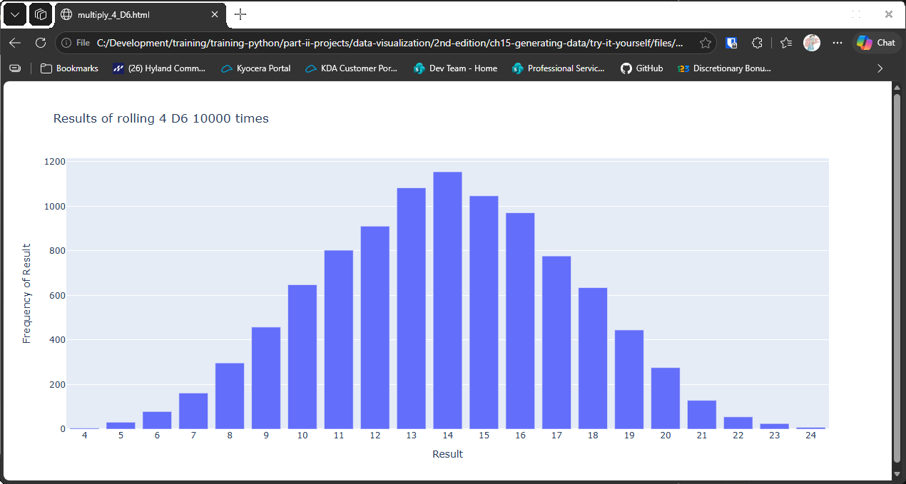

</details>
<br>

---

### Assignment 15.10 - Practicing with Both Libraries

Practicing with Both Libraries: Try using Matplotlib to make a die-rolling visualization, and use Plotly to make the visualization for a random walk. (You'll need to consult the documentation for each library to complete this exercise.)

Solution, which uses [die.py](./die.py) and [random_walk.py](./random_walk.py):

<details>
<summary>Spoiler Code</summary>
<br>

```python
import os
import matplotlib.pyplot as plt
from plotly import offline
from plotly.graph_objs import Layout, Scatter
from die import Die
from random_walk import RandomWalk

print("Try-it-Yourself:")
print("Assignment 15.10")

# Part 1: Matplotlib - roll one D6 1,000 times and plot how often each face came up
die = Die()
roll_count = 1_000

results = [die.roll() for roll_num in range(roll_count)]
faces = list(range(1, die.num_sides + 1))
frequencies = [results.count(face) for face in faces]

plt.style.use("bmh")
fig, ax = plt.subplots()
ax.bar(faces, frequencies, color="steelblue")
ax.set_title(f"Results of rolling one D6 {roll_count:,} times", fontsize=16)
ax.set_xlabel("Result", fontsize=12)
ax.set_ylabel("Frequency of Result", fontsize=12)
ax.set_xticks(faces)
plt.show()

# Part 2: Plotly - plot a random walk, coloring each point by when it was reached
num_points = 5_000
rw = RandomWalk(num_points)

trace = Scatter(
    x=rw.x_values,
    y=rw.y_values,
    mode="markers",
    marker={"size": 3, "color": list(range(num_points)), "colorscale": "Blues"},
)
layout = Layout(
    title=f"Random Walk of {num_points:,} Points",
    xaxis={"visible": False},
    yaxis={"visible": False},
)
ROOT_DIR = os.path.dirname(__file__)
file_path = os.path.join(ROOT_DIR, "files", "random_walk.html")
offline.plot({"data": [trace], "layout": layout}, filename=file_path)
```

</details>
<br>

<details>
<summary>Output</summary>

The matplotlib part opens a bar chart of one die rolled 1,000 times:

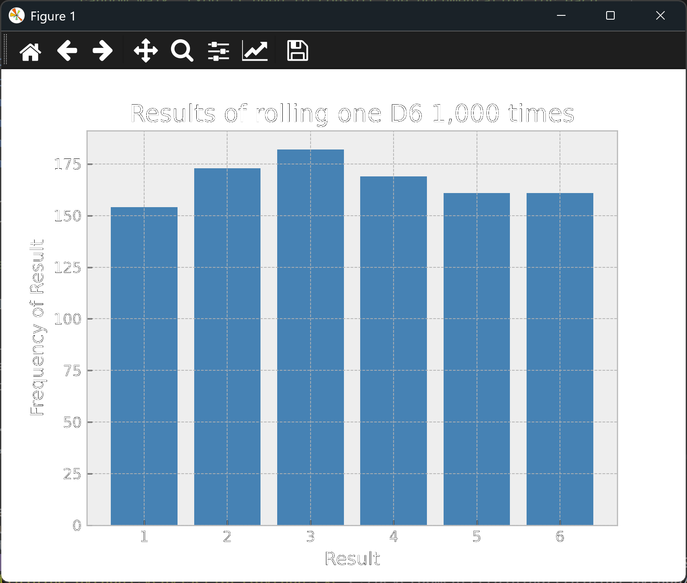

The plotly part opens in your browser, and is saved to `files/random_walk.html`:

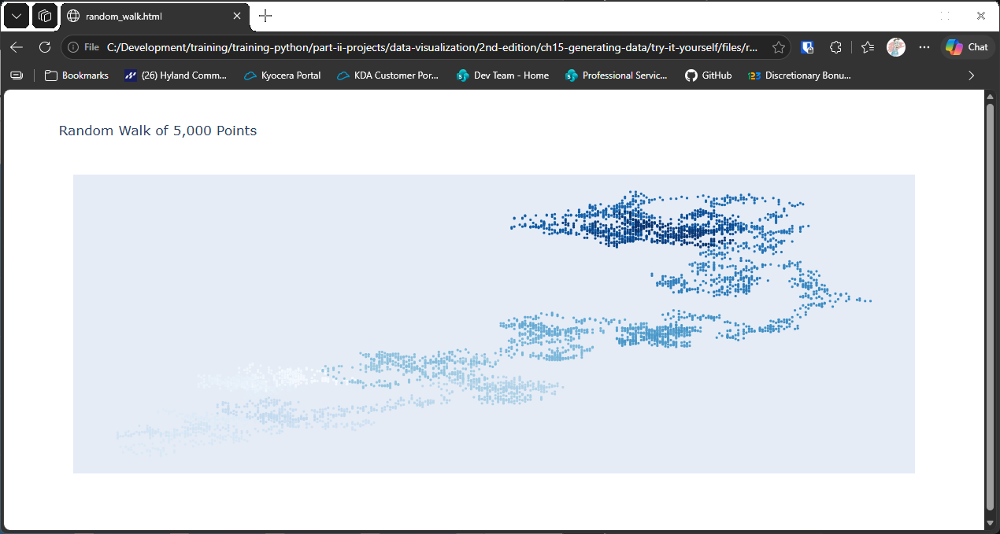

</details>
<br>

---
