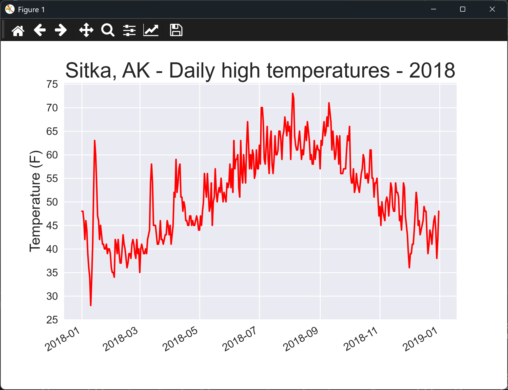

# Reading CSV Data

## Introduction

Much of the data you'll work with comes as a spreadsheet exported as a CSV file. A CSV file
is plain text: each line is one record, and the values in a record are separated by commas.
The first line usually names the columns.

This lesson reads a year of daily weather records for Sitka, Alaska, takes out the high
temperature for each day, and plots them. The file is in the `data` folder beside the script.

The `csv` module that reads the file is part of Python's standard library, so there is nothing
extra to install. The chart uses matplotlib, which you installed in the previous chapter.

---

## The Code

```python
"""Lesson 1.1 - Reading CSV Data"""

from datetime import datetime
import os
# The CSV module should not require installation
import csv
import matplotlib.pyplot as plt
import numpy as np

ROOT_DIR = os.path.dirname(__file__)
# file_path = os.path.join(ROOT_DIR, "data", "sitka_weather_07-2018_simple.csv")
file_path = os.path.join(ROOT_DIR, "data", "sitka_weather_2018_simple.csv")

with open(file_path, encoding="UTF-8") as f:
    # Open the CSV file
    reader = csv.reader(f)
    # Read the first line of the file (automatically parsing to a list)
    header_row = next(reader)

    # print(header_row)

    # for index, column_header in enumerate(header_row):
    #     print(index, column_header)

    # Get high temperatures from file
    dates, highs = [], []
    # Note: We've already read the header, so we can read ALL the remaining rows
    for row in reader:
        # We'll use strptime() to parse and format dates
        dates.append(datetime.strptime(row[2], "%Y-%m-%d"))
        highs.append(int(row[5]))

    # The following format abbreviations are supported in strptime()
    # -------------------------------------------------
    #       Date/Time Formats
    # -------------------------------------------------
    # Argument         Meaning
    # -------------------------------------------------
    #   %A     Weekday name, such as Monday
    #   %B     Month name, such as January
    #   %m     Month, as a number (01 to 12)
    #   %d     Day of the month, as a number (01 to 31)
    #   %Y     Four-digit year, such as 2019
    #   %y     Two-digit year, such as 19
    #   %H     Hour, in 24-hour format (00 to 23)
    #   %I     Hour, in 12-hour format (01 to 12)
    #   %p     AM or PM
    #   %M     Minutes (00 to 59)
    #   %S     Seconds (00 to 61)
    # -------------------------------------------------

    # Plot the high temperatures.
    plt.style.use("seaborn-v0_8")
    fig, ax = plt.subplots()
    ax.plot(dates, highs, c = "red")

    # Format plot.
    # ax.set_title("Daily high temperatures, July 2018", fontsize = 24)
    ax.set_title("Sitka, AK - Daily high temperatures - 2018", fontsize = 24)
    ax.set_xlabel("", fontsize = 16)
    ax.set_ylabel("Temperature (F)", fontsize = 16)
    fig.autofmt_xdate()
    ax.tick_params(axis ="both", which ="major", labelsize = 12)
    ax.set_yticks(np.arange(min(highs) - min(highs) % 5, max(highs) + 5, 5))

    plt.show()
```

---

### Walking Through the Code

**Opening the file.** `os.path.join()` builds the path to the file from the folder of the script,
so the script works wherever you run it from. `open()` opens the file, and `encoding="UTF-8"` says
how to read its characters.

**Reading rows.** `csv.reader()` turns each line into a list of values. `next(reader)` reads the
first line, which is the header row. The loop then reads every line after it.

**Parsing dates.** The date is text such as `2018-07-01`. `datetime.strptime()` converts it to a
date object, and the format string `"%Y-%m-%d"` describes how the text is laid out. The table in the
code lists the other format codes you can use.

**Parsing temperatures.** Each high temperature is text, so `int()` converts it to a number.

**Plotting.** `ax.plot()` draws the highs against the dates, in red. `fig.autofmt_xdate()` tilts the
date labels so they don't overlap.

**Choosing the y-ticks.** `np.arange()` makes a range of values from just below the lowest high to just
above the highest, in steps of 5. That gives the y-axis clean round numbers.

---

### Output

The window shows a red line of the daily high temperatures for 2018. The title reads "Sitka, AK - Daily
high temperatures - 2018". The dates run along the bottom, and the temperature in degrees Fahrenheit is
labeled up the side. The temperatures should rise through the summer and fall again toward the end of the year.



---
