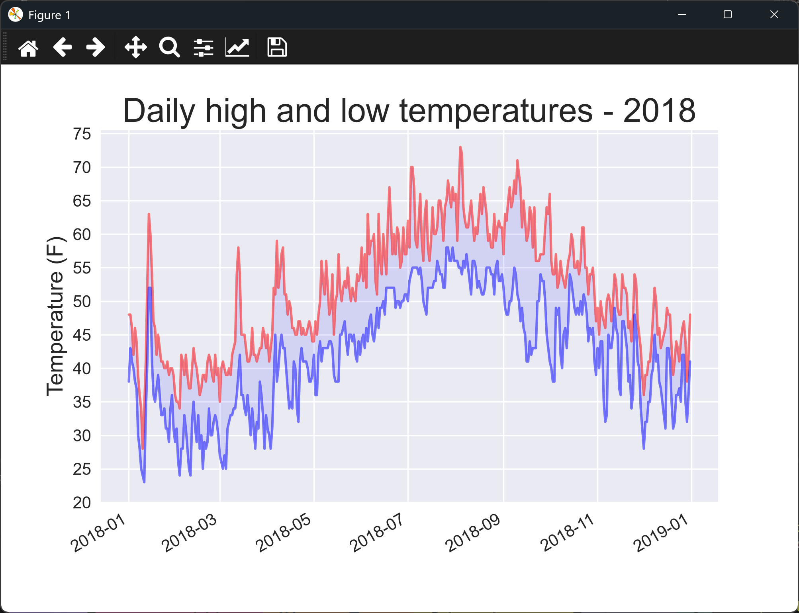

# Reading CSV Data with Multiple Plots

## Introduction

The last lesson plotted only the high temperatures. Each row of the weather file also has a low, so
this lesson reads both and plots them together. The area between the two lines is shaded, which
shows the day-to-day range at a glance.

---

## The Code

```python
"""Lesson 1.2 - Reading CSV Data (multiple plots)"""

from datetime import datetime
import os
import csv
import matplotlib.pyplot as plt
import numpy as np

ROOT_DIR = os.path.dirname(__file__)
file_path = os.path.join(ROOT_DIR, "data", "sitka_weather_2018_simple.csv")

with open(file_path, encoding="UTF-8") as f:
    reader = csv.reader(f)
    header_row = next(reader)
    dates, highs, lows = [], [], []
    for row in reader:
        dates.append(datetime.strptime(row[2], "%Y-%m-%d"))
        highs.append(int(row[5]))
        lows.append(int(row[6]))

    plt.style.use("seaborn-v0_8")
    fig, ax = plt.subplots()
    ax.plot(dates, highs, c = "red", alpha = 0.5)
    ax.plot(dates, lows, c = "blue", alpha = 0.5)
    ax.fill_between(dates, highs, lows, facecolor = "blue", alpha = 0.1)

    ax.set_title("Daily high and low temperatures - 2018", fontsize = 24)
    ax.set_xlabel("", fontsize = 16)
    ax.set_ylabel("Temperature (F)", fontsize = 16)
    fig.autofmt_xdate()
    ax.tick_params(axis ="both", which ="major", labelsize = 12)
    ax.set_yticks(np.arange(min(lows) - min(lows) % 5, max(highs) + 5, 5))

    plt.show()
```

---

### Walking Through the Code

**Reading two columns.** The loop reads the high and the low from each row, using the same column
positions as the last lesson, and stores each in its own list.

**Two lines.** The highs are drawn in red and the lows in blue. `alpha = 0.5` makes each line
semi-transparent, so where they overlap the colors blend.

**Shading the gap.** `ax.fill_between(dates, highs, lows)` fills the area between the two lines. Its
transparency is low, so the shading stays in the background.

**Y-ticks.** The ticks run from the lowest low to the highest high, in steps of 5.

---

### Output

The window shows two lines, a red line of daily highs above a blue line of daily lows, with the area
between them shaded light blue. The gap between the lines should change over the year, as the daily range changes with the seasons.



---
