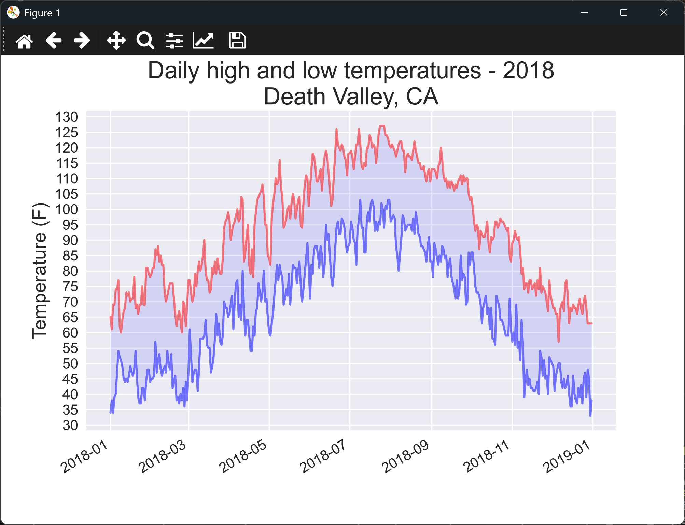

# Handling Missing Data

## Introduction

Real data is often incomplete. The weather station for Death Valley, for example, has some days with no
recorded temperatures. If the script converts a blank value to a number, it stops with an error. This
lesson uses a `try-except-else` block to skip those days and report them, so the rest of the data
still plots.

---

## The Code

```python
"""Lesson 2.1 - Error Checking"""

from datetime import datetime
import os
import csv
import matplotlib.pyplot as plt
import numpy as np

ROOT_DIR = os.path.dirname(__file__)
file_path = os.path.join(ROOT_DIR, "data", "death_valley_2018_simple.csv")

with open(file_path, encoding="UTF-8") as f:
    reader = csv.reader(f)
    header_row = next(reader)
    dates, highs, lows = [], [], []
    for row in reader:
        date = datetime.strptime(row[2], "%Y-%m-%d")
        # Here, we will use a try-except-else block to address dates without data
        try:
            high = int(row[4])
            low = int(row[5])
        except ValueError:
            print(f"Missing data for {date}")
        else:
            dates.append(date)
            highs.append(high)
            lows.append(low)

    plt.style.use("seaborn-v0_8")
    fig, ax = plt.subplots()
    ax.plot(dates, highs, c = "red", alpha = 0.5)
    ax.plot(dates, lows, c = "blue", alpha = 0.5)
    ax.fill_between(dates, highs, lows, facecolor = "blue", alpha = 0.1)

    ax.set_title("Daily high and low temperatures - 2018\nDeath Valley, CA", fontsize = 20)
    ax.set_xlabel("", fontsize = 16)
    ax.set_ylabel("Temperature (F)", fontsize = 16)
    fig.autofmt_xdate()
    ax.tick_params(axis ="both", which ="major", labelsize = 12)
    ax.set_yticks(np.arange(min(lows) - min(lows) % 5, max(highs) + 5, 5))

    plt.show()
```

---

### Walking Through the Code

**Trying the conversion.** The code inside `try` converts the high and low to integers. If a value is
blank, `int()` raises a `ValueError`.

**Handling the error.** The `except` block catches that error and prints the date with missing data. The
row is skipped, and the script carries on.

**Keeping good rows.** The `else` block runs only when the `try` block succeeded. That's where the date
and values are added to the lists, so a bad row never leaves the lists out of step with each other.

**Why this matters.** Without the `try` block, one blank value would stop the whole script. Plotting
the rows that are complete is usually better than plotting nothing.

---

### Output

The terminal prints a line for each day with missing data. For example:

```
Missing data for 2018-02-18 00:00:00
```

The window then shows the high and low lines for the days that have data, with the title "Daily high and low
temperatures - 2018" on the first line and "Death Valley, CA" on the second. Days with missing data are left out, so the lines join the days that remain.



---
