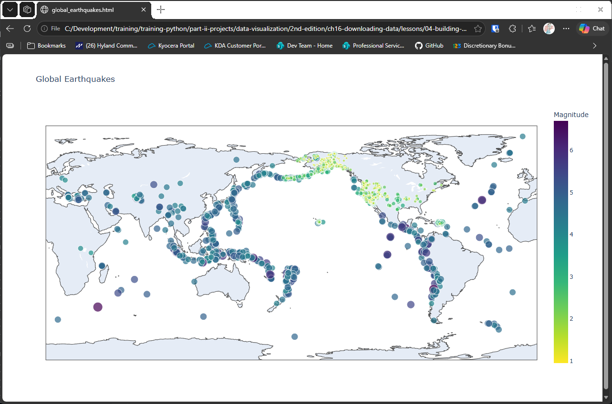

# Building a World Map

## Introduction

The JSON file from the last lesson holds the location and magnitude of every earthquake in its
period. This lesson plots them on a world map, with each earthquake as a point. The size of the point
shows the magnitude, and its color does too, using a color scale. Hovering over a point shows the
event's title.

The chart is drawn with plotly, so the map is interactive, and it's saved as an HTML file that opens in
your browser. Install plotly before running this lesson:

```bash
python -m pip install plotly
```

---

## The Code

```python
"""Lesson 4 - Building a World Map (plotly)"""

import os
import json
from plotly.graph_objs import Layout, Scattergeo
from plotly import offline

ROOT_DIR = os.path.dirname(__file__)

# file_path = os.path.join(ROOT_DIR, "data", "eq_data_1_day_m1.json")
# file_path = os.path.join(ROOT_DIR, "data", "eq_data_7_day_m1.json")
file_path = os.path.join(ROOT_DIR, "data", "eq_data_30_day_m1.json")
with open(file_path, encoding = "UTF-8") as f:
    all_eq_data = json.load(f)

all_eq_dicts = all_eq_data["features"]

url_template = "https://earthquake.usgs.gov/earthquakes/feed/v1.0/detail/IDTOKEN.geojson"
mags, lons, lats, hover_texts, urls = [], [], [], [], []
for eq_dict in all_eq_dicts:
    mags.append(eq_dict["properties"]["mag"])
    lons.append(eq_dict["geometry"]["coordinates"][0])
    lats.append(eq_dict["geometry"]["coordinates"][1])
    hover_texts.append(eq_dict["properties"]["title"])

    # I haven't figured out yet how to trigger a hyperlink from a scattergeo point,
    #   but I have code for storing them in case I figure that out
    net = {eq_dict["properties"]["net"]}
    code = {eq_dict["properties"]["code"]}
    id_token = f"{net}{code}".replace("{", "").replace("}", "").replace("'", "")
    urls.append(url_template.replace("IDTOKEN", id_token))

# Ex. 1
# data = [Scattergeo(lon = lons, lat = lats)]
data = [{
    "type": "scattergeo",
    "lon": lons,
    "lat": lats,
    "text": hover_texts,
    "marker": {
        "size": [3 * mag for mag in mags],
        "color": mags,
        "colorscale": "Viridis",
        "reversescale": True,
        "colorbar": {"title": "Magnitude"},
    },
    "customdata": urls
}]

my_layout = Layout(title = "Global Earthquakes")

fig = {"data": data, "layout": my_layout}
html_path = os.path.join(ROOT_DIR, "data", "global_earthquakes.html")
offline.plot(fig, filename = html_path)
```

---

### Walking Through the Code

**Choosing the data.** Three files of earthquake data are included: one day, seven days, and thirty
days. The script uses the thirty-day file. The other two lines are commented out, so you can switch
between them by changing which line is active.

**Collecting the points.** The loop reads each earthquake's magnitude, longitude, latitude, and title.
The longitude and latitude give the position of each point on the map.

**Building the URLs.** The loop also builds a link to each event's page on the USGS site. Plotly doesn't
yet let a point open a link when you click it, so the links are stored in `customdata` for later use.

**Styling the points.** `"size"` makes each point three times its magnitude, so larger earthquakes
are bigger. `"color"` uses the same magnitudes with the Viridis color scale. `"reversescale": True`
flips the scale, so stronger earthquakes get the darker color. The colorbar shows the scale.

**Saving the map.** The map is written to `data/global_earthquakes.html`, and `offline.plot()` opens it
in your browser.

### Choosing a Color Scale

The "colorscale" setting accepts the name of any plotly color scale. The helper script `show_color_scales.py` in this folder lists the names it knows:

```python
"""Show all plotly color scales"""

from plotly import colors

for key in colors.PLOTLY_SCALES:
    print(key)
```

Running it prints one name for each scale:

```
Greys
YlGnBu
Greens
YlOrRd
Bluered
RdBu
Reds
Blues
Picnic
Rainbow
Portland
Jet
Hot
Blackbody
Earth
Electric
Viridis
Cividis
```

To try a different scale, replace "Viridis" in the map's "colorscale" setting with any name from the list.

---

### Output

Your browser opens a world map with a point for each earthquake in the thirty-day file. Hovering over a
point shows its title. A colorbar on the side shows how the colors map to magnitude.



---
