# Chapter 16 Try-it-Yourself Assignments and Solutions

## Introduction

Here are my solutions for the chapter 16 try-it-yourself exercises, from the 2nd edition of the textbook.

Most of these exercises build on the lessons in the chapter. The first one asks you to download your own
weather data, so the solution uses a file of North Texas weather data that is already in the `data`
folder. The last few exercises download data from the internet, so they need a connection when you run
them.

Each exercise shows the full assignment, then a solution with the code and its output. The solution code is
hidden until you expand it, so you can attempt each assignment first.

Matplotlib charts open in a window, and you close the window to move on. Plotly maps are saved to the
`data` folder and open in your web browser.

---

### Assignment 16.0 - Download Your Own Data

Try It Yourself: Download Your Own Data. To obtain data, do the following:

1. Visit the NOAA Climate Data Online site at https://www.ncdc.noaa.gov/cdo-web/. In the Discover Data By
   section, click Search Tool. In the Select a Dataset box, choose Daily Summaries.
2. Select a date range, and in the Search For section, choose ZIP Codes. Enter the ZIP Code you're
   interested in, and click Search.
3. On the next page, you'll see a map and some information about the area you're focusing on. Below the
   location name, click View Full Details, or click the map and then click Full Details.
4. Scroll down and click Station List to see the weather stations that are available in this area. Choose
   one of the stations, and click Add to Cart. This data is free, even though the site uses a shopping cart
   icon. In the upper-right corner, click the cart.
5. In Select the Output, choose Custom GHCN-Daily CSV. Make sure the date range is correct, and click
   Continue.
6. On the next page, you can select the kinds of data you want. You can download one kind of data, for
   example, focusing on air temperature, or you can download all the data available from this station. Make
   your choices, and then click Continue.
7. On the last page, you'll see a summary of your order. Enter your email address, and click Submit Order.
   You'll receive a confirmation that your order was received, and in a few minutes you should receive
   another email with a link to download your data.

Solution, which reads the North Texas data already in the `data` folder:

<details>
<summary>Spoiler Code</summary>
<br>

```python
from datetime import datetime
import os
import csv
import matplotlib.pyplot as plt
import numpy as np

ROOT_DIR = os.path.dirname(__file__)
file_path = os.path.join(
    ROOT_DIR, "data", "north_texas_weather_2022_jan-jun.csv")

DALLAS = "USW00003971"

with open(file_path, encoding="UTF-8") as f:
    reader = csv.reader(f)
    header_row = next(reader)
    d_pos = header_row.index("DATE")
    h_pos = header_row.index("TMAX")
    l_pos = header_row.index("TMIN")
    p_pos = header_row.index("PRCP")
    dates, highs, lows, precip = [], [], [], []
    for row in reader:
        # Skip rows not from local NOAA station
        if row[0] != DALLAS:
            continue

        date = datetime.strptime(row[d_pos], "%Y-%m-%d")

        # Here, we will use a try-except-else block to address dates without data
        try:
            high = int(row[h_pos])
            low = int(row[l_pos])
            prec = float(row[p_pos])
        except ValueError:
            print(f"Missing data for {date}")
        else:
            dates.append(date)
            highs.append(high)
            lows.append(low)
            precip.append(prec)

    plt.style.use("seaborn-v0_8")
    fig, ax = plt.subplots()
    ax.plot(dates, highs, c="red", alpha=0.5)
    ax.plot(dates, lows, c="blue", alpha=0.5)
    ax.plot(dates, precip, c="green", alpha=0.5)
    polygon = ax.fill_between(
        dates, highs, lows, facecolor="orange", alpha=0.1)

    ax.set_title(
        "Daily high and low temperatures (plus precip.) - 2022\nDallas, TX", fontsize=20)
    ax.set_xlabel("", fontsize=16)
    ax.set_ylabel("Temperature (F) & Precip (in)", fontsize=16)
    fig.autofmt_xdate()
    ax.tick_params(axis="both", which="major", labelsize=12)
    min_y = 0 if min(lows) > 0 else min(lows) - min(lows) % 5
    ax.set_yticks(np.arange(min_y, max(highs) + 5, 5))

    plt.show()
```

</details>
<br>

<details>
<summary>Output</summary>

The terminal prints a line for each day with missing data:

```
Missing data for 2022-06-22 00:00:00
```

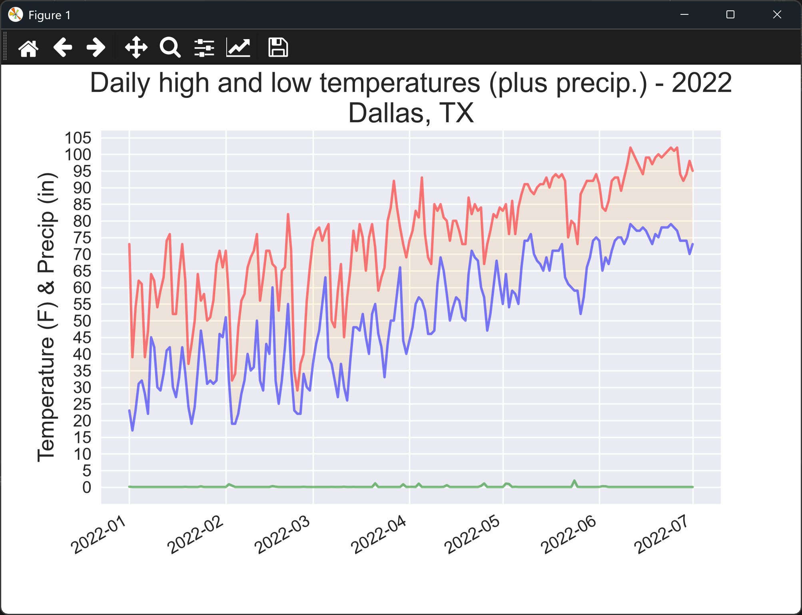

</details>
<br>

---

### Assignment 16.1 - Sitka Rainfall

Sitka Rainfall: Sitka is in a temperate rainforest, so it gets a fair amount of rainfall. In the data file
sitka_weather_2018_simple.csv is a header called PRCP, which represents daily rainfall amounts. Make a
visualization focusing on the data in this column. You can repeat the exercise for Death Valley if you're
curious how little rainfall occurs in a desert.

Solution:

<details>
<summary>Spoiler Code</summary>
<br>

```python
from datetime import datetime
import os
import csv
import matplotlib.pyplot as plt
import numpy as np

ROOT_DIR = os.path.dirname(__file__)
data_file = os.path.join(ROOT_DIR, "data", "sitka_weather_2018_simple.csv")

p_label = "PRCP"
d_label = "DATE"

with open(data_file, encoding="UTF-8") as f:
    reader = csv.reader(f)
    header_row = next(reader)
    p_pos = header_row.index(p_label)
    d_pos = header_row.index(d_label)
    dates, rainfall = [], []
    for row in reader:
        date = datetime.strptime(row[d_pos], "%Y-%m-%d")
        try:
            rain = float(row[p_pos])
        except ValueError:
            print(f"Missing data for {date}")
        else:
            dates.append(date)
            rainfall.append(rain)

    plt.style.use("seaborn-v0_8")
    fig, ax = plt.subplots()
    ax.plot(dates, rainfall, c="green", alpha=0.5)
    ax.set_title("Daily Rainfall - 2018\nSitka, AK", fontsize=20)
    ax.set_xlabel("", fontsize=16)
    ax.set_ylabel("Rainfall (in)", fontsize=16)
    fig.autofmt_xdate()
    ax.tick_params(axis="both", which="major", labelsize=12)
    ax.set_yticks(np.arange(0, max(rainfall) + 1, 0.5))

    plt.show()
```

</details>
<br>

<details>
<summary>Output</summary>

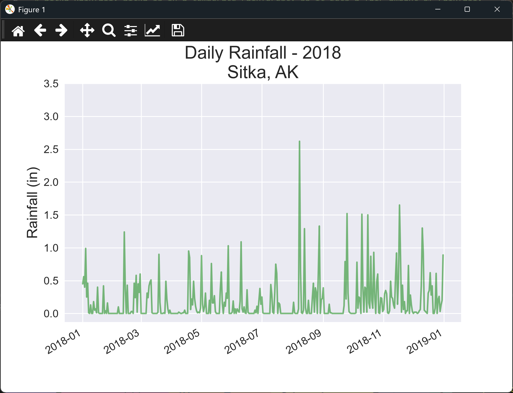

</details>
<br>

---

### Assignment 16.2 - Sitka-Death Valley Comparison

Sitka-Death Valley Comparison: The temperature scales on the Sitka and Death Valley graphs reflect the
different data ranges. To accurately compare the temperature range in Sitka to that of Death Valley, you
need identical scales on the y-axis. Change the settings for the y-axis on one or both of the charts in
Figures 16-5 and 16-6. Then make a direct comparison between temperature ranges in Sitka and Death Valley
(or any two places you want to compare).

Solution:

<details>
<summary>Spoiler Code</summary>
<br>

```python
from datetime import datetime
import os
import csv
import matplotlib.pyplot as plt
import numpy as np

ROOT_DIR = os.path.dirname(__file__)
sitka_data_file = os.path.join(ROOT_DIR, "data", "sitka_weather_2018_simple.csv")
death_valley_data_file = os.path.join(ROOT_DIR, "data", "death_valley_2018_simple.csv")

SH_COLOR = "red"
SL_COLOR = "blue"
DH_COLOR = "orange"
DL_COLOR = "green"

D_LABEL = "DATE"
H_LABEL = "TMAX"
L_LABEL = "TMIN"
labels = [D_LABEL, H_LABEL, L_LABEL]

increment_d = True

with open(sitka_data_file, encoding="UTF-8") as sf, \
     open(death_valley_data_file, encoding="UTF-8") as df:
    s_reader, d_reader = csv.reader(sf), csv.reader(df)
    s_header_row, d_header_row = next(s_reader), next(d_reader)

    sd_pos, sh_pos, sl_pos = [s_header_row.index(label) for label in labels]
    dd_pos, dh_pos, dl_pos = [d_header_row.index(label) for label in labels]

    dates, s_highs, s_lows, d_highs, d_lows = [], [], [], [], []

    while True:
        try:
            s_row = next(s_reader)
            d_row = next(d_reader)
        except:
            # If we have run out of rows in either file, stop
            break

        s_date = datetime.strptime(s_row[sd_pos], "%Y-%m-%d")
        d_date = datetime.strptime(d_row[dd_pos], "%Y-%m-%d")

        done = False

        # We only want to list dates that exist in both files
        while s_date != d_date:
            try:
                if s_date < d_date:
                    s_row = next(s_reader)
                else: d_row = next(d_reader)
            except:
                # If we have run out of rows in either file, stop
                done = True
                break

        # If we have run out of rows in either file, stop
        if done:
            break

        try:
            # Get all high/low temps
            s_low = int(s_row[sl_pos])
            s_high = int(s_row[sh_pos])
            d_low = int(d_row[dl_pos])
            d_high = int(d_row[dh_pos])
        except ValueError:
            print(f"Missing data for {s_date}")
        else:
            # Only add to graph if everything had values
            dates.append(s_date)
            s_highs.append(s_high)
            s_lows.append(s_low)
            d_highs.append(d_high)
            d_lows.append(d_low)

    plt.style.use("seaborn-v0_8")
    fig, ax = plt.subplots()
    ax.plot(dates, s_highs, c = SH_COLOR, alpha = 0.5)
    ax.plot(dates, s_lows, c = SL_COLOR, alpha = 0.5)
    ax.fill_between(dates, s_highs, s_lows, facecolor = SL_COLOR, alpha = 0.1)
    ax.plot(dates, d_highs, c = DH_COLOR, alpha = 0.5)
    ax.plot(dates, d_lows, c = DL_COLOR, alpha = 0.5)
    ax.fill_between(dates, d_highs, d_lows, facecolor = DL_COLOR, alpha = 0.1)

    ax.set_title("Daily High and Low Temperatures\nSitka, AK - Death Valley, CA", fontsize = 20)
    ax.set_xlabel("", fontsize = 16)
    ax.set_ylabel("Temperature (F)", fontsize = 16)
    fig.autofmt_xdate()
    ax.tick_params(axis ="both", which ="major", labelsize = 12)

    s_min, s_max = min(s_lows), max(s_highs)
    d_min, d_max = min(d_lows), max(d_highs)
    y_min = (s_min if s_min < d_min else d_min) - 5
    y_max = (s_max if s_max > d_max else d_max) + 5
    ax.set_yticks(np.arange(y_min - y_min % 5, y_max, 5))

    plt.show()
```

</details>
<br>

<details>
<summary>Output</summary>

The terminal prints a line for each day with missing data:

```
Missing data for 2018-02-18 00:00:00
```

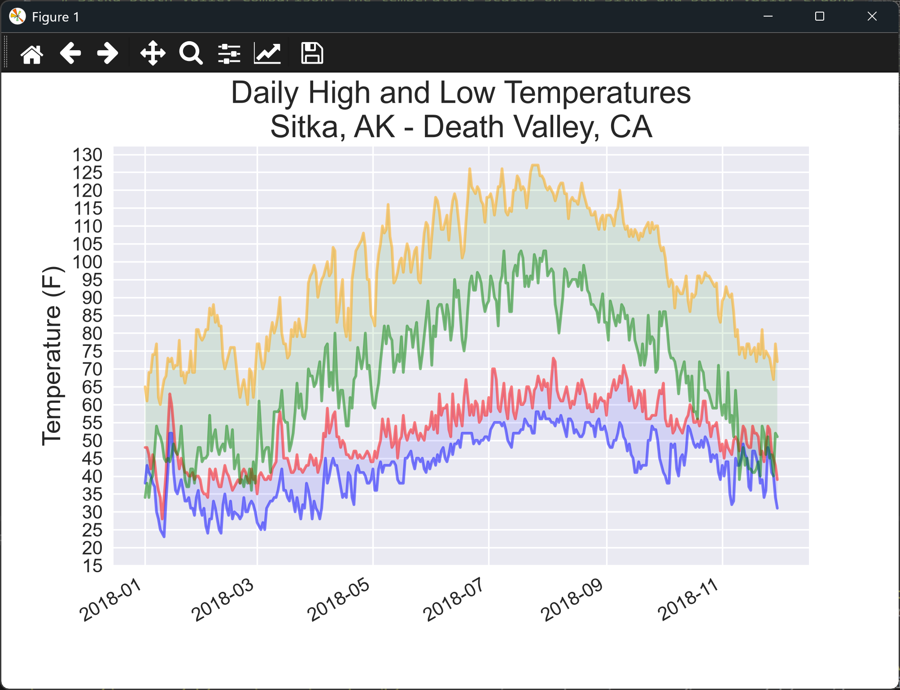

</details>
<br>

---

### Assignment 16.3 - San Francisco

San Francisco: Are temperatures in San Francisco more like temperatures in Sitka or temperatures in Death
Valley? Download some data for San Francisco, and generate a high-low temperature plot for San Francisco to
make a comparison.

Solution:

<details>
<summary>Spoiler Code</summary>
<br>

```python
from datetime import datetime
import os
import csv
import matplotlib.pyplot as plt
import numpy as np

ROOT_DIR = os.path.dirname(__file__)
data_file = os.path.join(ROOT_DIR, "data", "san_francisco_2018.csv")

h_label = "TMAX"
l_label = "TMIN"
d_label = "DATE"
L_COLOR = "#A020F0"
H_COLOR = "#BB4A00"
F_COLOR = "#A020F0"

with open(data_file, encoding="UTF-8") as f:
    reader = csv.reader(f)
    header_row = next(reader)
    h_pos = header_row.index(h_label)
    l_pos = header_row.index(l_label)
    d_pos = header_row.index(d_label)
    dates, highs, lows = [], [], []
    for row in reader:
        date = datetime.strptime(row[d_pos], "%Y-%m-%d")
        try:
            high = int(row[h_pos])
            low = int(row[l_pos])
        except ValueError:
            print(f"Missing data for {date}")
        else:
            dates.append(date)
            highs.append(high)
            lows.append(low)

    plt.style.use("seaborn-v0_8")
    fig, ax = plt.subplots()
    ax.plot(dates, lows, c = L_COLOR, alpha = 0.5)
    ax.plot(dates, highs, c = H_COLOR, alpha = 0.5)
    ax.fill_between(dates, highs, lows, facecolor = F_COLOR, alpha = 0.1)
    ax.set_title("Daily High & Low Temp - 2018\nSan Francisco, CA", fontsize = 20)
    ax.set_xlabel("", fontsize = 16)
    ax.set_ylabel("Temperature (F)", fontsize = 16)
    fig.autofmt_xdate()
    ax.tick_params(axis ="both", which ="major", labelsize = 12)
    min_temp = min(lows) - min(lows) % 5
    max_temp = max(highs) + max(highs) % 5
    ax.set_yticks(np.arange(min_temp, max_temp, 5))

    plt.show()
```

</details>
<br>

<details>
<summary>Output</summary>

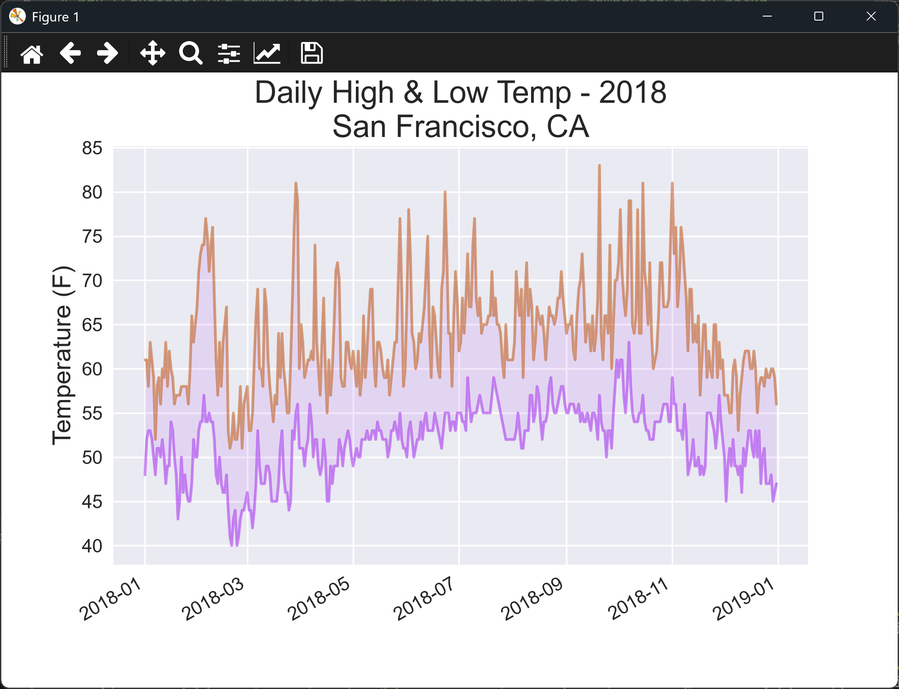

</details>
<br>

---

### Assignment 16.4 - Automatic Indexes

Automatic Indexes: In this section, we hardcoded the indexes corresponding to the TMIN and TMAX columns. Use
the header row to determine the indexes for these values, so your program can work for Sitka or Death Valley.
Use the station name to automatically generate an appropriate title for your graph as well.

Solution:

<details>
<summary>Spoiler Code</summary>
<br>

```python
from datetime import datetime
import os
import csv
import matplotlib.pyplot as plt
import numpy as np

data_file_names = {
    "1": "sitka_weather_2018_simple",
    "2": "death_valley_2018_simple",
    "3": "san_francisco_2018",
}

resp = "0"
while resp not in list(data_file_names):
    for val in range(1, len(data_file_names) + 1):
        print(f"{val} : {data_file_names[f'{val}']}")
    resp = input("Select a file to process:\n> ")
    if resp not in list(data_file_names):
        print("Invalid selection!")

ROOT_DIR = os.path.dirname(__file__)
data_file = os.path.join(ROOT_DIR, "data", f"{data_file_names[resp]}.csv")

print(f"Processing file: {data_file}")

S_LABEL = "STATION"
N_LABEL = "NAME"
H_LABEL = "TMAX"
L_LABEL = "TMIN"
D_LABEL = "DATE"

L_COLOR = "#1D2E68"
H_COLOR = "#F9423A"
F_COLOR = "#008013"

with open(data_file, encoding="UTF-8") as f:
    reader = csv.reader(f)
    header_row = next(reader)
    h_pos = header_row.index(H_LABEL)
    l_pos = header_row.index(L_LABEL)
    d_pos = header_row.index(D_LABEL)
    s_pos = header_row.index(S_LABEL)
    n_pos = header_row.index(N_LABEL)

    station, name = "", ""

    dates, highs, lows = [], [], []
    for row in reader:
        if station == "":
            station = row[s_pos]
        if name == "":
            name = row[n_pos]

        date = datetime.strptime(row[d_pos], "%Y-%m-%d")
        try:
            high = int(row[h_pos])
            low = int(row[l_pos])
        except ValueError:
            print(f"Missing data for {date}")
        else:
            dates.append(date)
            highs.append(high)
            lows.append(low)

    plt.style.use("seaborn-v0_8")
    fig, ax = plt.subplots()
    ax.plot(dates, lows, c = L_COLOR, alpha = 0.5)
    ax.plot(dates, highs, c = H_COLOR, alpha = 0.5)
    ax.fill_between(dates, highs, lows, facecolor = F_COLOR, alpha = 0.1)
    ax.set_title(f"Daily High & Low Temp - 2018\n{name} - [{station}]", fontsize = 14)
    ax.set_xlabel("", fontsize = 16)
    ax.set_ylabel("Temperature (F)", fontsize = 16)
    fig.autofmt_xdate()
    ax.tick_params(axis ="both", which ="major", labelsize = 12)
    min_temp = min(lows) - min(lows) % 5
    max_temp = max(highs) + max(highs) % 5
    ax.set_yticks(np.arange(min_temp, max_temp, 5))

    plt.show()
```

</details>
<br>

<details>
<summary>Output</summary>

The terminal shows a menu and asks you to choose a file. Choosing a number that isn't on the menu prints `Invalid selection!`, and the menu is shown again:

```
1 : sitka_weather_2018_simple
2 : death_valley_2018_simple
3 : san_francisco_2018
Select a file to process:
> 4
Invalid selection!
```

The script keeps asking until you choose a valid number. The choices are listed above, so 4 isn't one of them.

**Choosing 1 (Sitka):**

```
Select a file to process:
> 1
Processing file: ...\data\sitka_weather_2018_simple.csv
```

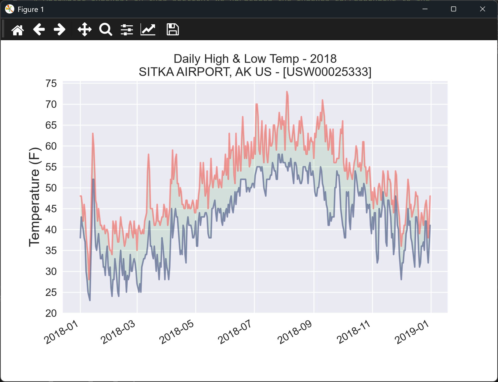

**Choosing 2 (Death Valley):**

```
Select a file to process:
> 2
Processing file: ...\data\death_valley_2018_simple.csv
Missing data for 2018-02-18 00:00:00
```

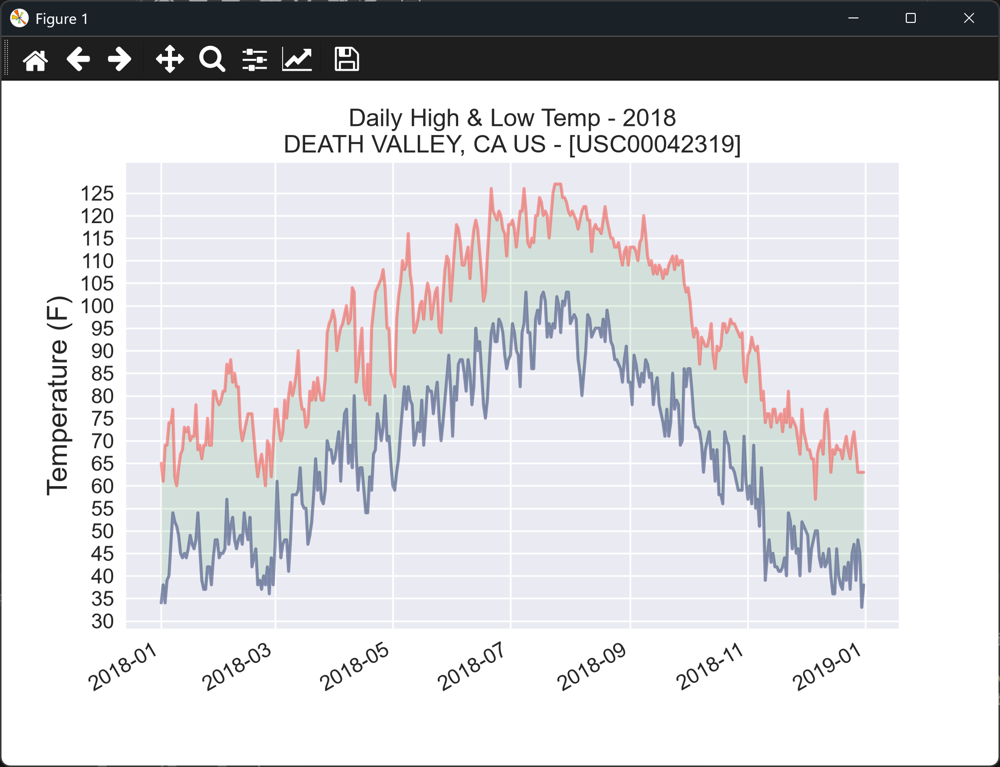

**Choosing 3 (San Francisco):**

```
Select a file to process:
> 3
Processing file: ...\data\san_francisco_2018.csv
```

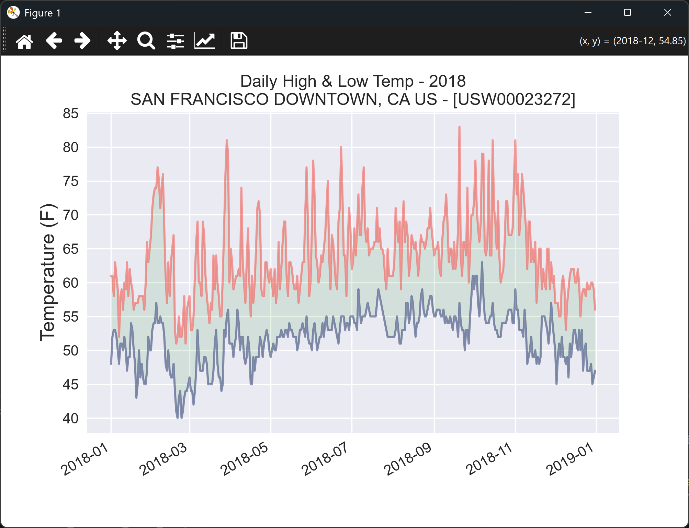

</details>
<br>

---

### Assignment 16.5 - Explore

Explore: Generate a few more visualizations that examine any other weather aspect you're interested in for
any locations you're curious about.

Solution, which uses the North Texas data for Dallas and plots its daily rainfall:

<details>
<summary>Spoiler Code</summary>
<br>

```python
from datetime import datetime
import os
import csv
import matplotlib.pyplot as plt

ROOT_DIR = os.path.dirname(__file__)
file_path = os.path.join(ROOT_DIR, "data", "north_texas_weather_2022_jan-jun.csv")

DALLAS = "USW00003971"

with open(file_path, encoding="UTF-8") as f:
    reader = csv.reader(f)
    header_row = next(reader)
    d_pos = header_row.index("DATE")
    p_pos = header_row.index("PRCP")
    dates, rainfall = [], []
    for row in reader:
        # Skip rows not from the Dallas NOAA station
        if row[0] != DALLAS:
            continue

        date = datetime.strptime(row[d_pos], "%Y-%m-%d")
        try:
            rain = float(row[p_pos])
        except ValueError:
            print(f"Missing data for {date}")
        else:
            dates.append(date)
            rainfall.append(rain)

    # Rain falls in short bursts, so bars show each day's total clearly
    plt.style.use("seaborn-v0_8")
    fig, ax = plt.subplots()
    ax.bar(dates, rainfall, color="green", width=1.0)
    ax.set_title("Daily Rainfall - January to June 2022\nDallas, TX", fontsize=20)
    ax.set_xlabel("", fontsize=16)
    ax.set_ylabel("Rainfall (in)", fontsize=16)
    fig.autofmt_xdate()
    ax.tick_params(axis="both", which="major", labelsize=12)

    plt.show()
```

</details>
<br>

<details>
<summary>Output</summary>

The terminal prints a line for each day with missing data:

```
Missing data for 2022-06-22 00:00:00
```

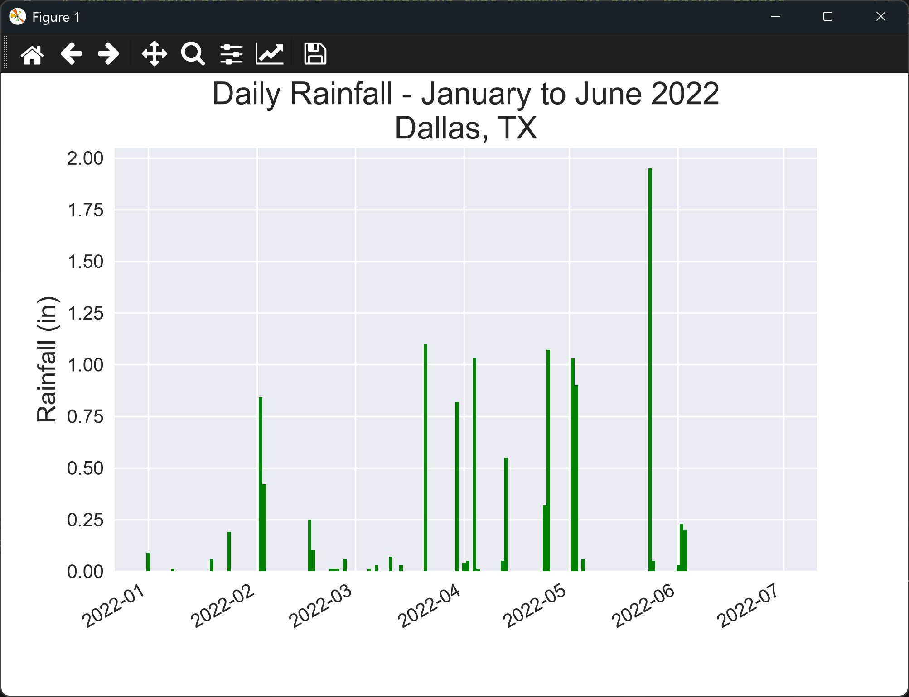

</details>
<br>

---

### Assignment 16.6 - Refactoring

Refactoring: The loop that pulls data from all_eq_dicts uses variables for the magnitude, longitude, latitude,
and title of each earthquake before appending these values to their appropriate lists. This approach was
chosen for clarity in how to pull data from a JSON file, but it's not necessary in your code. Instead of using
these temporary variables, pull each value from eq_dict and append it to the appropriate list in one line.
Doing so should shorten the body of this loop to just four lines.

Solution:

<details>
<summary>Spoiler Code</summary>
<br>

```python
import json
import os
from plotly.graph_objs import Layout
from plotly import offline

ROOT_DIR = os.path.dirname(__file__)
file_path = os.path.join(ROOT_DIR, "data", "eq_data_30_day_m1.json")

with open(file_path, encoding="UTF-8") as f:
    all_eq_data = json.load(f)

all_eq_dicts = all_eq_data["features"]

mags = [eq_dict["properties"]["mag"] for eq_dict in all_eq_dicts]
lons = [eq_dict["geometry"]["coordinates"][0] for eq_dict in all_eq_dicts]
lats = [eq_dict["geometry"]["coordinates"][1] for eq_dict in all_eq_dicts]
hover_texts = [eq_dict["properties"]["title"] for eq_dict in all_eq_dicts]

data = [{
    "type": "scattergeo",
    "lon": lons,
    "lat": lats,
    "text": hover_texts,
    "marker": {
        "size": [3 * mag for mag in mags],
        "color": mags,
        "colorscale": "Viridis",
        "reversescale": True,
        "colorbar": {"title": "Magnitude"},
    },
}]

my_layout = Layout(title="Global Earthquakes")
fig = {"data": data, "layout": my_layout}
html_path = os.path.join(ROOT_DIR, "data", "global_earthquakes.html")

offline.plot(fig, filename=html_path)
```

</details>
<br>

<details>
<summary>Output</summary>

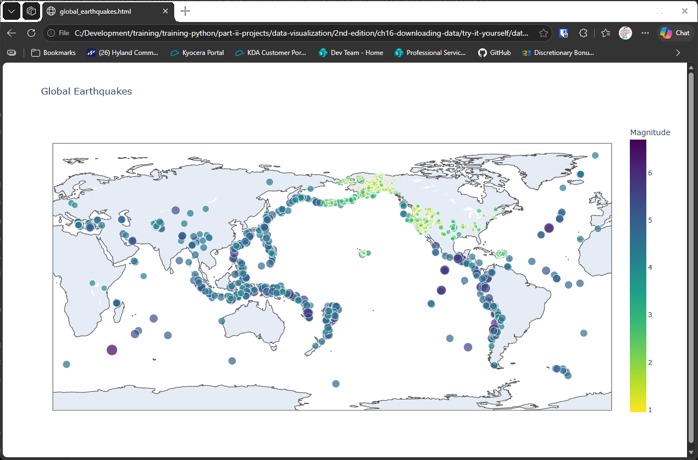

</details>
<br>

---

### Assignment 16.7 - Automated Title

Automated Title: In this section, we specified the title manually when defining `my_layout`, which means we have
to remember to update the title every time the source file changes. Instead, you can use the title for the data
set in the metadata part of the JSON file. Pull this value, assign it to a variable, and use this for the title
of the map when you're defining `my_layout`.

Solution:

<details>
<summary>Spoiler Code</summary>
<br>

```python
import json
from datetime import datetime
import os
from plotly.graph_objs import Layout
from plotly import offline

ROOT_DIR = os.path.dirname(__file__)
file_path = os.path.join(ROOT_DIR, "data", "eq_data_30_day_m1.json")

with open(file_path, encoding="UTF-8") as f:
    all_eq_data = json.load(f)

all_eq_dicts = all_eq_data["features"]

mags = [eq_dict["properties"]["mag"] for eq_dict in all_eq_dicts]
lons = [eq_dict["geometry"]["coordinates"][0] for eq_dict in all_eq_dicts]
lats = [eq_dict["geometry"]["coordinates"][1] for eq_dict in all_eq_dicts]
hover_texts = [eq_dict["properties"]["title"] for eq_dict in all_eq_dicts]

data = [{
    "type": "scattergeo",
    "lon": lons,
    "lat": lats,
    "text": hover_texts,
    "marker": {
        "size": [3 * mag for mag in mags],
        "color": mags,
        "colorscale": "Viridis",
        "reversescale": True,
        "colorbar": {"title": "Magnitude"},
    },
}]

title_info = all_eq_data["metadata"]["title"].split(",")[0]
date_info = datetime.fromtimestamp(
    all_eq_dicts[0]["properties"]["time"] / 1000).strftime("[%b %Y]")
my_layout = Layout(title=f"{title_info} - {date_info}")

fig = {"data": data, "layout": my_layout}
html_path = os.path.join(ROOT_DIR, "data", "global_earthquakes.html")

offline.plot(fig, filename=html_path)
```

</details>
<br>

<details>
<summary>Output</summary>

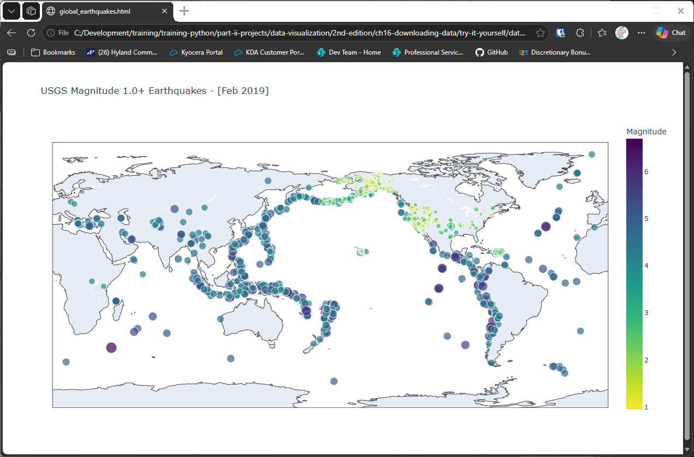

</details>
<br>

---

### Assignment 16.8 - Recent Earthquakes

Recent Earthquakes: You can find data files containing information about the most recent earthquakes over
1-hour, 1-day, 7-day, and 30-day periods online. Go to https://earthquake.usgs.gov/earthquakes/feed/v1.0/geojson.php
and you'll see a list of links to data sets for various time periods, focusing on earthquakes of different
magnitudes. Download one of these data sets, and create a visualization of the most recent earthquake activity.

Solution, which downloads the last month of data (this needs an internet connection):

<details>
<summary>Spoiler Code</summary>
<br>

```python
import os
import json
from plotly.graph_objs import Layout
from plotly import offline
import requests

API_URL = "https://earthquake.usgs.gov/earthquakes/feed/v1.0/summary/1.0_month.geojson"
ROOT_DIR = os.path.dirname(__file__)
file_path = os.path.join(ROOT_DIR, "data", "eq_data_last_30_days.json")

result = requests.get(API_URL, timeout=10).json()
with open(file_path, "w", encoding="UTF-8")as f:
    json.dump(result, f)

with open(file_path, encoding="UTF-8") as f:
    all_eq_data = json.load(f)

all_eq_dicts = all_eq_data["features"]

mags = [eq_dict["properties"]["mag"] for eq_dict in all_eq_dicts]
lons = [eq_dict["geometry"]["coordinates"][0] for eq_dict in all_eq_dicts]
lats = [eq_dict["geometry"]["coordinates"][1] for eq_dict in all_eq_dicts]
hover_texts = [eq_dict["properties"]["title"] for eq_dict in all_eq_dicts]

data = [{
    "type": "scattergeo",
    "lon": lons,
    "lat": lats,
    "text": hover_texts,
    "marker": {
        "size": [3 * mag for mag in mags],
        "color": mags,
        "colorscale": "Viridis",
        "reversescale": True,
        "colorbar": {"title": "Magnitude"},
    },
}]

my_layout = Layout(title=all_eq_data["metadata"]["title"])

fig = {"data": data, "layout": my_layout}
html_path = os.path.join(ROOT_DIR, "data", "global_earthquakes.html")

offline.plot(fig, filename=html_path)
```

</details>
<br>

<details>
<summary>Output</summary>

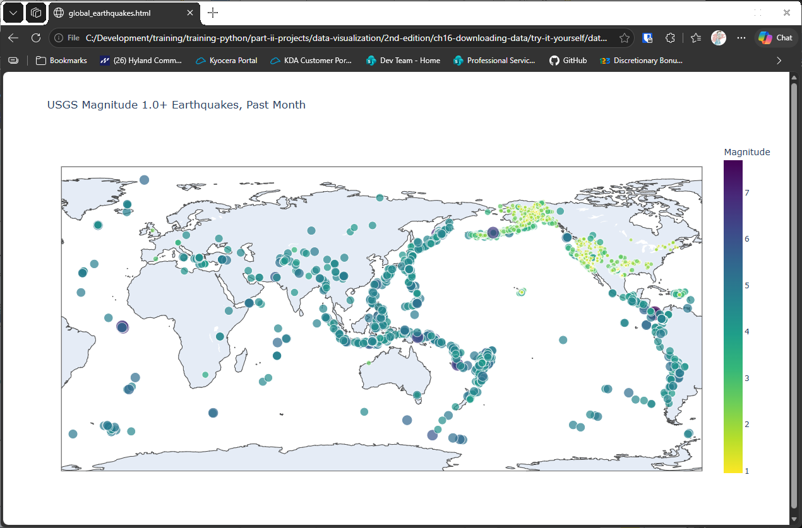

</details>
<br>

---

### Assignment 16.9 - World Fires

World Fires: In the resources for this chapter, you'll find a file called world_fires_1_day.csv. This file
contains information about fires burning in different locations around the globe, including the latitude and
longitude, and the brightness of each fire. Using the data processing work from the first part of this chapter
and the mapping work from this section, make a map that shows which parts of the world are affected by fires.
You can download more recent versions of this data at https://earthdata.nasa.gov/earth-observation-data/near-real-time/firms/active-fire-data/.
You can find links to the data in CSV format in the TXT section.

**Note:** This one may take a while to load. The download can be large, and the map has a point for every fire in the file, so give the browser time to draw it.

Solution, which downloads the last 24 hours of fire data (this needs an internet connection):

<details>
<summary>Spoiler Code</summary>
<br>

```python
import os
import csv
import requests
from plotly.graph_objs import Layout
from plotly import offline

ROOT_DIR = os.path.dirname(__file__)

API_URL = "https://firms.modaps.eosdis.nasa.gov/data/active_fire/noaa-20-viirs-c2/csv/J1_VIIRS_C2_Global_24h.csv"
LAT_LABEL = "latitude"
LON_LABEL = "longitude"
BRT_LABEL = "bright_ti4"

download = requests.get(API_URL, timeout=10)
content = download.content.decode("utf-8")

reader = csv.reader(content.splitlines(), delimiter=",")
header_row = next(reader)
lat_pos = header_row.index(LAT_LABEL)
lon_pos = header_row.index(LON_LABEL)
brt_pos = header_row.index(BRT_LABEL)

lats, lons, brts = [], [], []
for row in reader:
    lats.append(float(row[lat_pos]))
    lons.append(float(row[lon_pos]))
    brts.append(float(row[brt_pos]))

max_brt = max(brts)
data = [{
    "type": "scattergeo",
    "lon": lons,
    "lat": lats,
    "marker": {
        "size": [brt / max_brt * 10 for brt in brts],
        "color": [brt / max_brt for brt in brts],
        "colorscale": "Viridis",
        "reversescale": True,
        "colorbar": {"title": "Brightness"},
    },
}]

my_layout = Layout(title="Fires - Past 24 Hours")

fig = {"data": data, "layout": my_layout}
html_path = os.path.join(ROOT_DIR, "data", "global_fires.html")

offline.plot(fig, filename=html_path)
```

</details>
<br>

<details>
<summary>Output</summary>

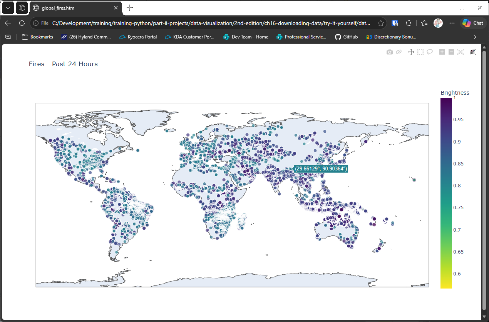

</details>
<br>

---
