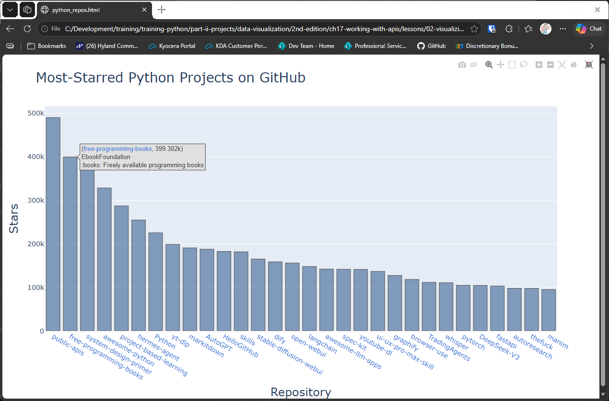

# Visualizing Results

## Introduction

The last lesson printed the details of each repository one at a time. A chart shows the same information
at a glance. This lesson calls the same GitHub API, then draws a bar chart of the most-starred Python
projects, with a link to each repository and a hover box for its owner and description.

The chart uses plotly, which saves it as an HTML file. You can install plotly with:

```bash
python -m pip install plotly
```

---

## The Code

```python
"""Lesson 2.1 - Visualizing Results"""

import requests
from plotly import offline
import os
import sys

ROOT_DIR = os.path.dirname(__file__)

# Make an API call and store the response.
url = "https://api.github.com/search/repositories?q=language:python&sort=stars"
headers = {"Accept": "application/vnd.github.v3+json"}

r = requests.get(url, headers=headers, timeout=10)
if r.status_code != 200:
    print(f"Failed to consume API!\n Status: {r.status_code}")
    sys.exit(-1)

response_dict = r.json()
repo_dicts = response_dict["items"]

repo_links, stars, labels = [], [], []
for repo_dict in repo_dicts:
    repo_name = repo_dict["name"]
    repo_url = repo_dict["html_url"]
    repo_link = f"<a href='{repo_url}'>{repo_name}</a>"
    repo_links.append(repo_link)

    stars.append(repo_dict["stargazers_count"])

    owner = repo_dict["owner"]["login"]
    description = repo_dict["description"]
    label = f"{owner}<br />{description}"
    labels.append(label)

# Make visualization.
data = [{
    "type": "bar",
    "x": repo_links,
    "y": stars,
    "hovertext": labels,
    "marker": {
        "color": "rgb(60, 100, 150)",
        "line": {"width": 1.5, "color": "rgb(25, 25, 25)"}
    },
    "opacity": 0.6,
}]

my_layout = {
    "title": {"text": "Most-Starred Python Projects on GitHub", "font": {"size": 28}},
    "xaxis": {
        "title": {"text": "Repository", "font": {"size": 24}},
        "tickfont": {"size": 14},
    },
    "yaxis": {
        "title": {"text": "Stars", "font": {"size": 24}},
        "tickfont": {"size": 14},
    },
    "hoverlabel": {
        "bgcolor": "#E0E0E0"
    }
}

fig = {"data": data, "layout": my_layout}

html_path = os.path.join(ROOT_DIR, "data", "python_repos.html")

offline.plot(fig, filename = html_path)
```

---

### Walking Through the Code

**Checking the request.** If the API doesn't return a status of 200, the script prints the status and stops
with `sys.exit()`. Without that check, the rest of the script would fail with a confusing error.

**Collecting the data.** The loop builds four lists: the repository names as links, the star counts, and
the labels for the hover box. The label holds the owner's name and the description, separated by a line
break, which is written as `<br />` in HTML.

**The bar chart.** The data is a dictionary in plotly's format. `"type": "bar"` makes bars, `"x"` holds the
linked names, and `"y"` holds the star counts. `"hovertext"` supplies the label shown on hover.

**The layout.** `my_layout` sets the title, axis titles, and font sizes. Each title is a dictionary holding
its `text` and its `font`. Older versions of plotly used a separate `titlefont` setting, which newer versions
no longer accept, so an example from an older book may need this change. The sizes are large because the
chart is meant to be read from a distance.

**Saving the chart.** The chart is saved to `data/python_repos.html`, and `offline.plot()` opens it in your
browser. The `data` folder must exist beside the script.

---

### Output

Your browser opens a bar chart titled "Most-Starred Python Projects on GitHub". Each bar is a repository,
with its name as a link underneath. Moving the mouse over a bar shows the owner and description. The
tallest bars are the most-starred projects.



---
