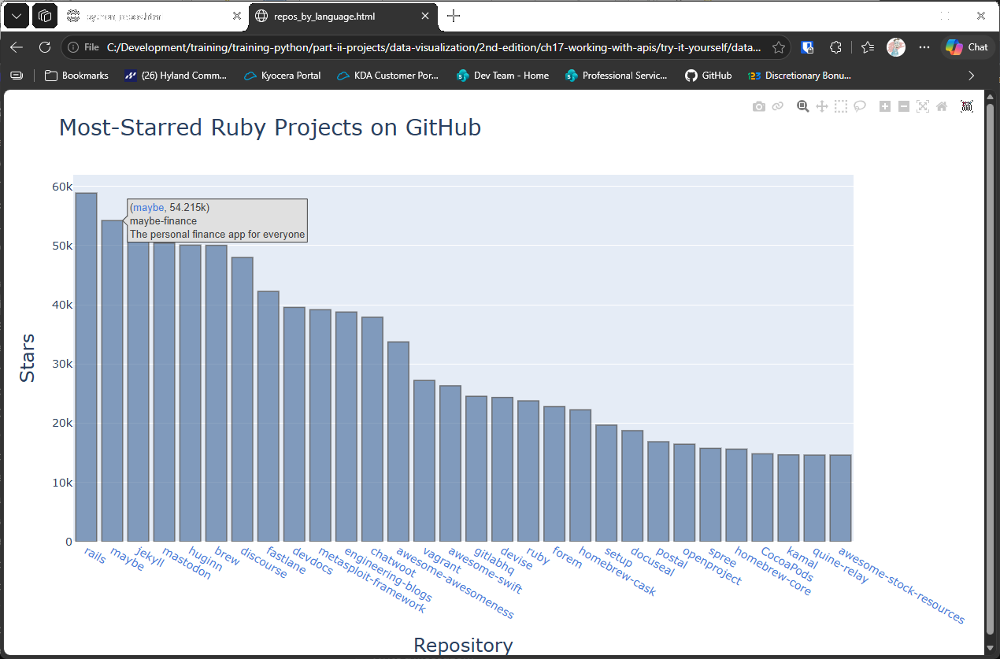
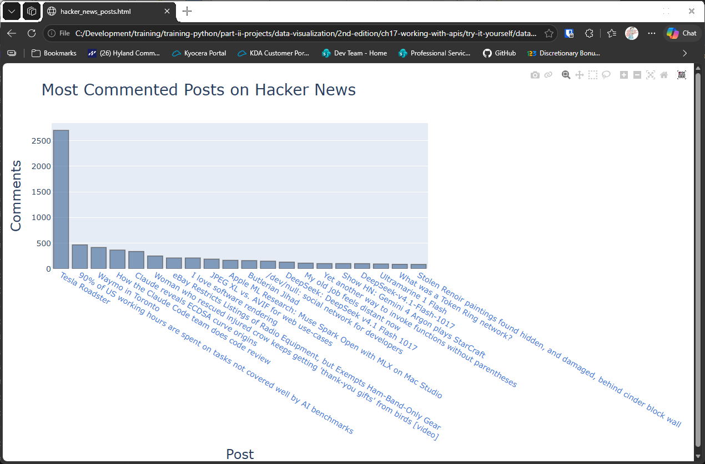
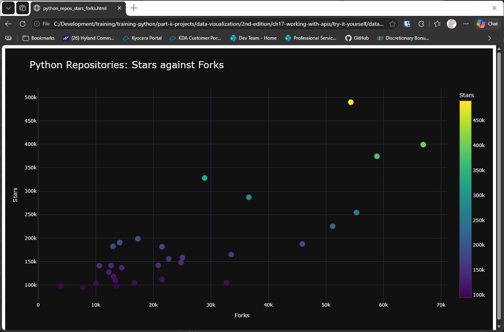

# Chapter 17 Try-it-Yourself Assignments and Solutions

## Introduction

Here are my solutions for the chapter 17 try-it-yourself exercises, from the 2nd edition of the textbook.

These exercises build on the GitHub and Hacker News examples in the chapter. The charts are saved to the `data`
folder and open in your web browser. The first and third exercises call the internet APIs, so they need a
connection when you run them.

Each exercise shows the full assignment, then a solution with the code and its output. The solution code is
hidden until you expand it, so you can attempt each assignment first.

---

### Assignment 17.01 - Other Languages

Other Languages: Modify the API call in python_repos.py so it generates a chart showing the most popular projects
in other languages. Try languages such as JavaScript, Ruby, C, Java, Perl, Haskell, and Go.

Solution:

<details>
<summary>Spoiler Code</summary>
<br>

```python
from random import randint
import os
import sys
from plotly import offline
import requests

ROOT_DIR = os.path.dirname(__file__)

languages = ["javascript", "ruby", "c", "java", "perl", "haskell", "go"]
sel_lang = languages[randint(0, len(languages) - 1)]

print(f"Retrieving data for [{sel_lang}]...")

url = f"https://api.github.com/search/repositories?q=language:{sel_lang}&sort=stars"
headers = {"Accept": "application/vnd.github.v3+json"}
r = requests.get(url, headers=headers, timeout=10)

if r.status_code != 200:
    print(f"API connection to [{url}] failed\n\twith status code: {r.status_code}")
    sys.exit(-1)

response_dict = r.json()
repo_dicts = response_dict["items"]

repo_links, stars, labels = [], [], []
for repo_dict in repo_dicts:
    repo_name = repo_dict["name"]
    repo_url = repo_dict["html_url"]
    repo_link = f"<a href='{repo_url}'>{repo_name}</a>"
    repo_links.append(repo_link)

    stars.append(repo_dict["stargazers_count"])

    owner = repo_dict["owner"]["login"]
    description = repo_dict["description"]
    label = f"{owner}<br />{description}"
    labels.append(label)

# Make visualization.
data = [{
    "type": "bar",
    "x": repo_links,
    "y": stars,
    "hovertext": labels,
    "marker": {
        "color": "rgb(60, 100, 150)",
        "line": {"width": 1.5, "color": "rgb(25, 25, 25)"}
    },
    "opacity": 0.6,
}]

my_layout = {
    "title": {"text": f"Most-Starred {sel_lang.title()} Projects on GitHub", "font": {"size": 28}},
    "xaxis": {
        "title": {"text": "Repository", "font": {"size": 24}},
        "tickfont": {"size": 14},
    },
    "yaxis": {
        "title": {"text": "Stars", "font": {"size": 24}},
        "tickfont": {"size": 14},
    },
    "hoverlabel": {
        "bgcolor": "#E0E0E0"
    }
}

fig = {"data": data, "layout": my_layout}

html_path = os.path.join(ROOT_DIR, "data", "repos_by_language.html")

offline.plot(fig, filename = html_path)
```

</details>
<br>

<details>
<summary>Output</summary>

The terminal names the language it picked at random, then your browser opens the chart:

```
Retrieving data for [ruby]...
```



</details>
<br>

---

### Assignment 17.02 - Active Discussions

Active Discussions: Using the data from hn_submissions.py, make a bar chart showing the most active discussions
currently happening on Hacker News. The height of each bar should correspond to the number of comments each
submission has. The label for each bar should include the submission's title and should act as a link to the
discussion page for that submission.

**Note:** This one is slow to run. The script makes a separate request for each of the first 50 stories, one after
another, so it can take a while before the chart opens. Let it finish, and don't close the terminal while it's
working.

Solution:

<details>
<summary>Spoiler Code</summary>
<br>

```python
import os
import sys
import requests
from plotly import offline

ROOT_DIR = os.path.dirname(__file__)
ITEM_COUNT = 20
MAX_RETRIEVE = 50

# Make an API call and store the response.
url = "https://hacker-news.firebaseio.com/v0/topstories.json"
r = requests.get(url, timeout=10)
if r.status_code != 200:
    print(f"Failed to consume API!\n Status: {r.status_code}")
    sys.exit(-1)

# Process information about each submission.
submission_ids = r.json()
links, titles, comments = [], [], []
for submission_id in submission_ids[:MAX_RETRIEVE]:
    url = f"https://hacker-news.firebaseio.com/v0/item/{submission_id}.json"
    r = requests.get(url, timeout=10)
    response_dict = r.json()
    titles.append(response_dict["title"].split(")")[-1])
    links.append(
        f"<a href='http://news.ycombinator.com/item?id={submission_id}'>{response_dict['title']}")
    comments.append(response_dict["descendants"]
                    if "descendants" in response_dict.keys() else 0)

# A little sneaky sorting
comments, titles, links = zip(
    *sorted(zip(comments, titles, links), reverse=True))
comments, titles, links = comments[:ITEM_COUNT], titles[:ITEM_COUNT], links[:ITEM_COUNT]

# Make visualization.
data = [{
    "type": "bar",
    "x": links,
    "y": comments,
    "marker": {
        "color": "rgb(60, 100, 150)",
        "line": {"width": 1.5, "color": "rgb(25, 25, 25)"}
    },
    "opacity": 0.6,
    # "hovertext": titles
}]

my_layout = {
    "title": {"text": "Most Commented Posts on Hacker News", "font": {"size": 28}},
    "xaxis": {
        "title": {"text": "Post", "font": {"size": 24}},
        "tickfont": {"size": 14},
    },
    "yaxis": {
        "title": {"text": "Comments", "font": {"size": 24}},
        "tickfont": {"size": 14},
    },
    "hoverlabel": {
        "bgcolor": "#E0E0E0"
    }
}

fig = {'data': data, 'layout': my_layout}

html_path = os.path.join(ROOT_DIR, "data", "hacker_news_posts.html")

offline.plot(fig, filename=html_path)
```

</details>
<br>

<details>
<summary>Output</summary>



</details>
<br>

---

### Assignment 17.03 - Testing python_repos.py

Testing python_repos.py: In `python_repos.py`, we printed the value of `status_code` to make sure the API call was
successful. Write a program called test_python_repos.py that uses unittest to assert that the value of status_code
is 200. Figure out some other assertions you can make, for example, that the number of items returned is expected
and that the total number of repositories is greater than a certain amount.

Solution:

<details>
<summary>Spoiler Code</summary>
<br>

```python
import os
import sys
import unittest
import requests
from plotly import offline

def get_github_data(response_dict):
    """Process information about each submission."""
    ROOT_DIR = os.path.dirname(__file__)

    repo_dicts = response_dict["items"]

    repo_links, stars, labels = [], [], []
    for repo_dict in repo_dicts:
        repo_name = repo_dict["name"]
        repo_url = repo_dict["html_url"]
        repo_link = f"<a href='{repo_url}'>{repo_name}</a>"
        repo_links.append(repo_link)

        stars.append(repo_dict["stargazers_count"])

        owner = repo_dict["owner"]["login"]
        description = repo_dict["description"]
        label = f"{owner}<br />{description}"
        labels.append(label)

    # Make visualization.
    data = [{
        "type": "bar",
        "x": repo_links,
        "y": stars,
        "hovertext": labels,
        "marker": {
            "color": "rgb(60, 100, 150)",
            "line": {"width": 1.5, "color": "rgb(25, 25, 25)"}
        },
        "opacity": 0.6,
    }]

    my_layout = {
        "title": {"text": "Most-Starred Python Projects on GitHub", "font": {"size": 28}},
        "xaxis": {
            "title": {"text": "Repository", "font": {"size": 24}},
            "tickfont": {"size": 14},
        },
        "yaxis": {
            "title": {"text": "Stars", "font": {"size": 24}},
            "tickfont": {"size": 14},
        },
        "hoverlabel": {
            "bgcolor": "#E0E0E0"
        }
    }

    fig = {"data": data, "layout": my_layout}

    html_path = os.path.join(ROOT_DIR, "data", "python_repos.html")

    offline.plot(fig, filename = html_path)

def main():
    """Run the tests. unittest.main() searches __main__, which is the runner here, so load this module's tests directly."""
    suite = unittest.defaultTestLoader.loadTestsFromTestCase(GithubTest)
    unittest.TextTestRunner(stream=sys.stdout, verbosity=2).run(suite)

class GithubTest(unittest.TestCase):
    """Unit tests for `python_repos.py`."""
    def test_data_retrieval(self):
        """Test that data is retrieved successfully."""
        # Make an API call and store the response.
        url = "https://api.github.com/search/repositories?q=language:python&sort=stars"
        headers = {"Accept": "application/vnd.github.v3+json"}

        r = requests.get(url, headers=headers, timeout=10)
        self.assertEqual(r.status_code, 200)

        response_dict = r.json()
        self.assertEqual(len(response_dict["items"]), 30)
        self.assertGreater(response_dict["total_count"], 1000)

        get_github_data(response_dict)

if __name__ == "__main__":
    main()
```

</details>
<br>

<details>
<summary>Output</summary>

The test prints unittest's summary. A passing run ends with `OK`:

```
.
----------------------------------------------------------------------
Ran 1 test in 2.922s

OK
```

</details>
<br>

---

### Assignment 17.04 - Further Exploration

Further Exploration: Visit the documentation for Plotly and either the GitHub API or the Hacker News API. Use some of
the information you find there to either customize the style of the plots we've already made or pull some different
information and create your own visualizations.

Solution, which charts stars against forks for the Python repositories, using Plotly's dark template and a color
scale that shows the star count:

<details>
<summary>Spoiler Code</summary>
<br>

```python
import os
import sys
import requests
from plotly import offline

ROOT_DIR = os.path.dirname(__file__)

# Pull the same GitHub data as before, but chart two numbers against each other
url = "https://api.github.com/search/repositories?q=language:python&sort=stars"
headers = {"Accept": "application/vnd.github.v3+json"}
r = requests.get(url, headers=headers, timeout=10)
if r.status_code != 200:
    print(f"Failed to consume API!\n Status: {r.status_code}")
    sys.exit(-1)

repo_dicts = r.json()["items"]
names = [repo["name"] for repo in repo_dicts]
stars = [repo["stargazers_count"] for repo in repo_dicts]
forks = [repo["forks_count"] for repo in repo_dicts]

# Plotly's built-in dark template restyles the whole chart, and the colors show the star count
fig = {
    "data": [{
        "type": "scatter",
        "mode": "markers",
        "x": forks,
        "y": stars,
        "text": names,
        "marker": {
            "size": 14,
            "color": stars,
            "colorscale": "Viridis",
            "showscale": True,
            "colorbar": {"title": {"text": "Stars"}},
        },
    }],
    "layout": {
        "title": {"text": "Python Repositories: Stars against Forks", "font": {"size": 24}},
        "template": "plotly_dark",
        "xaxis": {"title": {"text": "Forks"}},
        "yaxis": {"title": {"text": "Stars"}},
    },
}

html_path = os.path.join(ROOT_DIR, "data", "python_repos_stars_forks.html")
offline.plot(fig, filename=html_path)
```

</details>
<br>

<details>
<summary>Output</summary>



</details>
<br>

---
