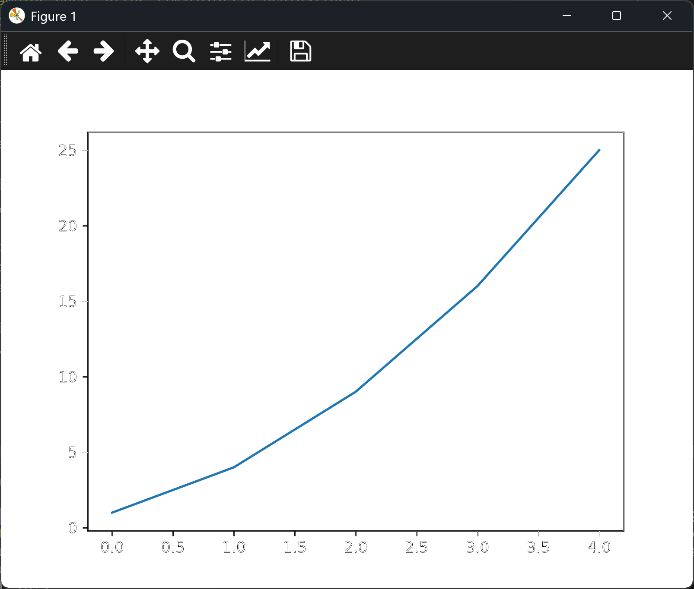

# Plotting a Simple Line Graph

## Introduction

This is the first lesson in the chapter. It introduces matplotlib and its **pyplot**
module, and it draws the simplest possible chart: a line graph of five square numbers.

Matplotlib is the Python library that draws charts. Most of what you'll do with it goes
through pyplot, which is imported with the short name `plt`:

```python
import matplotlib.pyplot as plt
```

To draw a chart, you create a *figure*, the whole window or image, and one or more *axes*,
the area where the data is drawn. The lessons in this folder use `fig, ax = plt.subplots()`
to create both at once.

A line graph is the right choice when your data has a natural order, such as time or
a sequence of measurements, and you want to see how the values change from one point to
the next. The slope of the line shows the rate of change.

You need to install matplotlib before running these lessons:

```bash
python -m pip install matplotlib
```

---

### The Code

```python
"""Lesson 1.1 - Plotting a Simple Line Graph"""

# matplotlib provides graphing/charting capabilities
# Samples here: https://matplotlib.org/gallery/
# You may need to run the following command to install matplotlib
# > python -m pip install matplotlib

import matplotlib.pyplot as plt

# Create some data to graph
squares = [1, 4, 9, 16, 25]

# fig is the standard abbreviation for the figure, and ax for the axes.
fig, ax = plt.subplots()

# Now we plot the values (points are x=index and y=value from the list being plotted)
ax.plot(squares)
# Because the index values start from 0, the y-values will be off

# Finally, we draw the figure and display in the matplotlib viewer for the end user
plt.show()
```

---

### Walking Through the Code

**Creating the data.** `squares` is a list of five values: the squares of 1 to 5.

**Creating the figure.** `plt.subplots()` returns a figure and a single set of axes. The
convention is to call them `fig` and `ax`.

**Plotting.** `ax.plot(squares)` draws a line through the values. Because only one list
is given, matplotlib uses each value's position in the list as its x-coordinate. The
positions start from 0, so the x-axis runs from 0 to 4 rather than 1 to 5. That's why
the comment warns that the values are "off". The next lesson fixes it.

**Showing the chart.** `plt.show()` opens the chart in a window. The script waits until
you close that window.

---

### Output

Running the script opens a window with a single blue line rising from a low point on the
left to a high point on the right. The horizontal axis is labeled with the positions 0
to 4, and the vertical axis runs from 0 to 25. The first point sits at about 1, and the
last at 25.



---
