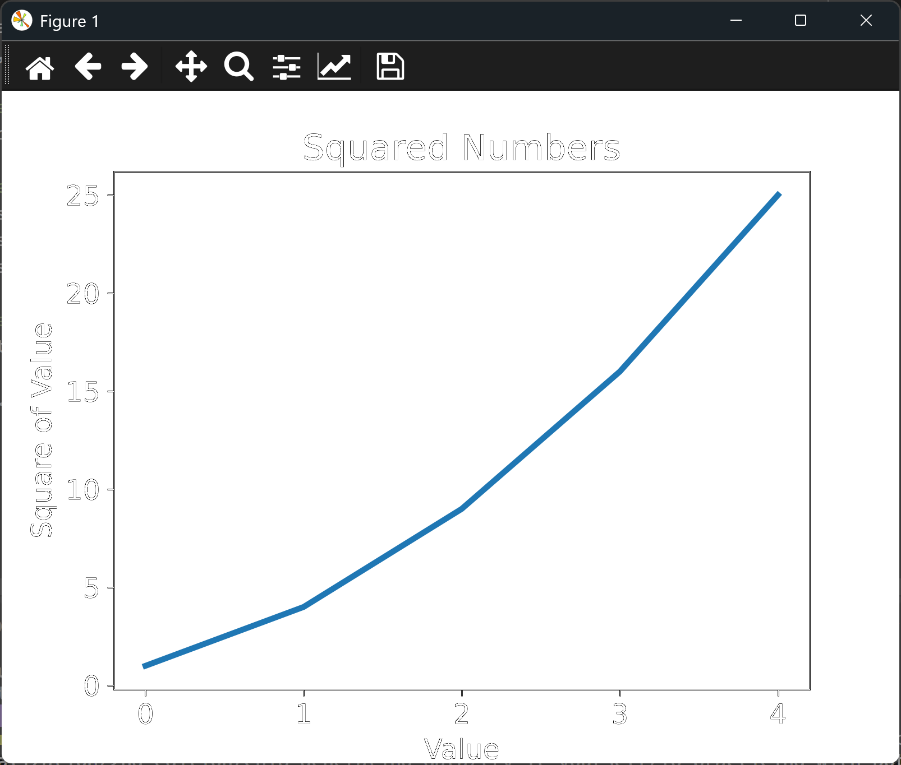

# Improving a Simple Line Graph

## Introduction

The last lesson drew a line graph, but it was hard to read. The x-axis had no labels,
the line was thin, and the axis values started from 0 rather than from the numbers we
actually cared about. This lesson keeps the same data and makes the chart clearer, using
three of matplotlib's most useful features: a thicker line, a title, and labels for each
axis.

---

## The Code

```python
"""Lesson 1.2 - Improving a Simple Line Graph"""

import matplotlib.pyplot as plt

squares = [1, 4, 9, 16, 25]
fig, ax = plt.subplots()

# We can thicken the line width
ax.plot(squares, linewidth = 3)

# Set chart title and label the axes.
ax.set_title("Squared Numbers", fontsize = 18)
ax.set_xlabel("Value", fontsize = 14)
ax.set_ylabel("Square of Value", fontsize = 14)

# Set size of tick labels.
ax.tick_params(axis = "both", labelsize = 14)

plt.show()
```

---

### Walking Through the Code

**Thickening the line.** `linewidth = 3` is a keyword argument to `ax.plot()`. Most
matplotlib functions accept keyword arguments like this, which set one option each.

**Titles and labels.** `set_title()`, `set_xlabel()`, and `set_ylabel()` add text to the
chart. `fontsize` sets the size of each piece of text in points.

**Tick labels.** `tick_params()` changes the numbers along the axes. Here it makes them
14 points, to match the labels.

---

### Output

The window now has the title "Squared Numbers" across the top, with "Value" along the
bottom and "Square of Value" up the side. The line is noticeably thicker than before.
The x-axis still runs from 0 to 4, because the values are still plotted against their
positions in the list. The next lesson fixes that.



---
