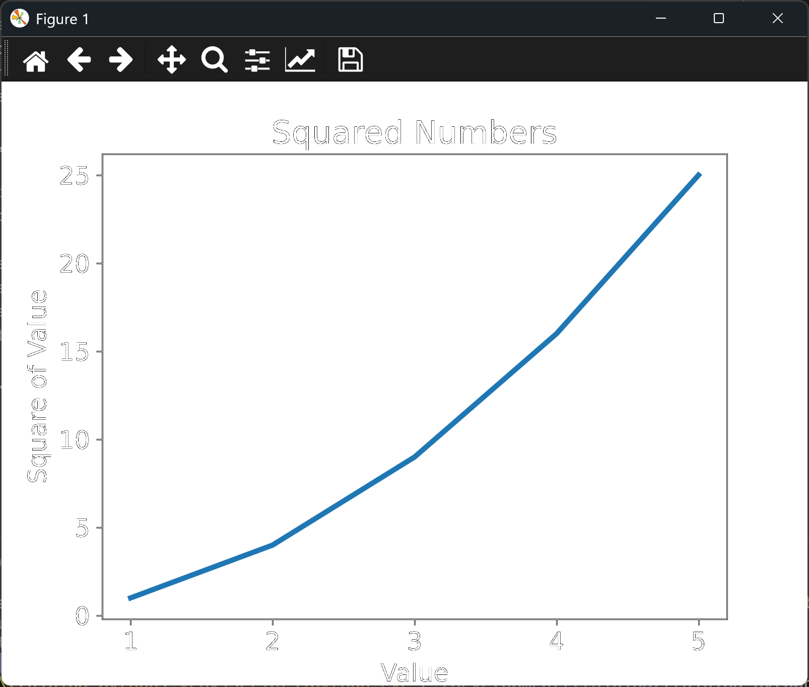

# Correcting a Simple Line Graph

## Introduction

The previous lesson's chart had a flaw that's easy to miss. The x-axis ran from 0 to 4,
because matplotlib used each value's position in the list as its x-coordinate. The
squares, though, belong to the numbers 1 to 5. This lesson supplies those numbers
explicitly, so the chart shows the correct x-values.

---

## The Code

```python
"""Lesson 1.3 - Correcting a Simple Line Graph"""

import matplotlib.pyplot as plt

# We'll create a list of x-axis values
numbers = list(range(1, 6))
# And modify the y-axis values
squares = [x ** 2 for x in numbers]

fig, ax = plt.subplots()

# Now we can specify the x-axis values instead of assuming the indices
ax.plot(numbers, squares, linewidth = 3)

ax.set_title("Squared Numbers", fontsize = 18)
ax.set_xlabel("Value", fontsize = 14)
ax.set_ylabel("Square of Value", fontsize = 14)
ax.tick_params(axis = "both", labelsize = 14)

plt.show()
```

---

### Walking Through the Code

**Two lists.** `numbers` holds the x-values, 1 to 5, created with `range()`. `squares`
is built from it with a list comprehension, so each square is computed from the number
it belongs to.

**Passing both lists.** `ax.plot(numbers, squares)` takes the x-values first and the
y-values second. Matplotlib now places each point at its true coordinates.

**The rest is unchanged.** The title, labels, line width, and tick size are the same as
the previous lesson.

---

### Output

The line still rises from the bottom left to the top right, but the x-axis now runs from
1 to 5, and each point sits above its own number. The point at 5 sits at 25 on the
y-axis.



---
