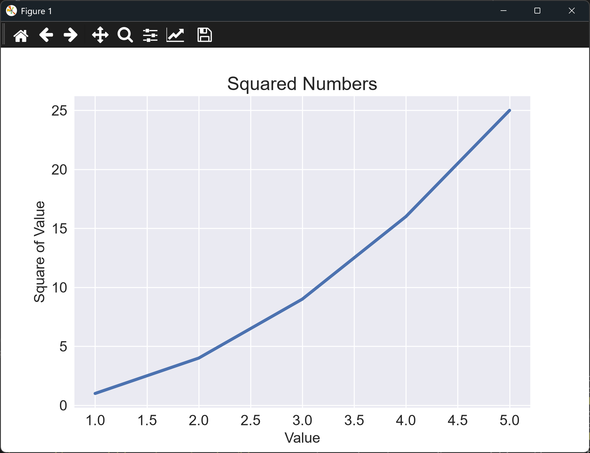

# Using a Style Sheet

## Introduction

Matplotlib ships with a set of built-in style sheets, which change the colors, background,
and grid lines of a chart without changing the data. This lesson applies one of them to the
line graph from the previous lesson. Style sheets are a quick way to make charts look
consistent across a project, or to match a company's look.

---

## The Code

```python
"""Lesson 1.4 - Using a Style Sheet"""

import matplotlib.pyplot as plt

# We can set a built-in stylesheet to be used for the plot
#     (this must be done before calling plt.subplots())
plt.style.use("seaborn-v0_8")

# If you use the following (book example), you'll receive a warning indicating that
#     the style is deprecated
# plt.style.use("seaborn")

# List of styles: https://matplotlib.org/stable/gallery/style_sheets/style_sheets_reference.html
# You could use the following code to identify the available stylesheet names
# for s in plt.style.available:
#     print(s)

numbers = list(range(1, 6))
squares = [x ** 2 for x in numbers]
fig, ax = plt.subplots()
ax.plot(numbers, squares, linewidth = 3)
ax.set_title("Squared Numbers", fontsize = 18)
ax.set_xlabel("Value", fontsize = 14)
ax.set_ylabel("Square of Value", fontsize = 14)
ax.tick_params(axis = "both", labelsize = 14)

plt.show()
```

---

### Walking Through the Code

**Setting the style.** `plt.style.use("seaborn-v0_8")` applies the style. It must come
before `plt.subplots()`, because the style is applied when the figure is created.

**Deprecated names.** Older versions of the book used `"seaborn"`. That name was removed
from matplotlib, and using it gives a warning. The `-v0_8` suffix is the current name.

**Finding other styles.** The commented-out loop prints every style name matplotlib knows.
Uncomment it to see the full list.

**The rest is unchanged.** The data and the chart settings are the same as before.

---

### Output

The chart looks the same as before, except for its styling. The background is a pale gray,
with white grid lines behind the data, and the line uses the style's blue. The values and
labels are unchanged.



---
