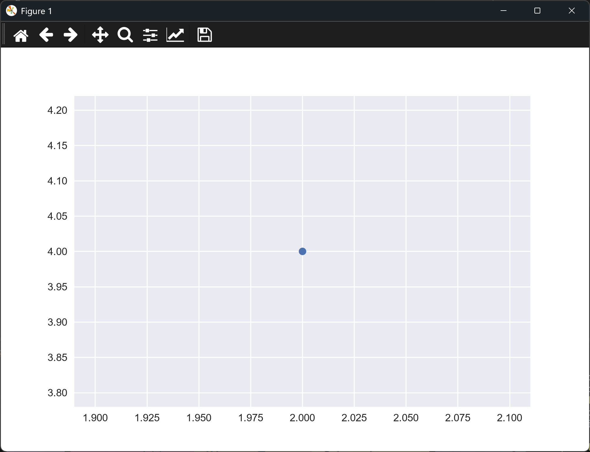

# A Simple Scatter Graph

## Introduction

So far every chart has joined its points with a line. A **scatter graph** plots each
point on its own, with no line between them. Use one when the points are separate
observations and the connection between one point and the next doesn't mean anything.
Scatter graphs are the usual way to show whether two quantities are related, and they
show clusters and outliers clearly.

This lesson starts with the simplest scatter graph there is: a single point.

---

## The Code

```python
"""Lesson 1.5 - A Simple Scatter Graph"""

import matplotlib.pyplot as plt

plt.style.use("seaborn-v0_8")
fig, ax = plt.subplots()

# For a scatter graph, use ax.scatter() instead of ax.plot()
# Here, we're passing a single point (x=2, y=4)
ax.scatter(2, 4)

plt.show()
```

---

### Walking Through the Code

**Choosing the function.** `ax.scatter()` replaces `ax.plot()`. It draws a marker for each
point, and it doesn't connect them.

**One point.** `ax.scatter(2, 4)` draws one marker at x = 2 and y = 4. A scatter call
accepts lists as well, which the next lessons use.

---

### Output

The window shows a single small blue dot. Because the chart has only one point, matplotlib
scales the axes tightly around it, and the tick values sit very close together. The dot
isn't labeled, and it isn't meant to be on its own: it's the starting point for the rest of
the scatter lessons.



---
