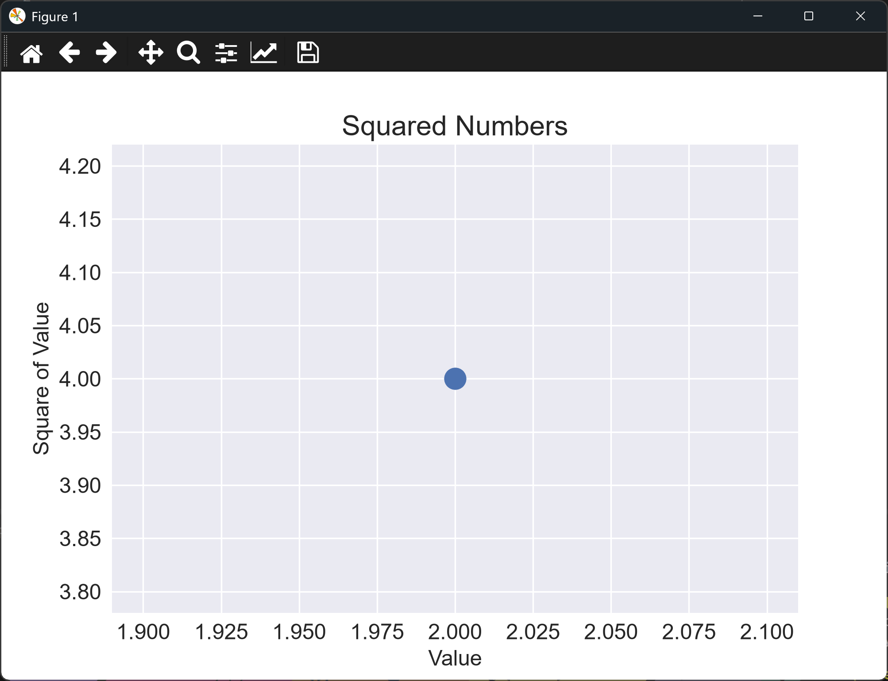

# An Improved Scatter Graph

## Introduction

The single point in the last lesson was too small to see well, and the chart had no labels.
This lesson makes the point larger and adds a title and axis labels, the same improvements
we made to the line graph earlier in the chapter.

---

## The Code

```python
"""Lesson 1.6 - An Improved Scatter Graph"""

import matplotlib.pyplot as plt

plt.style.use("seaborn-v0_8")
fig, ax = plt.subplots()

# Adding a value for s (size) increases the diameter of the point
ax.scatter(2, 4, s=200)

# Set chart title and label the axes.
ax.set_title("Squared Numbers", fontsize = 18)
ax.set_xlabel("Value", fontsize = 14)
ax.set_ylabel("Square of Value", fontsize = 14)

# Set size of tick labels.
ax.tick_params(axis = "both", labelsize = 14)

plt.show()
```

---

### Walking Through the Code

**Marker size.** `s=200` sets the area of each marker in points squared. Larger values
give larger dots.

**Labels.** The title and axis labels are set the same way as in the line graph lessons.

---

### Output

The window shows the same single point, now a much larger blue dot, with the title
"Squared Numbers" and the two axis labels. The axes are still scaled tightly around the
point.



---
