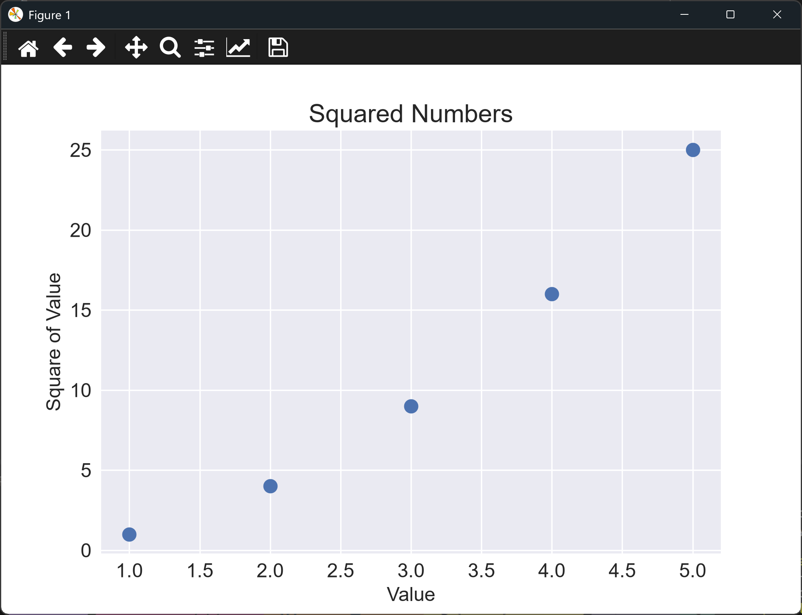

# Adding Data to a Scatter Graph

## Introduction

Now that the chart works for a single point, we can plot the whole set of squares. This
lesson passes lists of x-values and y-values to `ax.scatter()`, so it plots five points
instead of one.

---

## The Code

```python
"""Lesson 1.7 - Adding Data to a Scatter Graph"""

import matplotlib.pyplot as plt

# Add back in some data lists
numbers = list(range(1, 6))
squares = [x ** 2 for x in numbers]

plt.style.use("seaborn-v0_8")
fig, ax = plt.subplots()

# Change from a point to the lists for the plot
ax.scatter(numbers, squares, s=100)
ax.set_title("Squared Numbers", fontsize = 18)
ax.set_xlabel("Value", fontsize = 14)
ax.set_ylabel("Square of Value", fontsize = 14)
ax.tick_params(axis = "both", labelsize = 14)

plt.show()
```

---

### Walking Through the Code

**Lists of values.** `numbers` and `squares` are built the same way as in lesson 1.3.

**Plotting a series.** `ax.scatter(numbers, squares, s=100)` draws one marker for each
pair of values. The first marker is at (1, 1), and the last is at (5, 25).

---

### Output

The window shows five separate blue dots rising from the bottom left to the top right.
Each dot is larger than the default, because of `s=100`. Unlike the line graph, there is
no line between them, so the eye has to follow the curve the points form.



---
