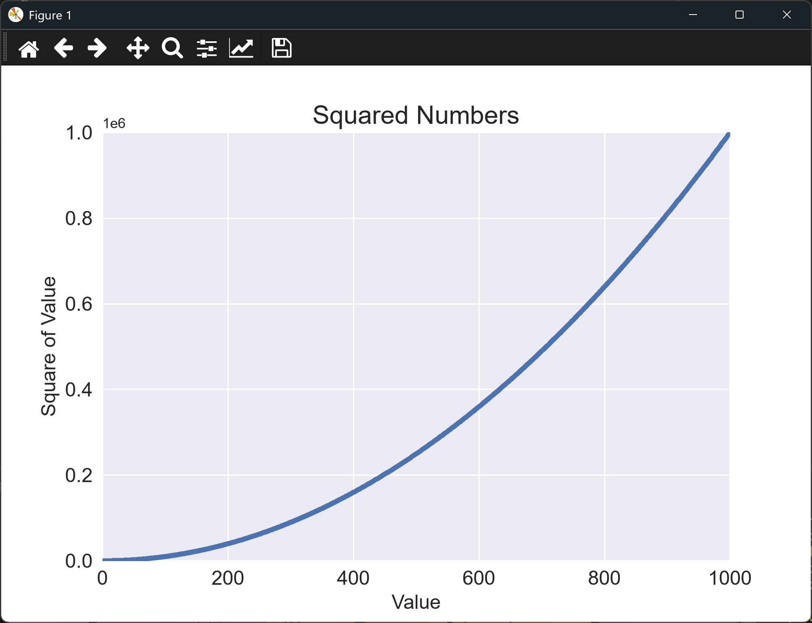

# Adding More Data to a Scatter Graph

## Introduction

Five points are enough to show the idea, but not enough to show the shape of the data. This
lesson increases the number of points to 1,000, which makes the curve of the squares
clear. With that many points, the markers have to be smaller, and the axes need limits so
the chart shows the full range.

---

## The Code

```python
"""Lesson 1.8 - Adding More Data to a Scatter Graph"""

import matplotlib.pyplot as plt

# Increase the size of the data lists
numbers = list(range(1, 1001))
squares = [x ** 2 for x in numbers]

plt.style.use("seaborn-v0_8")
fig, ax = plt.subplots()

ax.scatter(numbers, squares, s=10)
ax.set_title("Squared Numbers", fontsize = 18)
ax.set_xlabel("Value", fontsize = 14)
ax.set_ylabel("Square of Value", fontsize = 14)
ax.tick_params(axis = "both", labelsize = 14)

# Set the ranges of the axes [min_x, max_x, min_y, max_y]
ax.axis([0, 1_000, 0, 1_000_000])

plt.show()
```

---

### Walking Through the Code

**More points.** `range(1, 1001)` produces the numbers 1 to 1,000, and the squares are
built from them.

**Smaller markers.** `s=10` keeps the 1,000 markers from overlapping into a solid band.

**Axis limits.** `ax.axis()` takes the minimum and maximum x and y values as one list.
These are set by hand so the chart shows exactly the range we want.

---

### Output

The window shows a curve of 1,000 small blue dots. The curve starts near the origin and
rises steeply toward the top right, where the y-values reach 1,000,000. The x-axis runs from
0 to 1,000, and the y-axis from 0 to 1,000,000.



---
