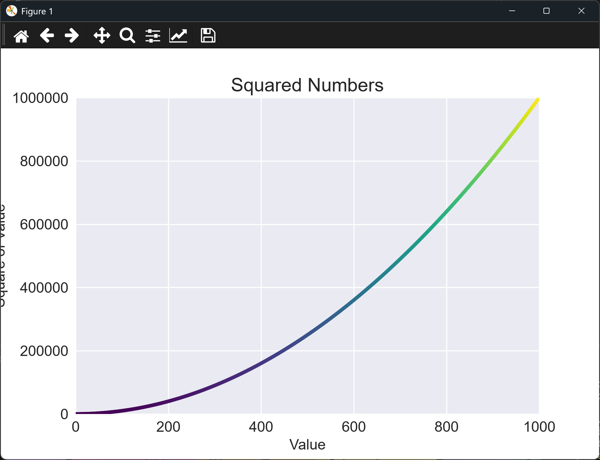

# Customizing a Scatter Graph

## Introduction

The chart from the last lesson shows the data clearly, but every point is the same color. A
color map solves that: each point's color depends on its value, so the eye can see the
change along the curve. This lesson also switches off scientific notation on the y-axis, so
large numbers print in full.

---

## The Code

```python
"""Lesson 1.9 - Customizing a Scatter Graph"""

import matplotlib.pyplot as plt

# Increase the size of the data lists
numbers = list(range(1, 1001))
squares = [x ** 2 for x in numbers]

plt.style.use("seaborn-v0_8")
fig, ax = plt.subplots()

# Set the point color using the color argument (can use name or RGB values tuple
#    where the values range from 0.0 to 1.0)
# ax.scatter(numbers, squares, s=10, color="red")
# ax.scatter(numbers, squares, s=10, color=(0.85, 0, 0))

# Or set a color map instead of a single color (which provides a kind of gradient of colors)
# c sets which axis values are reflected in the map, and cmap which map to use
# List of color maps: https://matplotlib.org/stable/tutorials/colors/colormaps.html
ax.scatter(numbers, squares, s=10, c=squares, cmap=plt.cm.viridis)

ax.set_title("Squared Numbers", fontsize = 18)
ax.set_xlabel("Value", fontsize = 14)
ax.set_ylabel("Square of Value", fontsize = 14)
ax.tick_params(axis = "both", labelsize = 14)
ax.axis([0, 1_000, 0, 1_000_000])

# Customize the tick labels
ax.ticklabel_format(style="plain")

plt.show()
```

---

### Walking Through the Code

**One color or many.** The two commented-out lines set a single color, either by name or
as an RGB tuple. The live line uses a color map instead.

**Color maps.** `c=squares` tells matplotlib to color each point by its y-value, and
`cmap=plt.cm.viridis` chooses the map. Viridis runs from dark purple for small values to
yellow for large ones.

**Plain tick labels.** `ax.ticklabel_format(style="plain")` stops large numbers printing in
scientific notation, so the y-axis reads as 1000000 rather than 1e6.

---

### Output

The points now run from dark purple near the origin to yellow at the top right. The axes
and labels match the last lesson, but the y-axis numbers are written out in full.



---
