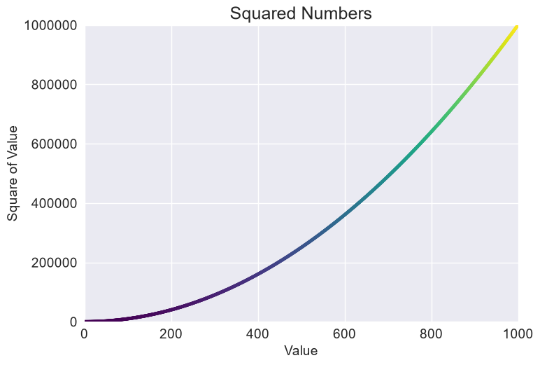

# Saving a Scatter Graph as an Image

## Introduction

Showing a chart in a window is useful while you're working, but often you need the chart as
a file, for a report, a presentation, or a website. Matplotlib can save any figure as an
image. This lesson takes the finished chart from the last lesson and saves it to disk.

---

## The Code

```python
"""Lesson 1.10 - Saving a Scatter Graph as an Image"""

import matplotlib.pyplot as plt
from relative_paths import get_path

numbers = list(range(1, 1001))
squares = [x ** 2 for x in numbers]

plt.style.use("seaborn-v0_8")
fig, ax = plt.subplots()

ax.scatter(numbers, squares, s=10, c=squares, cmap=plt.cm.viridis)
ax.set_title("Squared Numbers", fontsize = 18)
ax.set_xlabel("Value", fontsize = 14)
ax.set_ylabel("Square of Value", fontsize = 14)
ax.tick_params(axis = "both", labelsize = 14)
ax.axis([0, 1_000, 0, 1_000_000])
ax.ticklabel_format(style="plain")

# To save as an image, use plt.savefig() instead of plt.show()
plt.savefig(get_path("images/squares_graph.png"), bbox_inches="tight")
print("File saved...")
```

---

### Walking Through the Code

**Finding a path.** `get_path()` comes from `relative_paths.py`, in the same folder. It
returns the full path to a file in the folder of the scripts, so the image is saved
beside them whichever folder you run the script from.

**Saving instead of showing.** `plt.savefig()` writes the figure to the file. The script
doesn't call `plt.show()`, so no window opens. `bbox_inches="tight"` trims the blank
margin around the chart.

**Confirming the save.** The final `print()` tells you the script finished.

---

### Output

The terminal prints `File saved...`, and no window opens. The chart is written to
`images/squares_graph.png` in the `01-plots-pyplot` folder.



---
