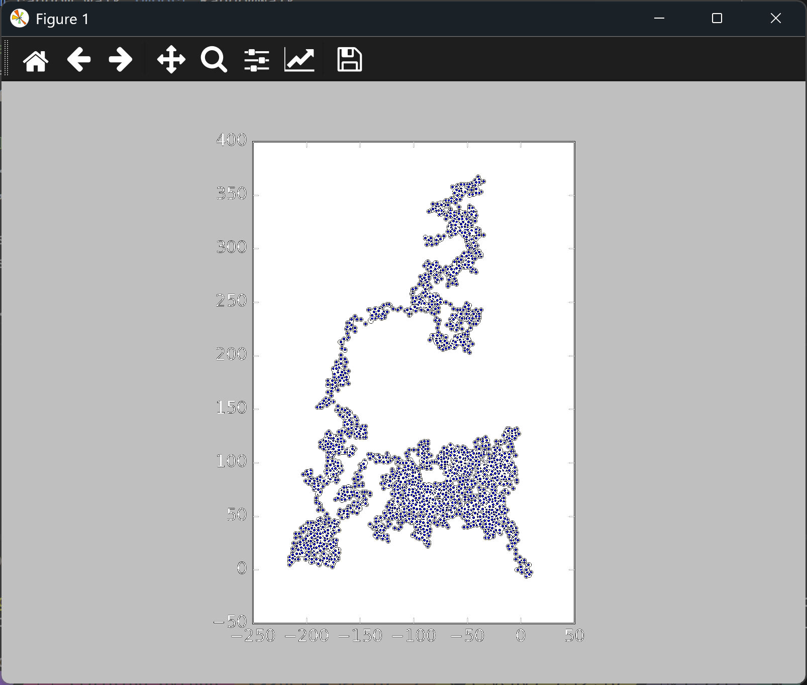

# Plotting a Random Walk

## Introduction

A random walk is a path built from many steps, where each step goes in a random direction
by a random distance. Random walks model many things in the real world, from pollen grains
drifting on the surface of water to the paths animals take while searching for food.

This lesson uses the `RandomWalk` class from `random_walk.py` to build a walk, then draws the
walk as a scatter graph. The class is in the same folder, so the script can import it.

---

## The Code

```python
"""Lesson 2.1 - Plotting a Random Walk"""

import matplotlib.pyplot as plt
from random_walk import RandomWalk

# Make random walk
rw = RandomWalk()
rw.fill_walk()

# Plot the points
plt.style.use("classic")
fig, ax = plt.subplots()

ax.scatter(rw.x_values, rw.y_values, s=5)
ax.set_aspect("equal")

plt.show()
```

---

### Walking Through the Code

**Making a walk.** `RandomWalk()` creates a walk with the default number of points, which is
5,000. It starts at the origin, (0, 0). `fill_walk()` then adds the random steps.

**Plotting the points.** `ax.scatter()` draws each point of the walk as a small dot. With
`s=5` the dots are small enough to show the shape of the path.

**Equal scaling.** `ax.set_aspect("equal")` gives the x-axis and y-axis the same scale, so
distances look the same in both directions. Without it, a walk that moved further
horizontally would look stretched.

---

### Output

The window shows a tangle of small dots, starting at the origin in the middle of the chart.
The path spreads out in every direction, with no particular shape, because each step is
random.



---
