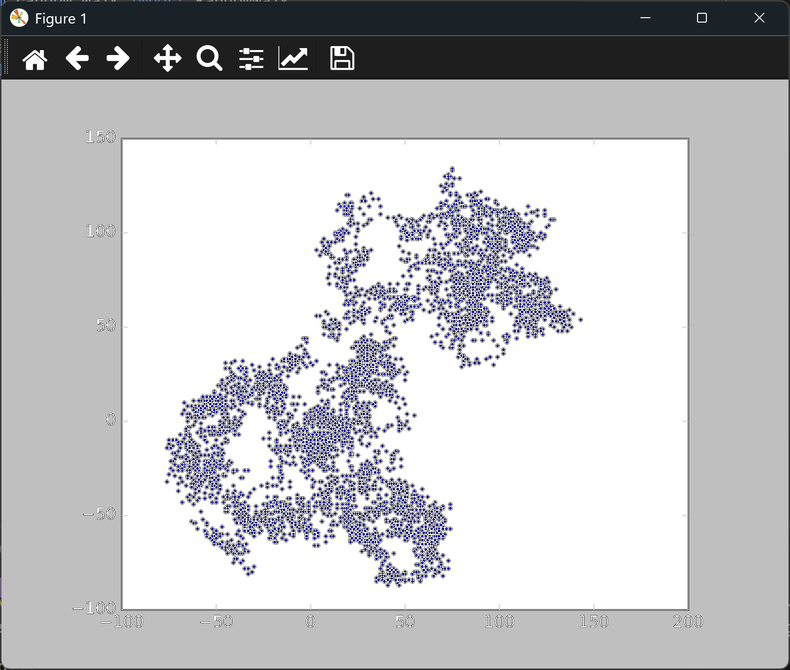

# Plotting a Random Walk Multiple Times

## Introduction

Each run of the last lesson made one walk. Because the steps are random, every walk looks
different, and seeing several of them is the best way to understand that. This lesson wraps the
plotting code in a loop, so you can keep making new walks until you decide to stop.

---

## The Code

```python
"""Lesson 2.2 - Plotting a Random Walk Multiple Times"""

import matplotlib.pyplot as plt
from random_walk import RandomWalk

# Make random walks until user decides to quit
while True:
    rw = RandomWalk()
    rw.fill_walk()

    plt.style.use("classic")
    fig, ax = plt.subplots()
    ax.scatter(rw.x_values, rw.y_values, s=5)
    ax.set_aspect("equal")

    plt.show()

    again = input("Make another walk? (y/n): ")
    if again and again.lower()[0] != "y":
        break
```

---

### Walking Through the Code

**The loop.** `while True` repeats the block until the `break` statement runs. Each pass
creates a new `RandomWalk`, so each chart is a different walk.

**Asking to continue.** `input()` shows the question and waits for an answer. The check
`again.lower()[0] != "y"` looks at the first letter of the answer, so `yes`, `Y`, and `y` all
continue. Pressing Enter without typing anything also continues, because an empty string is
false.

**Stopping.** Any other answer, such as `n`, runs `break` and ends the loop.

---

### Output

The first walk appears in a window. After you close the window, the terminal asks whether to
make another walk. Type `y` and press Enter, or just press Enter, to see another walk. Type `n`
to stop.

```
Make another walk? (y/n):
```



---
