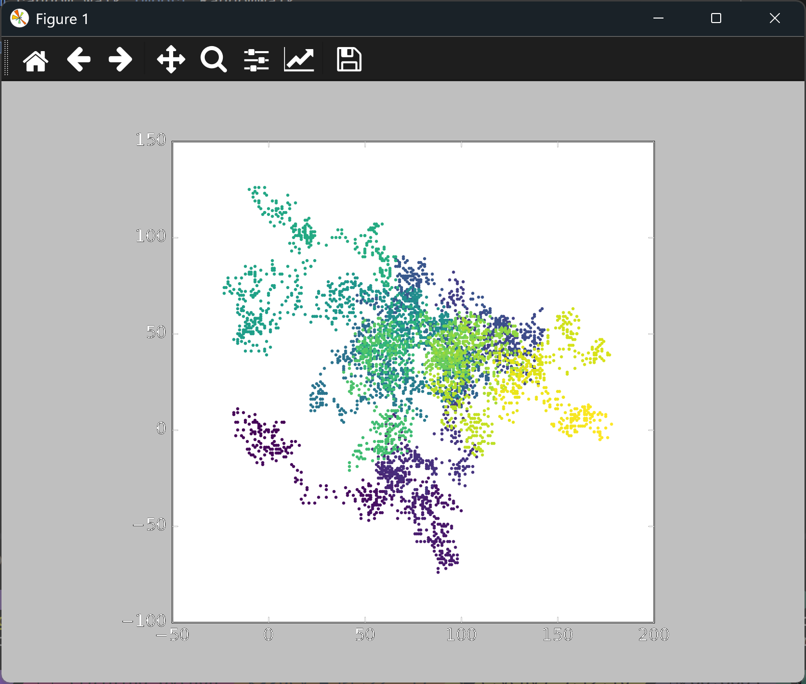

# Adding Style to a Random Walk

## Introduction

The walks so far were all one color, so the path's direction in time was hard to see. This
lesson colors each point by its position in the walk, using the viridis color map from the scatter
graph lessons. Points early in the walk are dark purple, and later points are yellow.

---

## The Code

```python
"""Lesson 2.3 - Adding Style to a Random Walk"""

import matplotlib.pyplot as plt
from random_walk import RandomWalk

while True:
    rw = RandomWalk()
    rw.fill_walk()

    plt.style.use("classic")
    fig, ax = plt.subplots()
    # Add style
    ax.scatter(rw.x_values, rw.y_values, s=5, c=range(rw.num_points),
               cmap=plt.cm.viridis, edgecolors="none")
    ax.set_aspect("equal")

    plt.show()

    again = input("Make another walk? (y/n): ")
    if again and again.lower()[0] != "y":
        break
```

---

### Walking Through the Code

**Coloring by position.** `c=range(rw.num_points)` gives every point a number, from 0 to 4,999.
Matplotlib maps those numbers onto the color map, so each point's color depends on how far along
the walk it is.

**The color map.** `cmap=plt.cm.viridis` chooses the map. Viridis is designed so that its colors
remain distinct when printed in black and white, and when viewed by people with color blindness.

**Removing the edges.** `edgecolors="none"` removes the outline around each dot, so the colors show
clearly.

---

### Output

The path is now a gradient. Dots near the origin are dark purple, and the dots at the end of the
walk are yellow. The direction in which the walk moved over time is easy to read from the colors.



---
