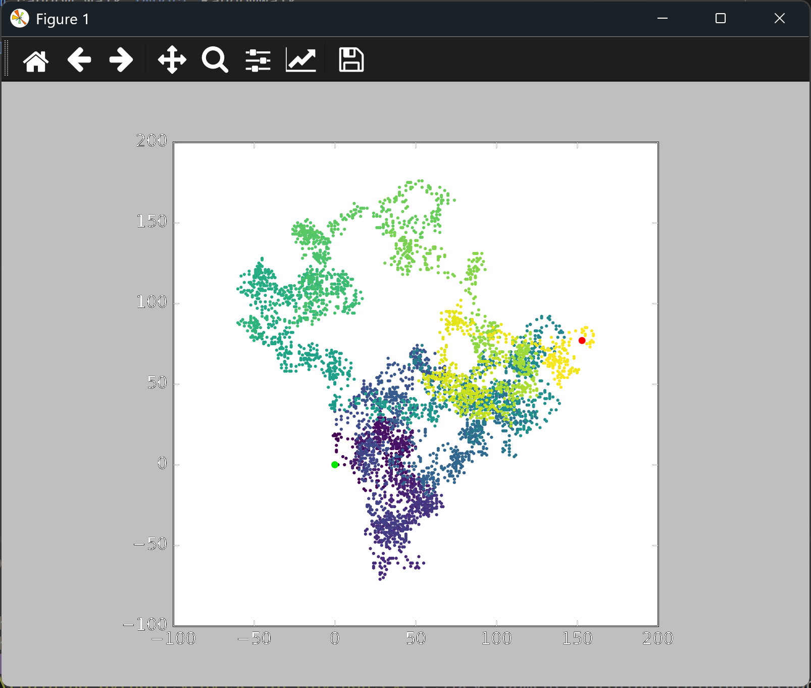

# Highlighting the First and Last Points

## Introduction

A colored path shows direction, but it still doesn't say where the walk began and where it ended.
This lesson marks the start in green and the end in red, so both are visible at a glance.

---

## The Code

```python
"""Lesson 2.4 - Highlighting the First and Last Points"""

import matplotlib.pyplot as plt
from random_walk import RandomWalk

while True:
    rw = RandomWalk()
    rw.fill_walk()

    plt.style.use("classic")
    fig, ax = plt.subplots()
    ax.scatter(rw.x_values, rw.y_values, s=5, c=range(rw.num_points),
               cmap=plt.cm.viridis, edgecolors="none")
    ax.set_aspect("equal")

    # Emphasize first and last points
    ax.scatter(0, 0, c=(0, .9, 0), edgecolors="none", s=25)
    ax.scatter(rw.x_values[-1], rw.y_values[-1], c="red", edgecolors="none", s=25)

    plt.show()

    again = input("Make another walk? (y/n): ")
    if again and again.lower()[0] != "y":
        break
```

---

### Walking Through the Code

**Plotting the path first.** The walk is drawn as before. The two highlights are drawn after it, so
they sit on top of the path.

**The start.** Every walk begins at (0, 0), so the green dot is always at the origin. The color
`(0, .9, 0)` is a tuple of red, green, and blue values between 0 and 1, which gives a bright green.

**The end.** `rw.x_values[-1]` and `rw.y_values[-1]` are the coordinates of the last point in the
walk. The red dot marks where the walk finished.

---

### Output

The path is still colored from purple to yellow, with a bright green dot at the origin and a red dot
at the end of the walk.

**Warning:** Running this lesson prints a warning. The script is still correct, and the chart still shows. The warning is about the green start dot, which passes its color as `c=(0, .9, 0)`. Matplotlib reads a single RGB tuple given to `c` as a list of values to map to colors, so it warns that the `color` keyword is the right choice for a single color.

```
...04_random_walk_start_end.py:17: UserWarning: *c* argument looks like a single numeric RGB or RGBA sequence, which should be avoided as value-mapping will have precedence in case its length matches with *x* & *y*. Please use the *color* keyword-argument or provide a 2D array with a single row if you intend to specify the same RGB or RGBA value for all points.
```

To remove the warning, change `c=(0, .9, 0)` to `color=(0, .9, 0)` in the green-dot line. The rest of the lesson stays the same.



---
