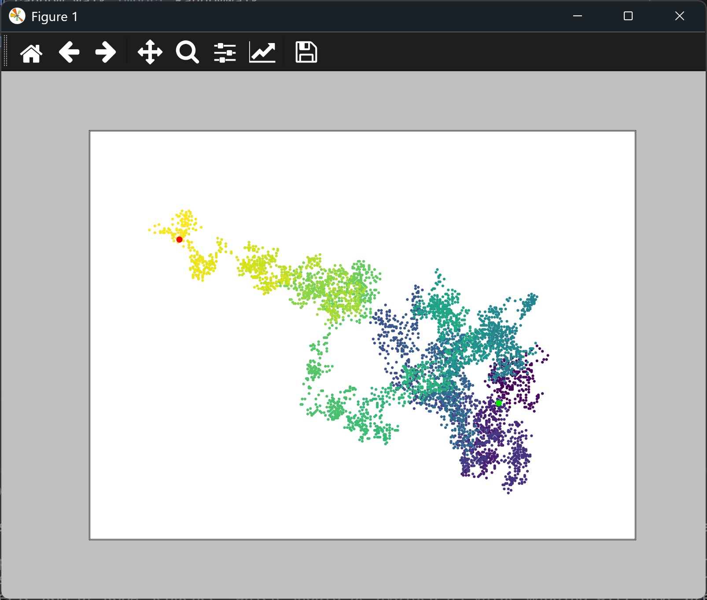

# Removing Axes from a Random Walk

## Introduction

The axes and their numbers take up space, but they add nothing to a random walk. The path is the
picture, so this lesson hides the axes. The start and end markers are drawn as before.

---

## The Code

```python
"""Lesson 2.5 - Removing Axes from a Random Walk"""

import matplotlib.pyplot as plt
from random_walk import RandomWalk

while True:
    rw = RandomWalk()
    rw.fill_walk()

    plt.style.use("classic")
    fig, ax = plt.subplots()
    ax.scatter(rw.x_values, rw.y_values, s=5, c=range(rw.num_points),
               cmap=plt.cm.viridis, edgecolors="none")
    ax.set_aspect("equal")
    ax.scatter(0, 0, color=(0, .9, 0), edgecolors="none", s=25)
    ax.scatter(rw.x_values[-1], rw.y_values[-1], c="red", edgecolors="none", s=25)

    # Remove axes from plot
    ax.get_xaxis().set_visible(False)
    ax.get_yaxis().set_visible(False)

    plt.show()

    again = input("Make another walk? (y/n): ")
    if again and again.lower()[0] != "y":
        break
```

---

### Walking Through the Code

**Hiding the axes.** `ax.get_xaxis()` and `ax.get_yaxis()` return the two axis objects. Calling
`set_visible(False)` on each hides the axis line, its ticks, and its numbers.

**Everything else is the same.** The color map, the start and end markers, and the loop are all
as in the previous lesson. Only the axes have been removed.

---

### Output

The window shows the colored walk on a plain background, with no numbers or tick marks. The green
dot marks the origin, and the red dot marks the end.



---
