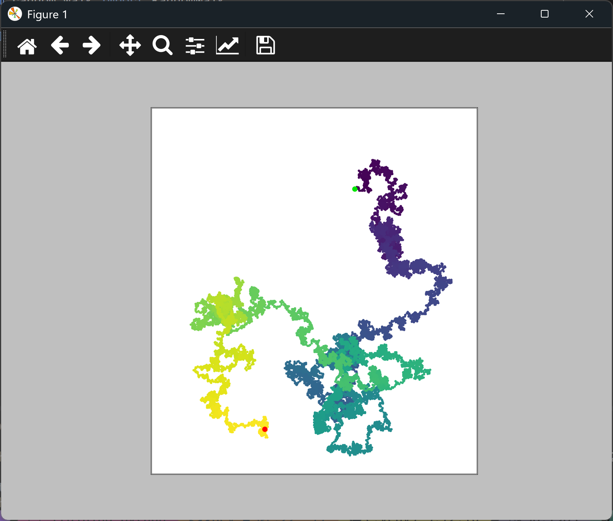

# Adding More Data Points to a Random Walk

## Introduction

With 5,000 points, a walk is a clear path, but a longer walk shows more of its structure. This
lesson increases the walk to 20,000 points, and everything else from the last lesson stays the
same.

---

## The Code

```python
"""Lesson 2.6 - Adding More Data Points to a Random Walk"""

import matplotlib.pyplot as plt
from random_walk import RandomWalk

while True:
    # Increase the number of data points
    rw = RandomWalk(20_000)
    rw.fill_walk()

    plt.style.use("classic")
    fig, ax = plt.subplots()
    ax.scatter(rw.x_values, rw.y_values, s=5, c=range(rw.num_points),
               cmap=plt.cm.viridis, edgecolors="none")
    ax.set_aspect("equal")
    ax.scatter(0, 0, color=(0, .9, 0), edgecolors="none", s=25)
    ax.scatter(rw.x_values[-1], rw.y_values[-1], c="red", edgecolors="none", s=25)
    ax.get_xaxis().set_visible(False)
    ax.get_yaxis().set_visible(False)

    plt.show()

    again = input("Make another walk? (y/n): ")
    if again and again.lower()[0] != "y":
        break
```

---

### Walking Through the Code

**The number of points.** `RandomWalk(20_000)` passes the number of points to the class. The
underscore in `20_000` is only for readability, and Python reads it as 20000.

**Longer walks.** The walk takes four times as many steps to build, so it takes a little longer to
appear. The path also fills more of the window, and the colors are packed more closely together.

---

### Output

The walk is denser than before. Its shape is clearer, because the longer path covers more of the
window and the colors form a smoother gradient.



---
