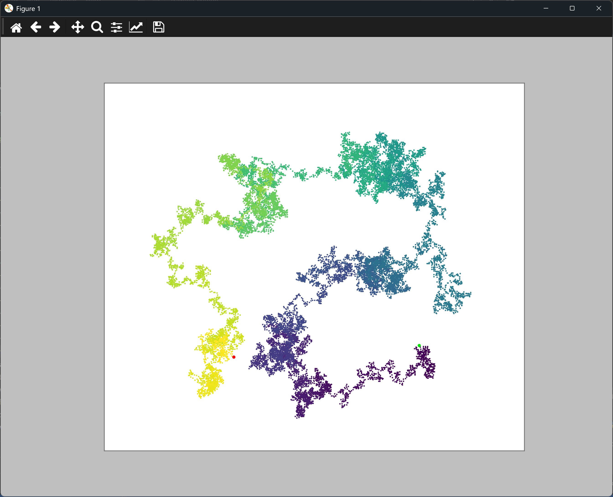

# Setting the Figure Size

## Introduction

The walk now has 20,000 points, and the window is a little cramped for it. Matplotlib lets you set
the size of the figure, so this lesson makes the figure much larger, to show the walk in more
detail.

---

## The Code

```python
"""Lesson 2.7 - Setting the Figure Size"""

import matplotlib.pyplot as plt
from random_walk import RandomWalk

while True:
    rw = RandomWalk(20_000)
    rw.fill_walk()

    plt.style.use("classic")
    # Pass the figsize argument to set the figure dimensions
    fig, ax = plt.subplots(figsize=(24, 13))
    ax.scatter(rw.x_values, rw.y_values, s=5, c=range(rw.num_points),
               cmap=plt.cm.viridis, edgecolors="none")
    ax.set_aspect("equal")
    ax.scatter(0, 0, color=(0, .9, 0), edgecolors="none", s=25)
    ax.scatter(rw.x_values[-1], rw.y_values[-1], c="red", edgecolors="none", s=25)
    ax.get_xaxis().set_visible(False)
    ax.get_yaxis().set_visible(False)

    plt.show()

    again = input("Make another walk? (y/n): ")
    if again and again.lower()[0] != "y":
        break
```

---

### Walking Through the Code

**Figure size.** `plt.subplots(figsize=(24, 13))` sets the width and height of the figure in inches.
Matplotlib draws at 100 dots per inch by default, so this makes a figure of about 2400 by 1300 pixels.

**Fitting the screen.** A figure that large is bigger than most screens, so the window may be cut
off at the edges. Reduce the numbers if that happens, for example to `(12, 6.5)`, which keeps the
same proportions at half the size.

---

### Output

The window is much larger than before, and the walk fills it. The path is shown in more detail, with
the colors and the start and end markers all clearly visible.



---
