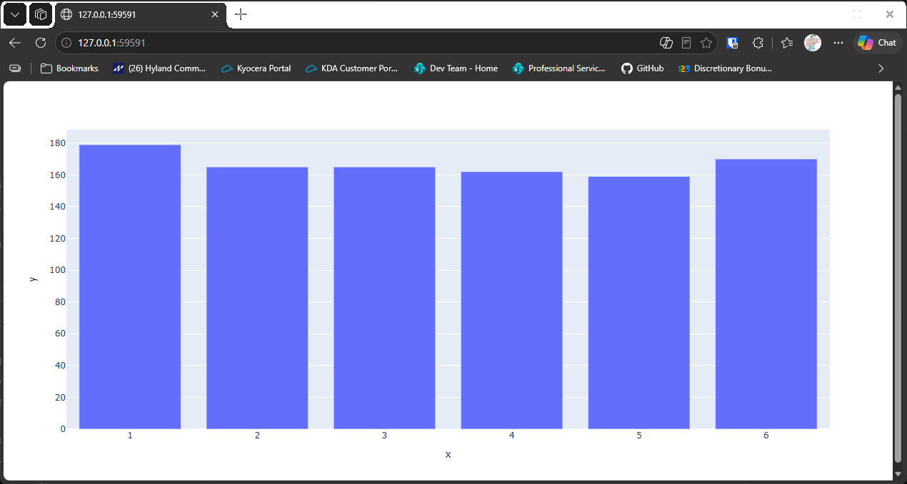

# Visualizing Results with Plotly Express

## Introduction

The list of counts from the last lesson is still just numbers. A bar chart shows them at a glance.
This lesson uses **Plotly Express**, the simplest interface to the plotly library, to draw the
bars and open the chart in your web browser.

Plotly charts are interactive: you can hover over a bar to see its value, and zoom and pan the
chart. Install plotly before running this lesson:

```bash
python -m pip install plotly
```

To make sure you have a version that works with this lesson, upgrade plotly to 5.13 or later:

```bash
python -m pip install --upgrade plotly
```

---

## The Code

```python
"""Lesson 3.3 - Visualizing Results with Plotly Express"""

from die import Die
import plotly.express as px
# python -m pip install pandas
# python -m pip install plotly
# python -m pip install --upgrade plotly      (make sure this one is v5.13 or higher due to a bug in 5.12)

die = Die()

results = []
for _ in range(1000):
    results.append(die.roll())

frequencies = []
poss_results = range(1, die.num_sides + 1)
for n in poss_results:
    frequency = results.count(n)
    frequencies.append(frequency)

# Visualize results

# With Plotly Express, we can easily generate a bar graph with x and y values
fig = px.bar(x=poss_results, y=frequencies)
# The graph launches in your default browser
fig.show()
```

---

### Walking Through the Code

**Importing Plotly Express.** `import plotly.express as px` gives the short name `px`. Plotly
Express is built on top of plotly, and it creates a complete chart from a few lines.

**Making the bar chart.** `px.bar(x=poss_results, y=frequencies)` makes one bar for each face,
with the face along the horizontal axis and its count as the height.

**Showing the chart.** `fig.show()` opens the chart in your default web browser. Nothing is shown
in the terminal.

---

### Output

Your browser opens a page with a bar chart of six bars. Plotly Express labels the axes with the
default names `x` and `y`, and the chart has no title yet. The next lesson replaces those.



---
