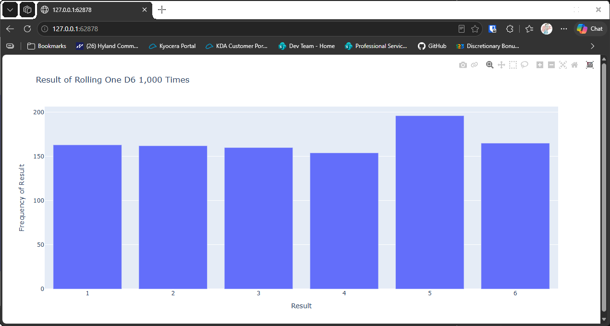

# Improving the Graph

## Introduction

The chart from the last lesson works, but it has no title and its axes are labeled with the default
`x` and `y`. This lesson adds a title and clearer labels, so the chart explains itself.

---

## The Code

```python
"""Lesson 3.4 - Improving the Graph"""

from die import Die
import plotly.express as px
# python -m pip install plotly

die = Die()

results = []
for _ in range(1000):
    results.append(die.roll())

frequencies = []
poss_results = range(1, die.num_sides + 1)
for n in poss_results:
    frequency = results.count(n)
    frequencies.append(frequency)

# Visualize results

# Create title and labels and add them to the plot
title = "Result of Rolling One D6 1,000 Times"
labels = {"x": "Result", "y": "Frequency of Result"}
fig = px.bar(x=poss_results, y=frequencies, title=title, labels=labels)

fig.show()
```

---

### Walking Through the Code

**The title.** `title` is a plain string. Passing it to `px.bar()` puts it at the top of the chart.

**The labels.** `labels` is a dictionary. Its keys are the axes, `"x"` and `"y"`, and its values
are the text to show. Plotly Express uses the labels in place of the default names.

**The rest is unchanged.** The data and the way it's counted are the same as the last lesson.

---

### Output

The browser page now has the title "Result of Rolling One D6 1,000 Times". The horizontal axis is
labeled "Result", and the vertical axis is labeled "Frequency of Result".



---
