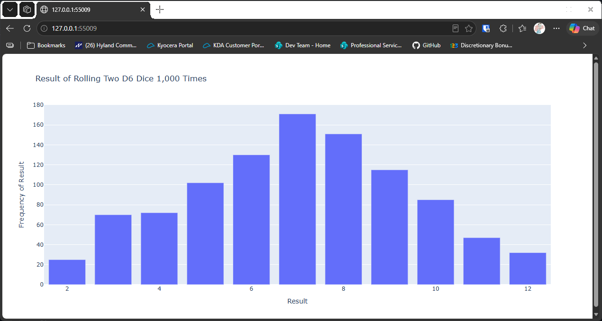

# Rolling Two D6 Dice

## Introduction

So far we've rolled one die. This lesson rolls two six-sided dice and adds their results together,
then charts how often each total appears. The totals run from 2 to 12, and they don't occur equally
often. Seven is the most common total, because it can be made in more ways than any other.

---

## The Code

```python
"""Lesson 3.5 - Rolling Two D6 Dice"""

import plotly.express as px
from die import Die

# Create two dice
dice = [Die(), Die()]

# Make some rolls and store in a list
results = []
for _ in range(1000):
    result = dice[0].roll() + dice[1].roll()
    results.append(result)

# Analyze the results
frequencies = []
max_result = sum([d.num_sides for d in dice])
poss_results = range(2, max_result + 1)

for n in poss_results:
    frequency = results.count(n)
    frequencies.append(frequency)

# Visualize results

# Create title and labels and add them to the plot
title = "Result of Rolling Two D6 Dice 1,000 Times"
labels = {"x": "Result", "y": "Frequency of Result"}
fig = px.bar(x=poss_results, y=frequencies, title=title, labels=labels)

fig.show()
```

---

### Walking Through the Code

**Two dice.** `dice = [Die(), Die()]` creates a list of two six-sided dice.

**Adding the rolls.** On each pass, `dice[0].roll() + dice[1].roll()` rolls both dice and adds the
results. The total is the result of one roll of the pair.

**The range of totals.** `max_result` adds the sides of both dice, giving 12. The lowest total is 2,
so `poss_results` runs from 2 to 12.

**The chart.** The chart is built the same way as the single-die chart, with bars for each total.

---

### Output

The browser shows a bar chart of the totals from 2 to 12. The bars form a hill, with 7 at the top
and 2 and 12 at the low ends.



---
