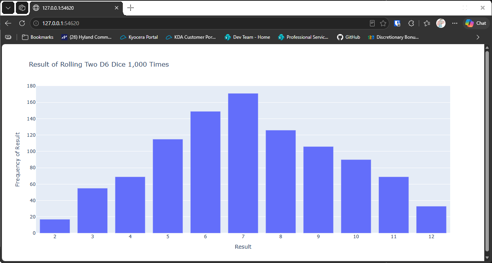

# Customizing the Graph

## Introduction

The two-dice chart is correct, but plotly chooses its own tick spacing, which can skip some totals.
Here, every total should have its own label. This lesson sets the spacing of the horizontal axis
so every column is labeled.

---

## The Code

```python
"""Lesson 3.6 - Customizing the Graph"""

import plotly.express as px
from die import Die

# Create two dice
dice = [Die(), Die()]

# Make some rolls and store in a list
results = []
for _ in range(1000):
    result = dice[0].roll() + dice[1].roll()
    results.append(result)

# Analyze the results
frequencies = []
max_result = sum([d.num_sides for d in dice])
poss_results = range(2, max_result + 1)

for n in poss_results:
    frequency = results.count(n)
    frequencies.append(frequency)

# Visualize results
title = "Result of Rolling Two D6 Dice 1,000 Times"
labels = {"x": "Result", "y": "Frequency of Result"}
fig = px.bar(x=poss_results, y=frequencies, title=title, labels=labels)

# Set the 'ticks' property to ensure every column is labeled
fig.update_layout(xaxis_dtick=1)

fig.show()
```

---

### Walking Through the Code

**Changing the chart after it's made.** `px.bar()` returns a figure, and `update_layout()` changes
its settings. Here the figure is changed after it's created, rather than when it's created.

**Tick spacing.** `xaxis_dtick=1` sets the distance between labels on the horizontal axis to one
unit. Each total from 2 to 12 now gets its own label.

---

### Output

The chart looks the same as before, but every total from 2 to 12 is labeled along the bottom.



---
