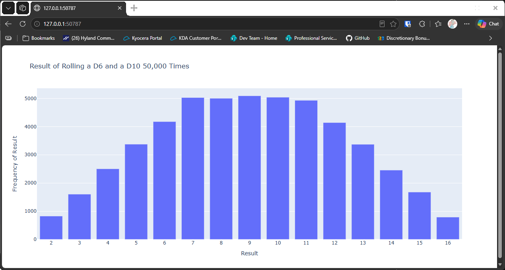

# Rolling D6 and D10

## Introduction

This lesson changes one thing from the last: the second die has ten sides instead of six. It also
rolls 50,000 times, so the shape of the results is clearer. Two dice with different numbers of
sides don't produce the same pattern as two identical dice, and the chart makes that visible.

---

## The Code

```python
"""Lesson 3.7 - Rolling D6 and D10"""

import plotly.express as px
from die import Die

# Create two dice (this time different numbers of sides)
dice = [Die(), Die(10)]

# Make some rolls and store in a list
results = []
for _ in range(50_000):
    result = dice[0].roll() + dice[1].roll()
    results.append(result)

# Analyze the results
frequencies = []
max_result = sum([d.num_sides for d in dice])
poss_results = range(2, max_result + 1)

for n in poss_results:
    frequency = results.count(n)
    frequencies.append(frequency)

# Visualize results
title = "Result of Rolling a D6 and a D10 50,000 Times"
labels = {"x": "Result", "y": "Frequency of Result"}
fig = px.bar(x=poss_results, y=frequencies, title=title, labels=labels)
fig.update_layout(xaxis_dtick=1)

fig.show()
```

---

### Walking Through the Code

**A different die.** `Die(10)` is a ten-sided die. The first die is still a standard six-sided die.

**The range of totals.** The lowest total is 2, and the highest is 6 + 10 = 16. `max_result` finds the
16, so the chart covers 2 to 16.

**Many rolls.** With 50,000 rolls, the counts are large enough for the shape to be clear.

---

### Output

The chart shows totals from 2 to 16. Rather than a hill with a single peak, the top is flat, from about
7 to 11.



---
