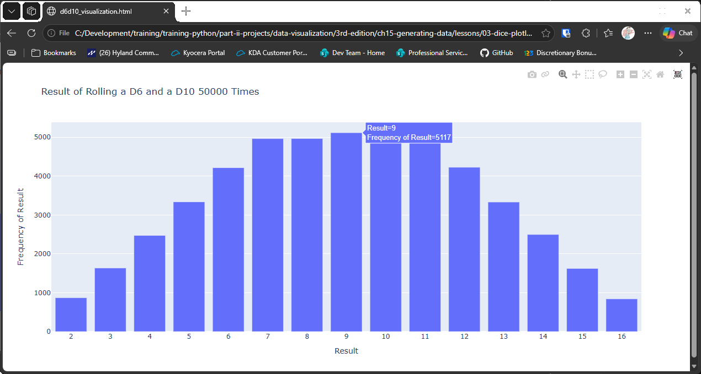

# Saving Results to a File

## Introduction

A chart in a browser is useful for looking at, but you can't send it to someone or put it in a report
as it stands. Plotly can save a figure as an HTML file, which opens in any browser. This lesson saves
the D6 and D10 chart from the last lesson to a file, using the `relative_paths` helper so the file
lands in the right folder.

The helper `relative_paths.py` is in the same folder as the lessons, and it's imported in the script.

---

## The Code

```python
"""Lesson 3.8 - Saving Results to a File"""

import plotly.express as px
from die import Die
from relative_paths import get_path

# Create two dice (this time different numbers of sides)
dice = [Die(), Die(10)]

# Make some rolls and store in a list
results = []
for _ in range(50_000):
    result = dice[0].roll() + dice[1].roll()
    results.append(result)

# Analyze the results
frequencies = []
max_result = sum([d.num_sides for d in dice])
poss_results = range(2, max_result + 1)

for n in poss_results:
    frequency = results.count(n)
    frequencies.append(frequency)

# Visualize results
title = "Result of Rolling a D6 and a D10 50000 Times"
labels = {"x": "Result", "y": "Frequency of Result"}
fig = px.bar(x=poss_results, y=frequencies, title=title, labels=labels)
fig.update_layout(xaxis_dtick=1)

# Create a filename with extension "html"
filename = "d6d10_visualization.html"
# Get a path (just like we did in the ch 10)
filepath = get_path(filename, "files")

# Write the figure to an HTML file
# Note: If you have plotly 5.12 installed, this will generate an encoding error.
#       Upgrade to at least 5.13
fig.write_html(filepath)
print(f"Stored file: {filepath}")
```

---

### Walking Through the Code

**The filename.** `filename` ends in `.html`, so the file opens in a browser.

**The path.** `get_path(filename, "files")` returns the full path to `files/d6d10_visualization.html`
in the folder beside the script. It works from any working directory, because it's based on the
script's own location.

**Saving.** `fig.write_html(filepath)` writes the whole interactive chart to the file. Open the file in
any browser to see it.

**Confirming.** The final `print()` shows where the file was saved.

**The `files` folder.** The folder must already exist beside the script. If it doesn't, the save fails.

**Plotly version.** Older versions of plotly, 5.12 and earlier, can give an encoding error when saving.
Use 5.13 or later.

---

### Output

The terminal prints the path to the saved file, which ends in `files/d6d10_visualization.html`. No
browser window opens. Open the file in your browser to see the same chart as the last lesson.



---
