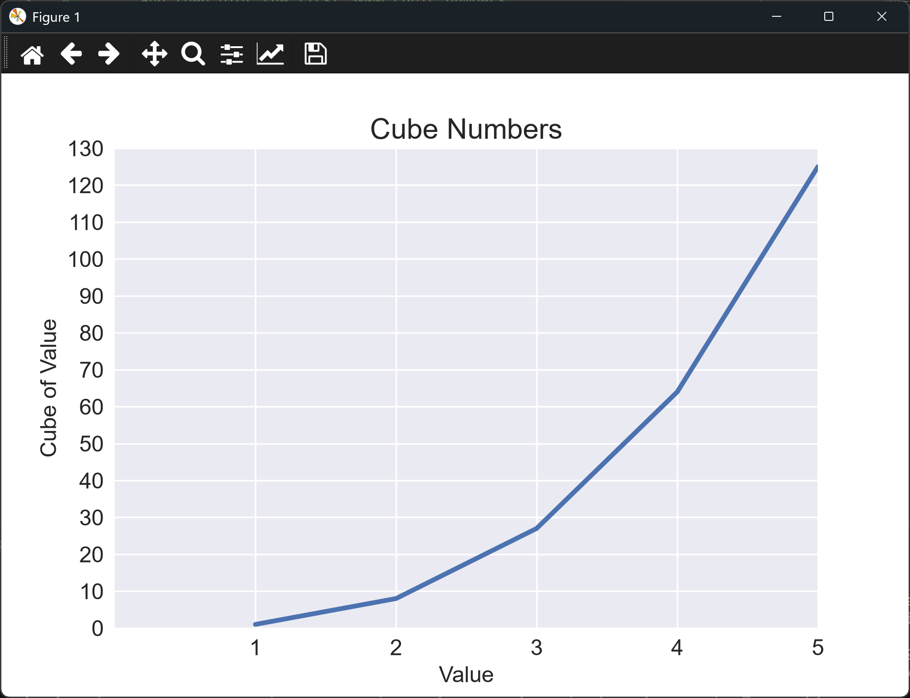
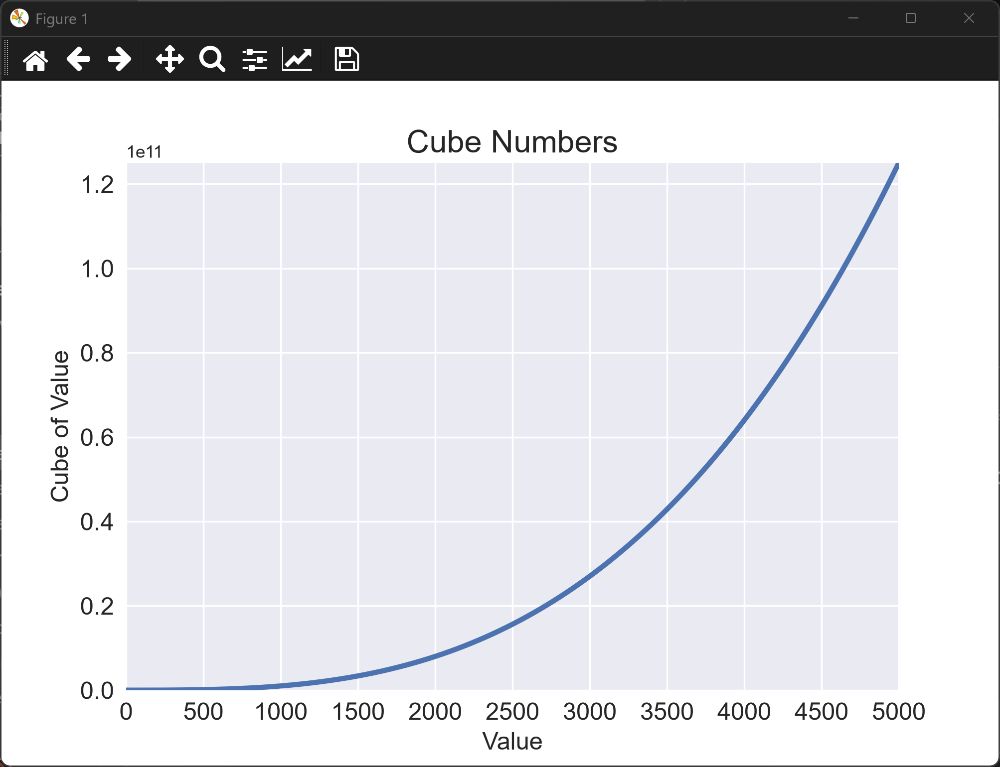
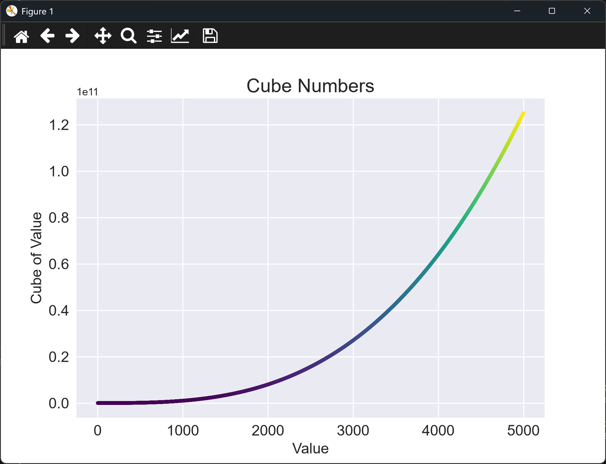
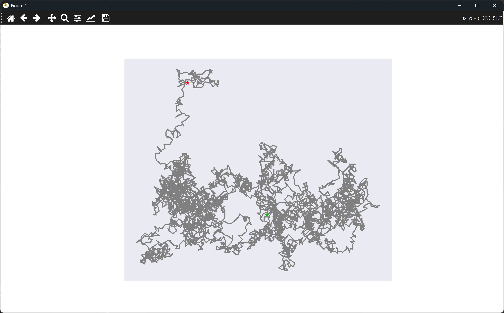
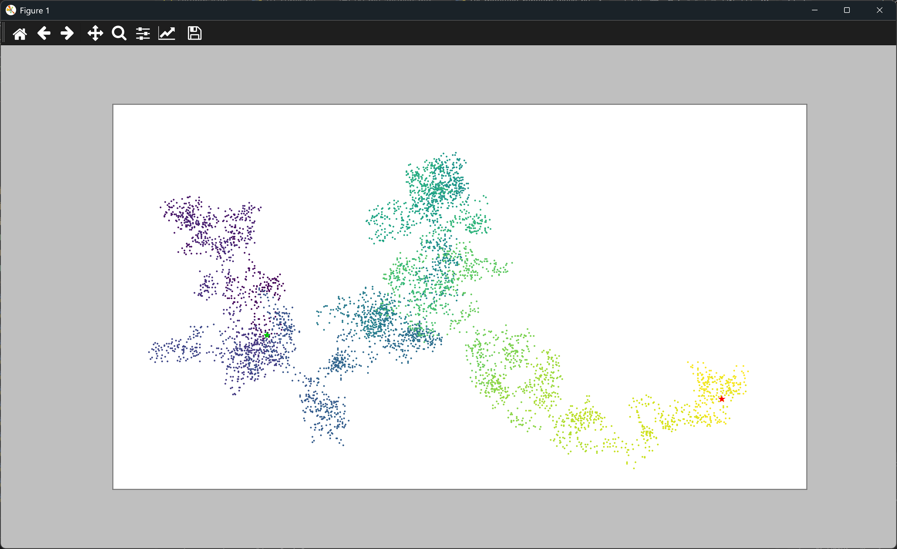
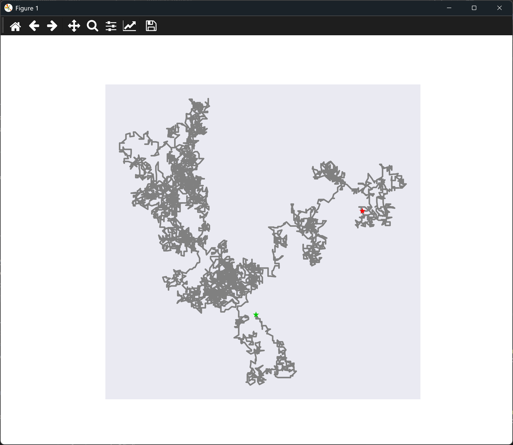
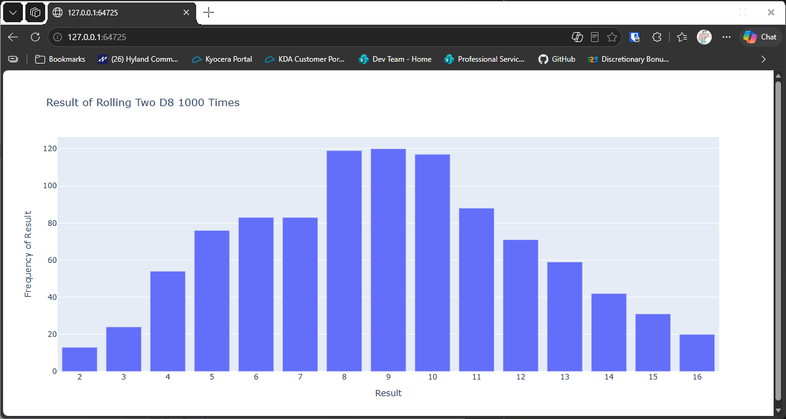
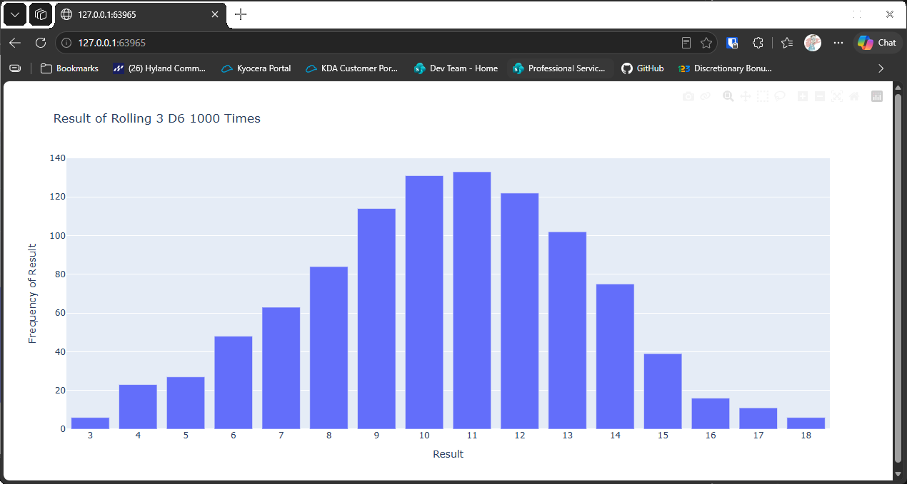
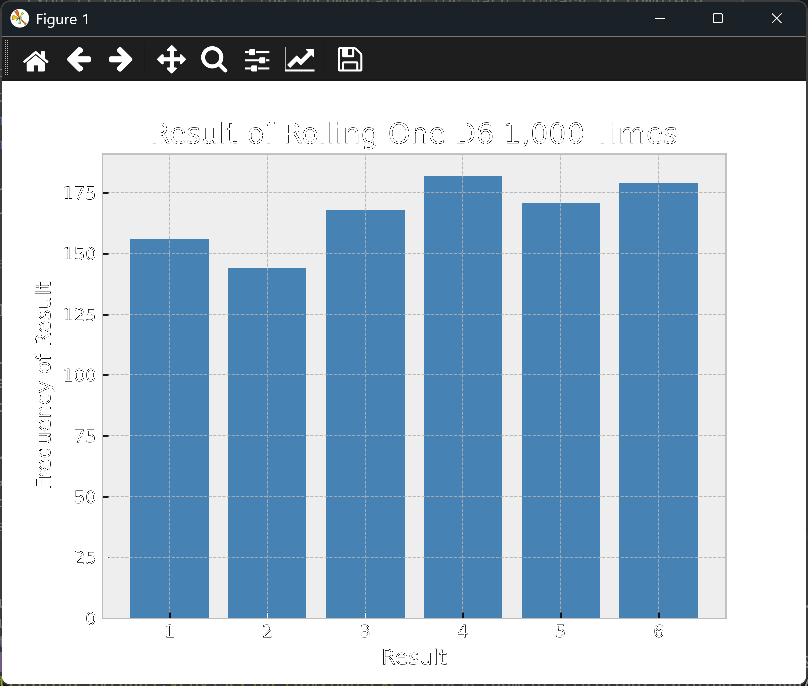
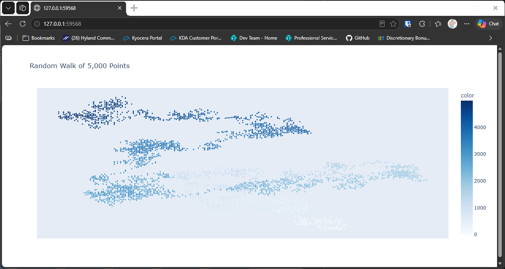

# Chapter 15 Try-it-Yourself Assignments and Solutions

## Introduction

Here are my solutions for the chapter 15 try-it-yourself exercises, from the 3rd edition of the
textbook.

The 3rd edition builds the random walk class up in stages, with a `fill_walk()` method that takes a
maximum step size. It also uses plotly Express for the dice charts. This file covers those answers.

Each exercise shows the full assignment, then a solution with the code and its output. The solution
code is hidden until you expand it, so you can attempt each assignment first.

Matplotlib charts open in a window, and you close the window to move on. Plotly charts open in your
web browser.

---

### Assignment 15.1 - Cubes

Cubes: A number raised to the third power is a cube. Plot the first five cubic numbers, and then plot
the first 5000 cubic numbers.

Solution:

<details>
<summary>Spoiler Code</summary>
<br>

```python
import math
import matplotlib.pyplot as plt
from matplotlib.ticker import MaxNLocator, MultipleLocator


def plot_cubes(max_x: int) -> None:
    """Plot the cubes of the numbers 1 to max_x"""
    numbers = list(range(1, max_x + 1))
    cubes = [x ** 3 for x in numbers]

    plt.style.use("seaborn-v0_8")
    _, ax = plt.subplots()

    ax.set_title("Cube Numbers", fontsize = 18)
    ax.set_xlabel("Value", fontsize = 14)
    ax.set_ylabel("Cube of Value", fontsize = 14)
    ax.tick_params(axis = "both", labelsize = 14)

    ax.plot(numbers, cubes, linewidth = 3)

    if max_x <= 10:
        # With only a few points, label each whole number on the x-axis,
        # and step the y-axis up in tens
        top = 10 * math.ceil(max_x ** 3 / 10)
        ax.axis([0, max_x, 0, top])
        ax.set_xticks(numbers)
        ax.yaxis.set_major_locator(MultipleLocator(10))
    else:
        # With many points, show whole numbers on the x-axis and let matplotlib choose the rest
        ax.axis([0, max_x, 0, max_x ** 3])
        ax.xaxis.set_major_locator(MaxNLocator(integer = True))

    plt.show()


plot_cubes(5)
plot_cubes(5000)
```

</details>
<br>

<details>
<summary>Output</summary>

The script opens two windows, one after the other. The first shows the first five cubes, and the second shows the first 5,000.





</details>
<br>

---

### Assignment 15.2 - Colored Cubes

Colored Cubes: Apply a colormap to your cubes plot.

Solution:

<details>
<summary>Spoiler Code</summary>
<br>

```python
import matplotlib.pyplot as plt

print("Try-it-Yourself:")
print("Assignment 15.2")

numbers = list(range(1, 5001))
cubes = [x ** 3 for x in numbers]

plt.style.use("seaborn-v0_8")
fig, ax = plt.subplots()

ax.set_title("Cube Numbers", fontsize = 18)
ax.set_xlabel("Value", fontsize = 14)
ax.set_ylabel("Cube of Value", fontsize = 14)
ax.tick_params(axis = "both", labelsize = 14)

ax.scatter(numbers, cubes, s=10, c=cubes, cmap=plt.cm.viridis)
plt.show()
```

</details>
<br>

<details>
<summary>Output</summary>

```
Try-it-Yourself:
Assignment 15.2
```



</details>
<br>

---

### Assignment 15.3 - Molecular Motion

Molecular Motion: Modify rw_visual.py by replacing ax.scatter() with ax.plot(). To simulate the path of
a pollen grain on the surface of a drop of water, pass in the rw.x_values and rw.y_values, and include
a linewidth argument. Use 5000 instead of 50,000 points.

Solution, which uses [random_walk.py](./random_walk.py):

<details>
<summary>Spoiler Code</summary>
<br>

```python
import matplotlib.pyplot as plt
from random_walk import RandomWalk

print("Try-it-Yourself:")
print("Assignment 15.3")

while True:
    rw = RandomWalk()
    rw.fill_walk()

    plt.style.use("seaborn-v0_8")
    fig, ax = plt.subplots(figsize=(16, 9))
    ax.plot(rw.x_values, rw.y_values, color="gray", linewidth=2, zorder=1)
    ax.set_aspect("equal")
    # I added the zorder argument to make sure the dots appear on top of the line ploy
    ax.scatter(0, 0, color=(0, .8, 0), edgecolors="none", s=75, zorder=2, marker="*")
    ax.scatter(rw.x_values[-1], rw.y_values[-1], c="red", edgecolors="none",
               s=75, zorder=3, marker="*")
    ax.get_xaxis().set_visible(False)
    ax.get_yaxis().set_visible(False)

    plt.show()

    again = input("Make another walk? (y/n): ")
    if again and again.lower()[0] != "y":
        break
```

</details>
<br>

<details>
<summary>Output</summary>

```
Try-it-Yourself:
Assignment 15.3
```



</details>
<br>

---

### Assignment 15.4 - Modified Random Walks

Modified Random Walks: In the RandomWalk class, x_step and y_step are generated from the same set of
conditions. The direction is chosen randomly from the list [1, -1] and the distance from the list
[0, 1, 2, 3, 4]. Modify the values in these lists to see what happens to the overall shape of your
walks. Try a longer list of choices for the distance, such as 0 through 8, or remove the -1 from the x
or y direction list.

Solution, which uses [random_walk.py](./random_walk.py):

<details>
<summary>Spoiler Code</summary>
<br>

```python
import matplotlib.pyplot as plt
from random_walk import RandomWalk

print("Try-it-Yourself:")
print("Assignment 15.4")

while True:
    rw = RandomWalk()
    # Changing distance list
    rw.fill_walk(max_dist=10)

    plt.style.use("classic")
    fig, ax = plt.subplots(figsize=(16, 9))
    ax.scatter(rw.x_values, rw.y_values, s=5, c=range(rw.num_points),
               cmap=plt.cm.viridis, edgecolors="none")
    ax.set_aspect("equal")
    ax.scatter(0, 0, color=(0, .8, 0), edgecolors="none", s=100, marker="*")
    ax.scatter(rw.x_values[-1], rw.y_values[-1], c="red", edgecolors="none", s=100, marker="*")
    ax.get_xaxis().set_visible(False)
    ax.get_yaxis().set_visible(False)

    plt.show()

    again = input("Make another walk? (y/n): ")
    if again and again.lower()[0] != "y":
        break
```

</details>
<br>

<details>
<summary>Output</summary>

```
Try-it-Yourself:
Assignment 15.4

Make another walk? (y/n):
```



</details>
<br>

---

### Assignment 15.5 - Refactoring

Refactoring: The fill_walk() method is lengthy. Create a new method called get_step() to determine the
direction and distance for each step, and then calculate the step. You should end up with two calls to
get_step() in fill_walk():

`x_step = self.get_step()`

`y_step = self.get_step()`

---

This refactoring should reduce the size of fill_walk() and make the method easier to read and
understand.

The refactored class is in [refactored_random_walk.py](./refactored_random_walk.py).

Solution, which uses [refactored_random_walk.py](./refactored_random_walk.py):

<details>
<summary>Spoiler Code</summary>
<br>

```python
import matplotlib.pyplot as plt
from refactored_random_walk import RandomWalk

print("Try-it-Yourself:")
print("Assignment 15.5")

while True:
    rw = RandomWalk()
    rw.fill_walk()

    plt.style.use("seaborn-v0_8")
    fig, ax = plt.subplots(figsize=(16, 9))
    ax.plot(rw.x_values, rw.y_values, color="gray", linewidth=2, zorder=1)
    ax.set_aspect("equal")
    # I added the zorder argument to make sure the dots appear on top of the line ploy
    ax.scatter(0, 0, color=(0, .8, 0), edgecolors="none", s=75, zorder=2, marker="*")
    ax.scatter(rw.x_values[-1], rw.y_values[-1], c="red", edgecolors="none", s=75,
               zorder=3, marker="*")
    ax.get_xaxis().set_visible(False)
    ax.get_yaxis().set_visible(False)

    plt.show()

    again = input("Make another walk? (y/n): ")
    if again and again.lower()[0] != "y":
        break
```

</details>
<br>

<details>
<summary>Output</summary>

```
Try-it-Yourself:
Assignment 15.5

Make another walk? (y/n):
```



</details>
<br>

---

### Assignment 15.6 - Two D8s

Two D8s: Create a simulation showing what happens when you roll two eight-sided dice 1000 times. Try to
picture what you think the visualization will look like before you run the simulation; then see if your
intuition was correct. Gradually increase the number of rolls until you start to see the limits of your
system's capabilities.

Solution, which uses [die.py](./die.py):

<details>
<summary>Spoiler Code</summary>
<br>

```python
import plotly.express as px
from die import Die

print("Try-it-Yourself:")
print("Assignment 15.6")

# Create two dice
dice = [Die(8) for _ in range(2)]
rolls = 1_000

# Make some rolls and store in a list
results = []
for _ in range(rolls):
    result = dice[0].roll() + dice[1].roll()
    results.append(result)

# Analyze the results
frequencies = []
max_result = sum([d.num_sides for d in dice])
poss_results = range(2, max_result + 1)

for n in poss_results:
    frequency = results.count(n)
    frequencies.append(frequency)

# Visualize results
title = f"Result of Rolling Two D8 {rolls} Times"
labels = {"x": "Result", "y": "Frequency of Result"}
fig = px.bar(x=poss_results, y=frequencies, title=title, labels=labels)
fig.update_layout(xaxis_dtick=1)

fig.show()
```

</details>
<br>

<details>
<summary>Output</summary>

```
Try-it-Yourself:
Assignment 15.6
```



</details>
<br>

---

### Assignment 15.7 - Three Dice

Three Dice: When you roll three D6 dice, the smallest number you can roll is 3 and the largest number is
18. Create a visualization that shows what happens when you roll three D6 dice.

Solution, which uses [die.py](./die.py):

<details>
<summary>Spoiler Code</summary>
<br>

```python
import plotly.express as px
from die import Die

print("Try-it-Yourself:")
print("Assignment 15.7")

num_dice = 3
rolls = 1_000

# Create three dice
dice = [Die() for _ in range(num_dice)]

# Make some rolls and store in a list
results = []
for _ in range(rolls):
    result = sum([d.roll() for d in dice])
    results.append(result)

# Analyze the results
frequencies = []
max_result = sum([d.num_sides for d in dice])
poss_results = range(num_dice, max_result + 1)

for n in poss_results:
    frequency = results.count(n)
    frequencies.append(frequency)

# Visualize results
title = f"Result of Rolling {len(dice)} D{dice[0].num_sides} {rolls} Times"
labels = {"x": "Result", "y": "Frequency of Result"}
fig = px.bar(x=poss_results, y=frequencies, title=title, labels=labels)
fig.update_layout(xaxis_dtick=1)

fig.show()
```

</details>
<br>

<details>
<summary>Output</summary>

```
Try-it-Yourself:
Assignment 15.7
```


</details>
<br>

---

### Assignment 15.8 - Multiplication

Multiplication: When you roll two dice, you usually add the two numbers together to get the result. Create
a visualization that shows what happens if you multiply these numbers instead.

Solution, which uses [die.py](./die.py):

<details>
<summary>Spoiler Code</summary>
<br>

```python
import plotly.express as px
from numpy import prod
from die import Die

print("Try-it-Yourself:")
print("Assignment 15.8")

settings = {
    "num_dice": 2,
    "rolls": 1000,
    "sides": 6
}

# Create two dice
dice = [Die(settings["sides"]) for _ in range(settings["num_dice"])]

# Make some rolls and store in a list
results = []
for _ in range(settings["rolls"]):
    result = prod([d.roll() for d in dice])
    results.append(result)

# Analyze the results
max_result = prod([d.num_sides for d in dice])
poss_results = range(1, max_result + 1)
frequencies = []
for n in poss_results:
    frequency = results.count(n)
    frequencies.append(frequency)

# Visualize results
title = f"Result of Rolling {len(dice)} D{dice[0].num_sides} {settings['rolls']} Times"
labels = {"x": "Result", "y": "Frequency of Result"}
fig = px.bar(x=poss_results, y=frequencies, title=title, labels=labels)
fig.update_layout(xaxis_dtick=1)

fig.show()
```

</details>
<br>

<details>
<summary>Output</summary>

```
Try-it-Yourself:
Assignment 15.8
```



</details>
<br>

---

### Assignment 15.9 - Die Comprehensions

Die Comprehensions: For clarity, the listings in this section use the long form of for loops. If you're
comfortable using list comprehensions, try writing a comprehension for one or both of the loops in each of
these programs.

Solution, which uses [die.py](./die.py) and the comprehension form of each loop:

<details>
<summary>Spoiler Code</summary>
<br>

```python
import plotly.express as px
from die import Die
from numpy import prod

print("Try-it-Yourself:")
print("Assignment 15.9")

settings = {
    "num_dice": 2,
    "rolls": 1000,
    "sides": 6
}

# Create two dice
dice = [Die(settings["sides"]) for _ in range(settings["num_dice"])]

# Make some rolls and store in a list
results = [prod([d.roll() for d in dice]) for _ in range(settings["rolls"])]

# Analyze the results
max_result = prod([d.num_sides for d in dice])
poss_results = range(1, max_result + 1)
frequencies = [results.count(n) for n in poss_results]

# Visualize results
title = f"Result of Rolling {len(dice)} D{dice[0].num_sides} {settings['rolls']} Times"
labels = {"x": "Result", "y": "Frequency of Result"}
fig = px.bar(x=poss_results, y=frequencies, title=title, labels=labels)
fig.update_layout(xaxis_dtick=1)

fig.show()
```

</details>
<br>

<details>
<summary>Output</summary>

```
Try-it-Yourself:
Assignment 15.9
```


</details>
<br>

---

### Assignment 15.10 - Practicing with Both Libraries

Practicing with Both Libraries: Try using Matplotlib to make a die-rolling visualization, and use Plotly to
make the visualization for a random walk. (You'll need to consult the documentation for each library to
complete this exercise.)

Solution, which uses [die.py](./die.py) and [random_walk.py](./random_walk.py):

<details>
<summary>Spoiler Code</summary>
<br>

```python
import matplotlib.pyplot as plt
import plotly.express as px
from die import Die
from random_walk import RandomWalk

print("Try-it-Yourself:")
print("Assignment 15.10")

# Part 1: Matplotlib - roll one D6 1,000 times and plot how often each face came up
die = Die()
rolls = 1_000

results = [die.roll() for _ in range(rolls)]
faces = list(range(1, die.num_sides + 1))
frequencies = [results.count(face) for face in faces]

plt.style.use("bmh")
fig, ax = plt.subplots()
ax.bar(faces, frequencies, color="steelblue")
ax.set_title(f"Result of Rolling One D6 {rolls:,} Times", fontsize=16)
ax.set_xlabel("Result", fontsize=12)
ax.set_ylabel("Frequency of Result", fontsize=12)
ax.set_xticks(faces)
plt.show()

# Part 2: Plotly - plot a random walk, coloring each point by when it was reached
rw = RandomWalk()
rw.fill_walk()

walk = px.scatter(
    x=rw.x_values,
    y=rw.y_values,
    color=list(range(rw.num_points)),
    color_continuous_scale="Blues",
    title=f"Random Walk of {rw.num_points:,} Points",
)
walk.update_traces(marker_size=3)
walk.update_layout(xaxis_visible=False, yaxis_visible=False)
walk.show()
```

</details>
<br>

<details>
<summary>Output</summary>

The matplotlib part opens a bar chart of one die rolled 1,000 times:



The plotly part opens in your browser, showing a random walk of 5,000 points with no axes:



</details>
<br>

---
