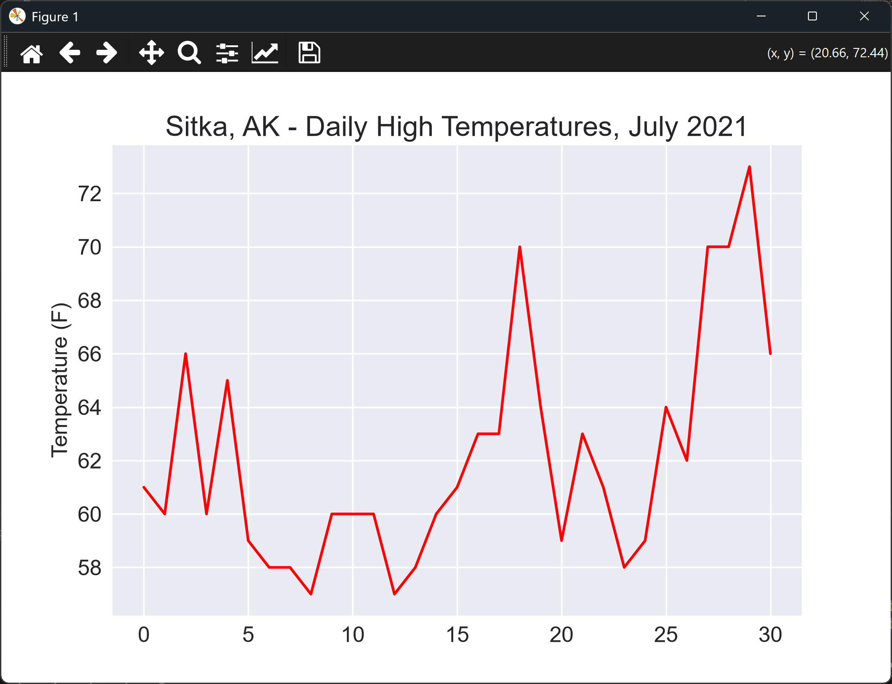

# Plotting the Temperatures

## Introduction

We now have a list of daily highs, so we can plot them. This lesson draws the highs as a line graph with
matplotlib. The x-axis is left unlabeled for now, because the dates come in the next lesson.

---

## The Code

```python
"""Lesson 1.4 - Plotting the Temperatures"""

from pathlib import Path
import csv
import matplotlib.pyplot as plt
from relative_paths import get_path

folder = "data"
file_name = "sitka_weather_07-2021_simple.csv"
file_path = get_path(file_name, folder)

csv_file = Path(file_path)
lines = csv_file.read_text(encoding="UTF-8").splitlines()

reader = csv.reader(lines)
header_row = next(reader)

# for index, column in enumerate(header_row):
#     print(index, column)

# Now that we know that the high temperature (TMAX) is in index 4,
#     we can extract the data from the CSV rows
highs = [int(row[4]) for row in reader]

# Plot the high temperatures
plt.style.use("seaborn-v0_8")
fig, ax = plt.subplots()
ax.plot(highs, color="red")

# Format the plot
ax.set_title("Sitka, AK - Daily High Temperatures, July 2021", fontsize=18)
# We're intentionally leaving the x-axis labels blank, because later we'll fill in the dates
ax.set_xlabel("", fontsize=14)
ax.set_ylabel("Temperature (F)", fontsize=14)
ax.tick_params(labelsize=14)

plt.show()
```

---

### Walking Through the Code

**Extracting the highs.** This is the same code as the last lesson, which pulls the high from column 4 of
each row.

**Plotting.** `ax.plot(highs, color="red")` draws one point for each day, in order. Because only one list
is given, the x-axis shows the position of each day in the list, from 0 to 30.

**Formatting.** The title, the y-axis label, and the tick sizes are set. The x-axis label is left blank on
purpose.

---

### Output

The window shows a red line of the daily highs for July 2021. The title reads "Sitka, AK - Daily High
Temperatures, July 2021", and the x-axis shows day positions rather than dates.



---
