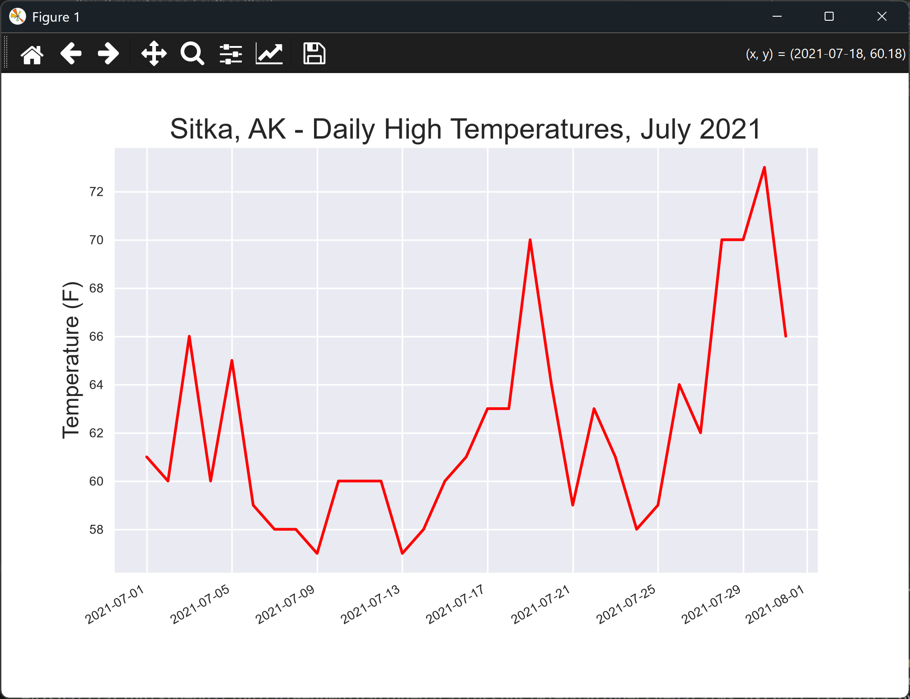

# Adding Dates

## Introduction

The chart from the last lesson showed day positions, not dates. This lesson parses each date string into
a `datetime` object and uses those dates as the x-axis, so the chart shows the real days.

---

## The Code

```python
"""Lesson 1.5 - Adding Dates"""

from pathlib import Path
import csv
# Add this to parse strings to dates
from datetime import datetime
import matplotlib.pyplot as plt
from relative_paths import get_path

folder = "data"
file_name = "sitka_weather_07-2021_simple.csv"
file_path = get_path(file_name, folder)

csv_file = Path(file_path)
lines = csv_file.read_text(encoding="UTF-8").splitlines()

reader = csv.reader(lines)
header_row = next(reader)

# Get the high temperatures and dates
highs, dates = [], []
# Note: Sometimes a vanilla loop is better than a super-complicated comprehension
for row in reader:
    highs.append(int(row[4]))
    # We'll use the strptime() function to parse date strings based on a specified format
    dates.append(datetime.strptime(row[2], "%Y-%m-%d"))

# Here's the complicated comprehension
# highs, dates = zip(*[(int(row[4]), datetime.strptime(row[2], "%Y-%m-%d")) for row in reader])

# The following tokens are available for date/time format strings
# Token |             Meaning
# -------------------------------------------------
#   %A    Weekday name, such as Monday
#   %B    Month name, such as January
#   %m    Month, as a number (01 to 12)
#   %d    Day of the month, as a number (01 to 31)
#   %Y    Four-digit year, such as 2019
#   %y    Two-digit year, such as 19
#   %H    Hour, in 24-hour format (00 to 23)
#   %I    Hour, in 12-hour format (01 to 12)
#   %p    AM or PM %M Minutes (00 to 59)
#   %S    Seconds (00 to 61)
# -------------------------------------------------

# Plot the high temperatures
plt.style.use("seaborn-v0_8")
fig, ax = plt.subplots()

# Add dates as the x-axis
ax.plot(dates, highs, color="red")

# Format the plot
ax.set_title("Sitka, AK - Daily High Temperatures, July 2021", fontsize=18)
ax.set_xlabel("", fontsize=8)
ax.set_ylabel("Temperature (F)", fontsize=14)
ax.tick_params(labelsize=8)

# Add date formatting
fig.autofmt_xdate()

plt.show()
```

---

### Walking Through the Code

**Two lists.** `highs` and `dates` are built together in one loop. Each row adds one temperature and one
date, so the two lists stay in step.

**Parsing dates.** `datetime.strptime()` turns text such as `2021-07-01` into a date object. The format
string `"%Y-%m-%d"` describes the layout of the text. The comment block lists the other format tokens.

**Using dates on the x-axis.** `ax.plot(dates, highs)` uses the dates as the horizontal positions, so the
axis now shows real days.

**Tidying the labels.** `fig.autofmt_xdate()` tilts the date labels, so they don't overlap.

---

### Output

The window shows the same red line as before, but the x-axis now shows dates through July 2021, with the
labels tilted.



---
