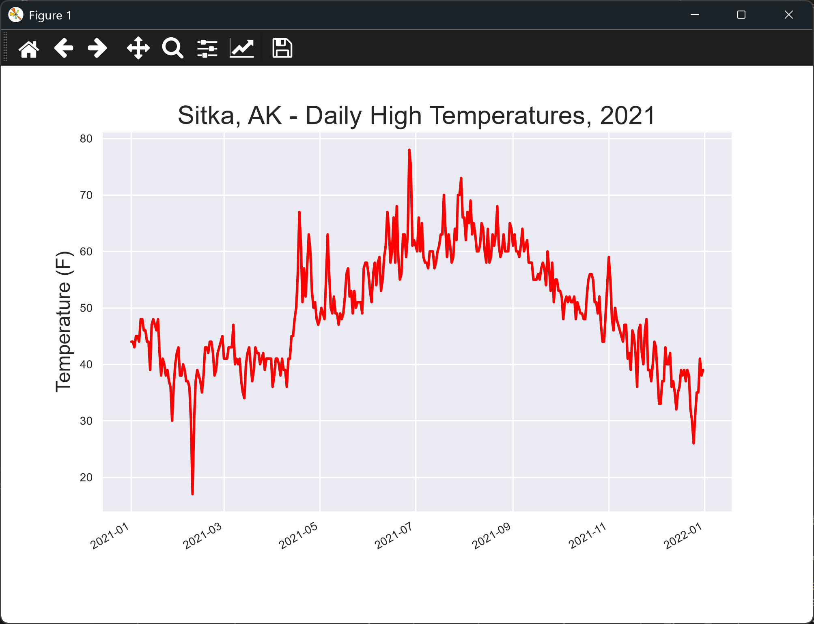

# Longer Timeline

## Introduction

July is only one month of data. The folder also has a file with a full year of 2021 weather for Sitka.
This lesson switches to that file. The code stays the same, so this lesson shows how far a few small
changes can take a script.

---

## The Code

```python
"""Lesson 1.6 - Longer Timeline"""

from pathlib import Path
import csv
from datetime import datetime
import matplotlib.pyplot as plt
from relative_paths import get_path

folder = "data"
# Switch to the full year CSV
file_name = "sitka_weather_2021_simple.csv"
file_path = get_path(file_name, folder)

csv_file = Path(file_path)
lines = csv_file.read_text(encoding="UTF-8").splitlines()

reader = csv.reader(lines)
header_row = next(reader)

highs, dates = [], []
for row in reader:
    highs.append(int(row[4]))
    dates.append(datetime.strptime(row[2], "%Y-%m-%d"))

# Plot the temperatures
plt.style.use("seaborn-v0_8")
fig, ax = plt.subplots()

# Add dates as the x-axis
ax.plot(dates, highs, color="red")

# Format the plot
ax.set_title("Sitka, AK - Daily High Temperatures, 2021", fontsize=18)
ax.set_xlabel("", fontsize=8)
ax.set_ylabel("Temperature (F)", fontsize=14)
ax.tick_params(labelsize=8)

# Add date formatting
fig.autofmt_xdate()

plt.show()
```

---

### Walking Through the Code

**Changing the file.** Only the file name is different from the last lesson. The `sitka_weather_2021_simple.csv`
file holds the whole of 2021, rather than July alone.

**Everything else is the same.** The loop, the date parsing, and the formatting all work unchanged on the
longer file.

---

### Output

The window shows a red line of Sitka's daily highs across the whole of 2021. The title now reads
"Sitka, AK - Daily High Temperatures, 2021", and the dates run from January to December.



---
