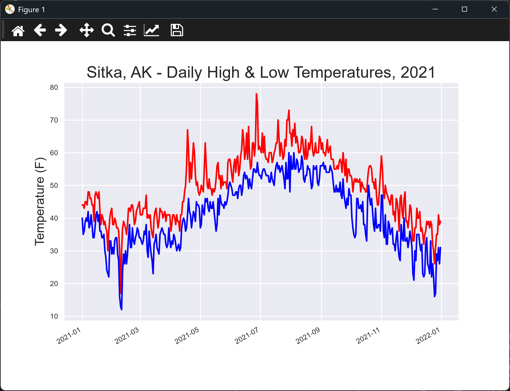

# Highs and Lows

## Introduction

A single line of highs only tells part of the story. This lesson reads the lows as well and plots both
lines on the same chart, so you can see the daily range.

---

## The Code

```python
"""Lesson 1.7 - Highs and Lows"""

from pathlib import Path
import csv
from datetime import datetime
import matplotlib.pyplot as plt
from relative_paths import get_path

folder = "data"
file_name = "sitka_weather_2021_simple.csv"
file_path = get_path(file_name, folder)

csv_file = Path(file_path)
lines = csv_file.read_text(encoding="UTF-8").splitlines()

reader = csv.reader(lines)
header_row = next(reader)

dates, highs, lows = [], [], []
for row in reader:
    # Note: We're not accounting for dates where a high or low temp might be missing
    highs.append(int(row[4]))
    lows.append(int(row[5]))
    dates.append(datetime.strptime(row[2], "%Y-%m-%d"))

# Plot the temperatures
plt.style.use("seaborn-v0_8")
fig, ax = plt.subplots()

# Add plots for both high and low temperatures
ax.plot(dates, highs, color="red")
ax.plot(dates, lows, color="blue")

# Format the plot
ax.set_title("Sitka, AK - Daily High & Low Temperatures, 2021", fontsize=18)
ax.set_xlabel("", fontsize=8)
ax.set_ylabel("Temperature (F)", fontsize=14)
ax.tick_params(labelsize=8)

# Add date formatting
fig.autofmt_xdate()

plt.show()
```

---

### Walking Through the Code

**Reading two columns.** The high is in column 4, and the low is in column 5. Both are read in the same
loop as the dates.

**Two lines.** `ax.plot()` is called twice, once for the highs in red and once for the lows in blue.

**The caveat.** The loop assumes every row has values. A row with a missing temperature would stop the
script, which the next lessons deal with.

---

### Output

The window shows a red line of daily highs and a blue line of daily lows for 2021. The blue line should sit below the red one, since a day's low is normally cooler than its high.



---
