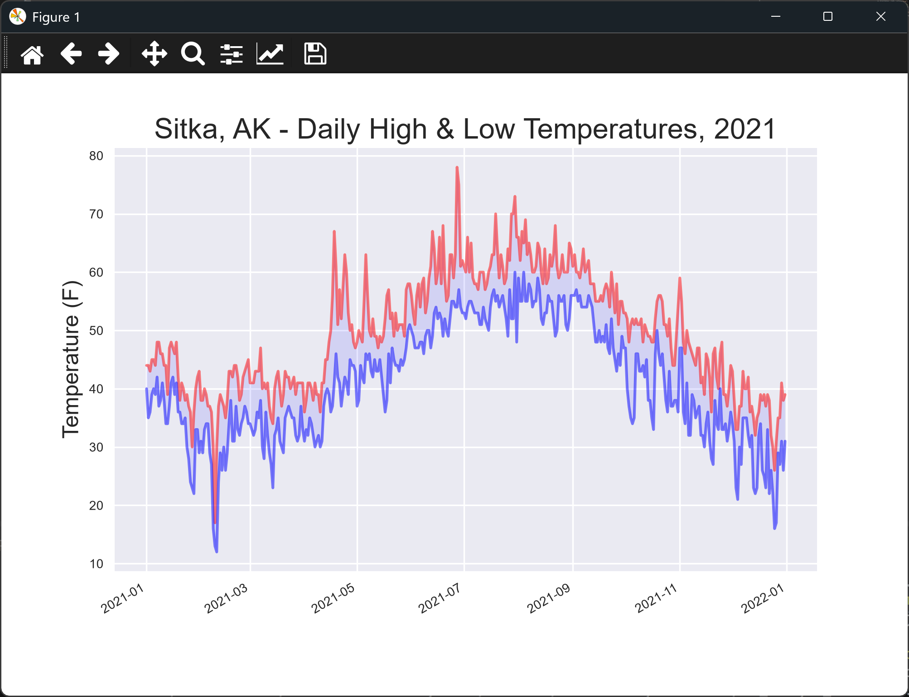

# Sitka Highs and Lows

## Introduction

The last lesson drew the highs and lows as two plain lines. Here the area between them is shaded, which
makes the daily range easier to see. This is the Sitka chart in its finished form for the first part of
the chapter.

---

## The Code

```python
"""Lesson 1.8 - Sitka Highs and Lows"""

from pathlib import Path
import csv
from datetime import datetime
import matplotlib.pyplot as plt
from relative_paths import get_path

folder = "data"
file_name = "sitka_weather_2021_simple.csv"
file_path = get_path(file_name, folder)

csv_file = Path(file_path)
lines = csv_file.read_text(encoding="UTF-8").splitlines()

reader = csv.reader(lines)
header_row = next(reader)

dates, highs, lows = [], [], []
for row in reader:
    highs.append(int(row[4]))
    lows.append(int(row[5]))
    dates.append(datetime.strptime(row[2], "%Y-%m-%d"))

# Create the plot
plt.style.use("seaborn-v0_8")
fig, ax = plt.subplots()

# Add plots for both high and low temperatures (alpha is opacity)
ax.plot(dates, highs, color="red", alpha=0.5)
ax.plot(dates, lows, color="blue", alpha=0.5)

# Add shading between the high/low plots (alpha is opacity)
ax.fill_between(dates, highs, lows, facecolor="blue", alpha=0.1)

# Format the plot
ax.set_title("Sitka, AK - Daily High & Low Temperatures, 2021", fontsize=18)
ax.set_xlabel("", fontsize=8)
ax.set_ylabel("Temperature (F)", fontsize=14)
ax.tick_params(labelsize=8)

# Add date formatting
fig.autofmt_xdate()

plt.show()
```

---

### Walking Through the Code

**Transparency.** `alpha=0.5` makes each line semi-transparent. Where the two lines cross, the colors
blend.

**Shading.** `ax.fill_between(dates, highs, lows)` fills the space between the two lines. Its `alpha=0.1`
keeps the shading light, so it sits behind the lines.

---

### Output

The window shows the same two lines as before, with the area between them shaded pale blue across 2021.



---
