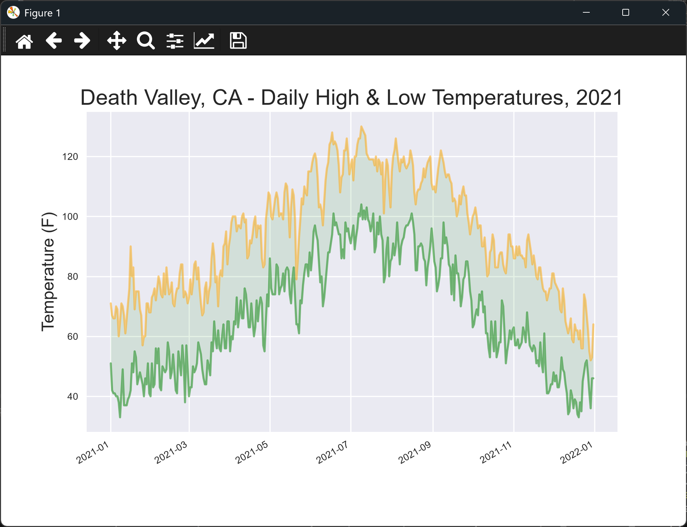

# Death Valley Highs and Lows

## Introduction

This lesson brings the chapter together. It plots Death Valley's highs and lows for 2021, using the
column positions from the last lesson. Some days in this file have no temperature recorded, so the code
checks each row for missing data and skips the days that have none.

---

## The Code

```python
"""Lesson 1.10 - Death Valley Highs and Lows"""

from pathlib import Path
import csv
from datetime import datetime
import matplotlib.pyplot as plt
from relative_paths import get_path

folder = "data"
file_name = "death_valley_2021_simple.csv"
file_path = get_path(file_name, folder)

csv_file = Path(file_path)
lines = csv_file.read_text(encoding="UTF-8").splitlines()

reader = csv.reader(lines)
header_row = next(reader)

dates, highs, lows = [], [], []
for row in reader:
    current_date = datetime.strptime(row[2], "%Y-%m-%d")

    # Handle missing data
    try:
        high = int(row[3])
        low = int(row[4])
    except ValueError:
        print(f"Missing data for {current_date}")
    else:
        # Only append when we have all data for the day
        dates.append(current_date)
        highs.append(high)
        lows.append(low)

# Create the plot
plt.style.use("seaborn-v0_8")
fig, ax = plt.subplots()

# Add plots for both high and low temperatures (alpha is opacity)
ax.plot(dates, highs, color="orange", alpha=0.5)
ax.plot(dates, lows, color="green", alpha=0.5)

# Add shading between the high/low plots (alpha is opacity)
ax.fill_between(dates, highs, lows, facecolor="green", alpha=0.1)

# Format the plot
ax.set_title("Death Valley, CA - Daily High & Low Temperatures, 2021", fontsize=18)
ax.set_xlabel("", fontsize=8)
ax.set_ylabel("Temperature (F)", fontsize=14)
ax.tick_params(labelsize=8)

# Add date formatting
fig.autofmt_xdate()

plt.show()
```

---

### Walking Through the Code

**Handling missing data.** The high and low are converted inside a `try` block. If a value is blank,
`int()` raises a `ValueError`, the script prints the date, and the row is skipped.

**Keeping the lists in step.** The three `append()` calls sit in the `else` block, so they only run when
both values were read. Every date in the list has a high and a low.

**Different columns.** The high is read from column 3 and the low from column 4, matching the Death Valley
layout from the last lesson.

---

### Output

The terminal prints a line for each date with missing data, for example:

```
Missing data for 2021-05-04 00:00:00
```

The window then shows orange and green lines for Death Valley's highs and lows for 2021, with the range
shaded green. Days with missing data are left out, so the lines join the days that remain.



---
