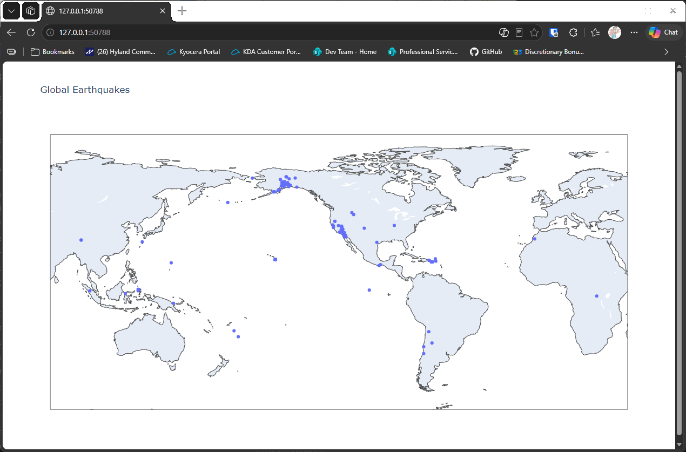

# Basic Map

## Introduction

We have the latitude and longitude of each earthquake, so we can put them on a map. Plotly Express
has a function, `scatter_geo()`, that places a point at each coordinate on a map of the Earth. This
lesson makes the simplest possible map of the one-day earthquake data.

Plotly Express is part of plotly. If you don't have plotly yet, install it first:

```bash
python -m pip install plotly
```

---

## The Code

```python
"""Lesson 2.3: Basic Map"""

import json
from pathlib import Path
from relative_paths import get_path
# https://plotly.com/python/plotly-express
import plotly.express as px

folder = "data"
filename = "readable_eq_data_1_day_09102023.json"
filepath = get_path(filename, folder)

contents = Path(filepath).read_text(encoding="UTF-8")
all_eq_data = json.loads(contents)
all_eq_dicts = all_eq_data["features"]

mags, lons, lats = [], [], []
for eq_dict in all_eq_dicts:
    mags.append(eq_dict["properties"]["mag"])
    lons.append(eq_dict["geometry"]["coordinates"][0])
    lats.append(eq_dict["geometry"]["coordinates"][1])

# Create the basic map plot
plot_title = "Global Earthquakes"
# The scatter_geo() function creates a scatter plot by lat/lon on a map of Earth
fig = px.scatter_geo(lat=lats, lon=lons, title=plot_title)

fig.show()
```

---

### Walking Through the Code

**Reading the data.** The first part of the script is the same as the last lesson. It collects the
longitudes and latitudes into two lists.

**Plotting on a map.** `px.scatter_geo()` takes the latitudes and longitudes and draws a point for each
pair on a map of the Earth. The magnitudes are not used yet.

**Showing the map.** `fig.show()` opens the map in your web browser. Plotly maps are interactive: you can
drag the map and zoom in with the mouse wheel.

---

### Output

Your browser opens a world map with a point for each earthquake in the one-day file. All the points are the
same size and color, because the magnitudes are not used yet.



---
