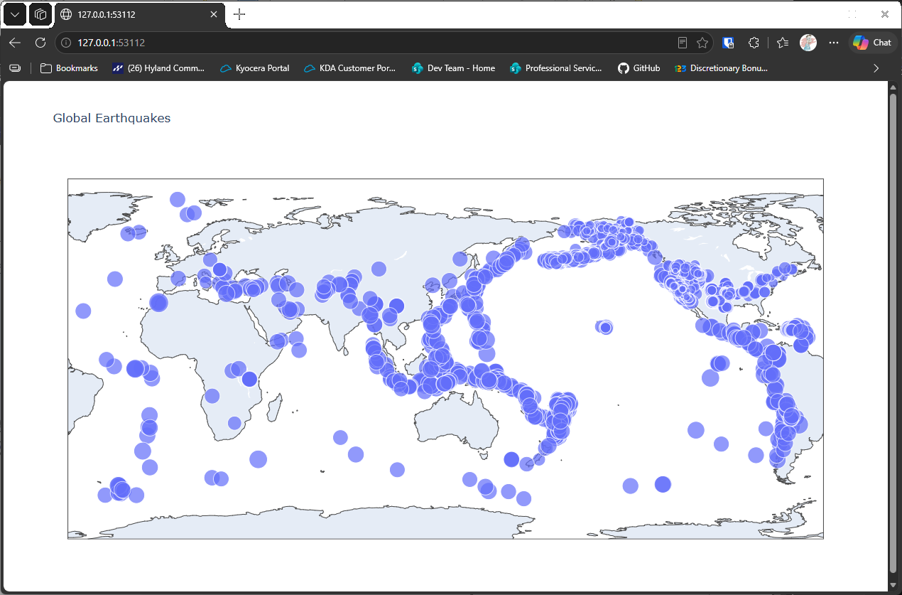

# Magnitude Sizes

## Introduction

The basic map shows where the earthquakes happened, but not how strong they were. This lesson uses the
magnitudes to set the size of each point, so the big earthquakes stand out. It also uses the 30-day file,
which holds many more earthquakes.

---

## The Code

```python
"""Lesson 2.4: Magnitude Sizes"""

import json
from pathlib import Path
from relative_paths import get_path
import plotly.express as px

folder = "data"
# Include additional data (30 days)
filename = "readable_eq_data_30_day_09102023.json"
filepath = get_path(filename, folder)

contents = Path(filepath).read_text(encoding="utf-8")
all_eq_data = json.loads(contents)
all_eq_dicts = all_eq_data["features"]

mags, lons, lats = [], [], []
for eq_dict in all_eq_dicts:
    mags.append(eq_dict["properties"]["mag"])
    lons.append(eq_dict["geometry"]["coordinates"][0])
    lats.append(eq_dict["geometry"]["coordinates"][1])

# Some of the magnitudes came back as negative numbers in my download.
# So we'll clean those up
for i in range(len(mags)):
    if mags[i] < 0:
        mags[i] *= -1

plot_title = "Global Earthquakes"
# Set size corresponding to magnitude
fig = px.scatter_geo(lat=lats, lon=lons, size=mags, title=plot_title)

fig.show()
```

---

### Walking Through the Code

**The 30-day file.** This lesson reads `readable_eq_data_30_day_09102023.json`, which covers thirty days
rather than one.

**Cleaning the magnitudes.** Some magnitudes in the download came back as negative numbers. A size can't be
negative, so the loop flips each negative magnitude to a positive one.

**Sizing the points.** `size=mags` tells plotly to make each point's size depend on its magnitude. Larger
earthquakes get larger points.

---

### Output

The map now has many more points, from the thirty-day file. The largest earthquakes show as the biggest
points.



---
