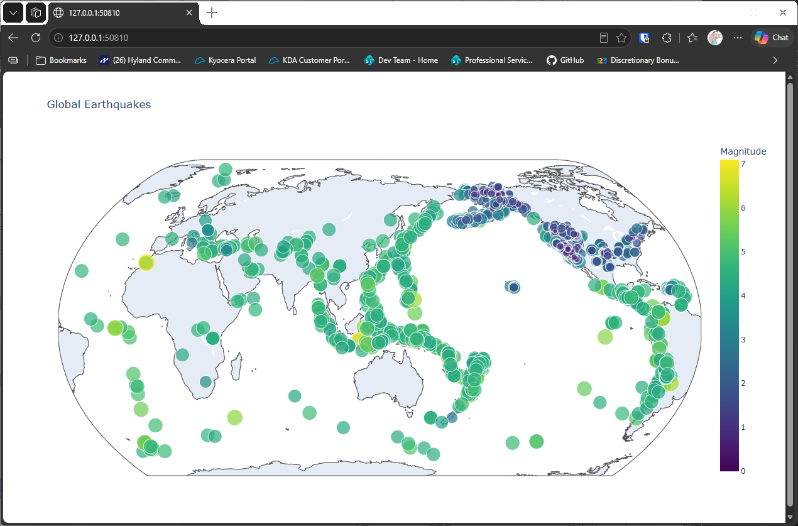

# Magnitude Colors

## Introduction

Size shows magnitude, and color can show it too. This lesson colors each point with a color scale that
depends on its magnitude, and it switches to a different map projection so the world looks more natural.

---

## The Code

```python
"""Lesson 2.5: Magnitude Colors"""

import json
from pathlib import Path
from relative_paths import get_path
import plotly.express as px

folder = "data"
# Include additional data (30 days)
filename = "readable_eq_data_30_day_09102023.json"
filepath = get_path(filename, folder)

contents = Path(filepath).read_text(encoding="utf-8")
all_eq_data = json.loads(contents)
all_eq_dicts = all_eq_data["features"]

mags, lons, lats = [], [], []
for eq_dict in all_eq_dicts:
    mags.append(eq_dict["properties"]["mag"])
    lons.append(eq_dict["geometry"]["coordinates"][0])
    lats.append(eq_dict["geometry"]["coordinates"][1])

# Some of the magnitudes came back as negative numbers in my download.
# So we'll clean those up
for i in range(len(mags)):
    if mags[i] < 0:
        mags[i] *= -1

plot_title = "Global Earthquakes"

# To see available color gradients/scales, do this:
# print(px.colors.named_colorscales())

fig = px.scatter_geo(
    lat=lats,
    lon=lons,
    size=mags,
    title=plot_title,
    # Set color gradient corresponding to magnitude
    color=mags,
    color_continuous_scale="Viridis",
    labels={"color":"Magnitude"},
    # Switch earth projection
    projection="natural earth"
)

fig.show()
```

---

### Walking Through the Code

**Color by magnitude.** `color=mags` assigns a color to each point based on its magnitude. The
`color_continuous_scale="Viridis"` setting chooses the gradient, from dark purple for small values to
yellow for large ones.

**Labeling the colorbar.** `labels={"color": "Magnitude"}` names the color scale, so the reader knows what
the colors mean.

**A different projection.** `projection="natural earth"` changes how the globe is flattened onto the page.
The default projection is different, so the same points look a little different.

**Finding other scales.** The commented-out line lists the names of the other color scales plotly knows.
Replace `"Viridis"` with any of them to try a different gradient.

---

### Output

The map shows each earthquake as a point, sized and colored by its magnitude. A colorbar on the side shows
which color stands for which magnitude. The map uses the natural earth projection, so the continents look
more rounded than before.



---
