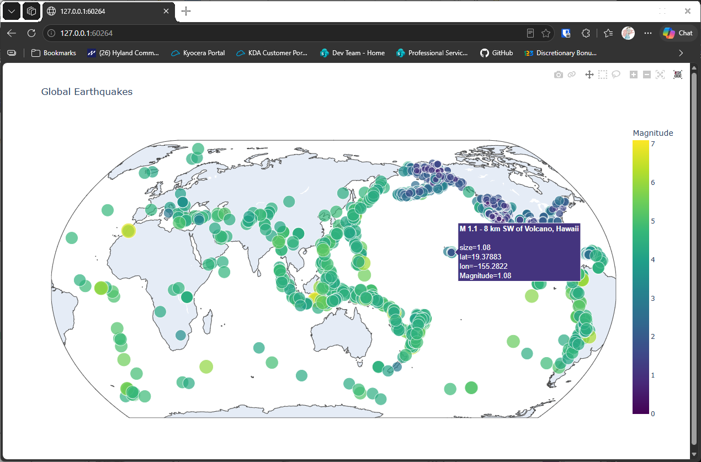

# Adding Hover Text

## Introduction

A map of points is informative, but a reader can't tell which earthquake is which. This lesson adds the
title of each earthquake as hover text, so moving the mouse over a point shows what it is.

---

## The Code

```python
"""Lesson 2.6: Add Hover Text"""

import json
from pathlib import Path
from relative_paths import get_path
import plotly.express as px

folder = "data"
filename = "readable_eq_data_30_day_09102023.json"
filepath = get_path(filename, folder)

contents = Path(filepath).read_text(encoding="utf-8")
all_eq_data = json.loads(contents)
all_eq_dicts = all_eq_data["features"]

# Add a list for the earthquake titles
mags, lons, lats, eq_titles = [], [], [], []
for eq_dict in all_eq_dicts:
    mags.append(eq_dict["properties"]["mag"])
    lons.append(eq_dict["geometry"]["coordinates"][0])
    lats.append(eq_dict["geometry"]["coordinates"][1])
    eq_titles.append(eq_dict["properties"]["title"])

for i in range(len(mags)):
    if mags[i] < 0:
        mags[i] *= -1

plot_title = "Global Earthquakes"

fig = px.scatter_geo(
    lat=lats,
    lon=lons,
    size=mags,
    title=plot_title,
    color=mags,
    color_continuous_scale="Viridis",
    labels={"color":"Magnitude"},
    projection="natural earth",
    # Add our titles to the hover text
    hover_name=eq_titles
)

fig.show()
```

---

### Walking Through the Code

**Collecting the titles.** The loop has a fourth list, `eq_titles`, which takes each earthquake's title
from its `properties`. The title is a short description such as the location and the magnitude.

**The hover text.** `hover_name=eq_titles` tells plotly to show each title when the mouse moves over its
point.

**The rest is unchanged.** The sizes, colors, and projection are the same as in the last lesson.

---

### Output

The map looks the same as before, but moving the mouse over a point shows the earthquake's title in a
small box.



---
