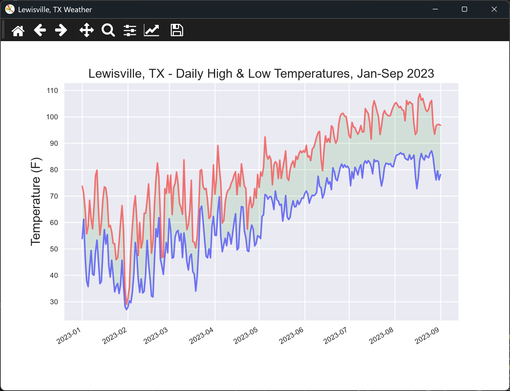
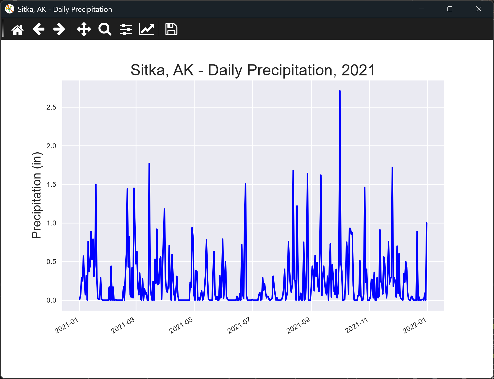
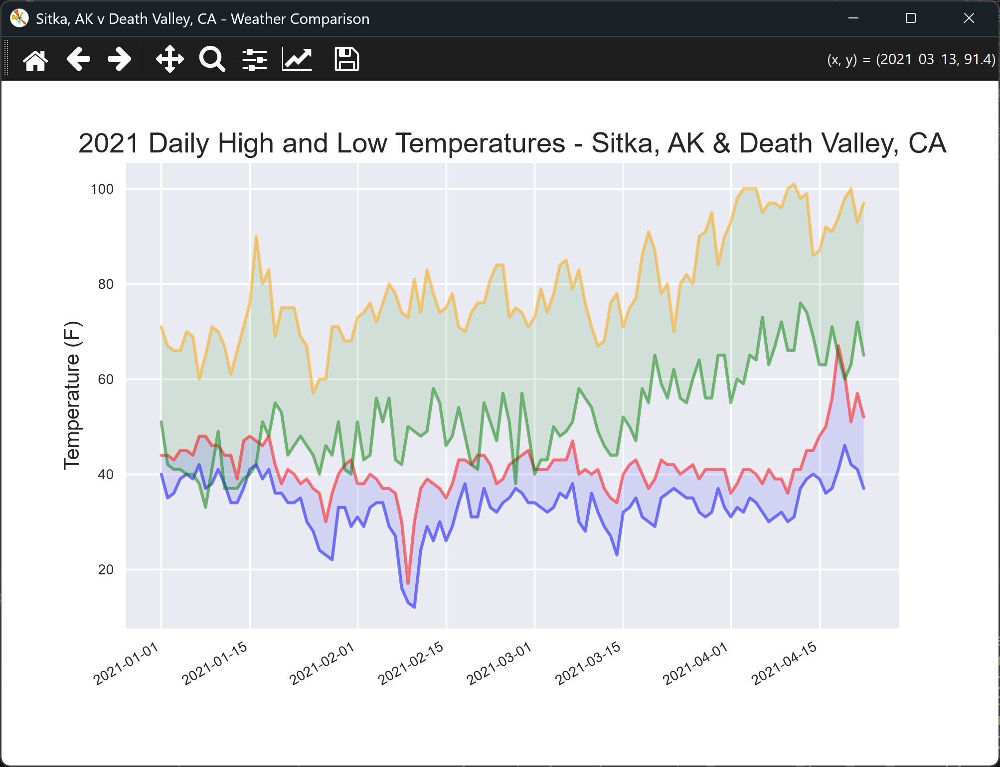
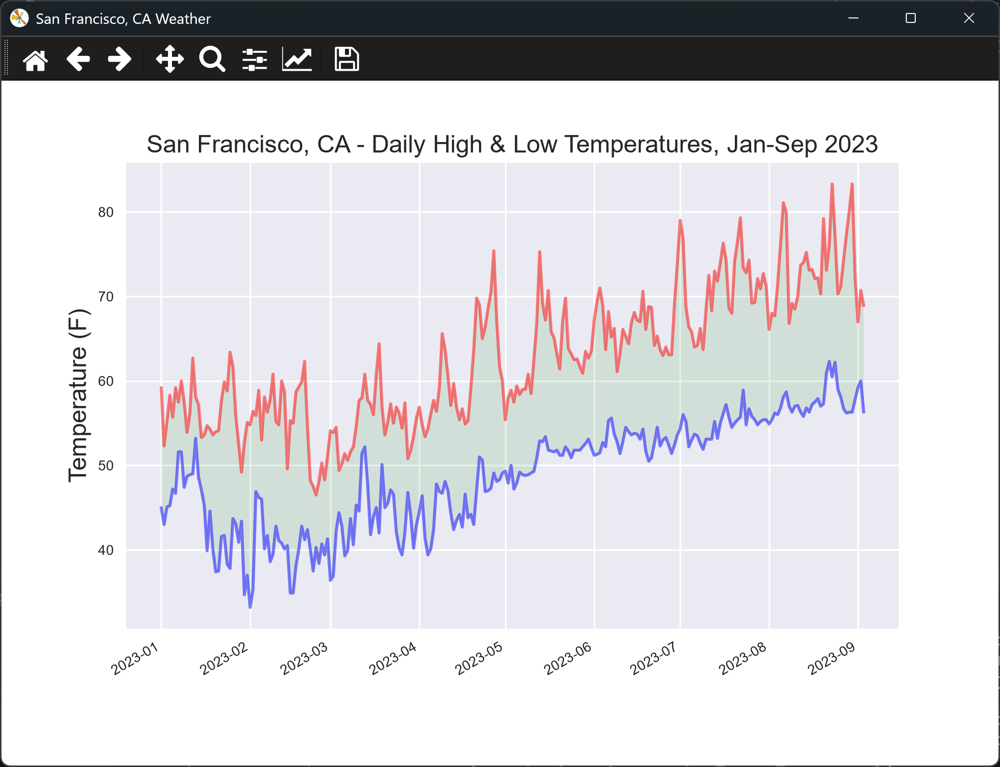
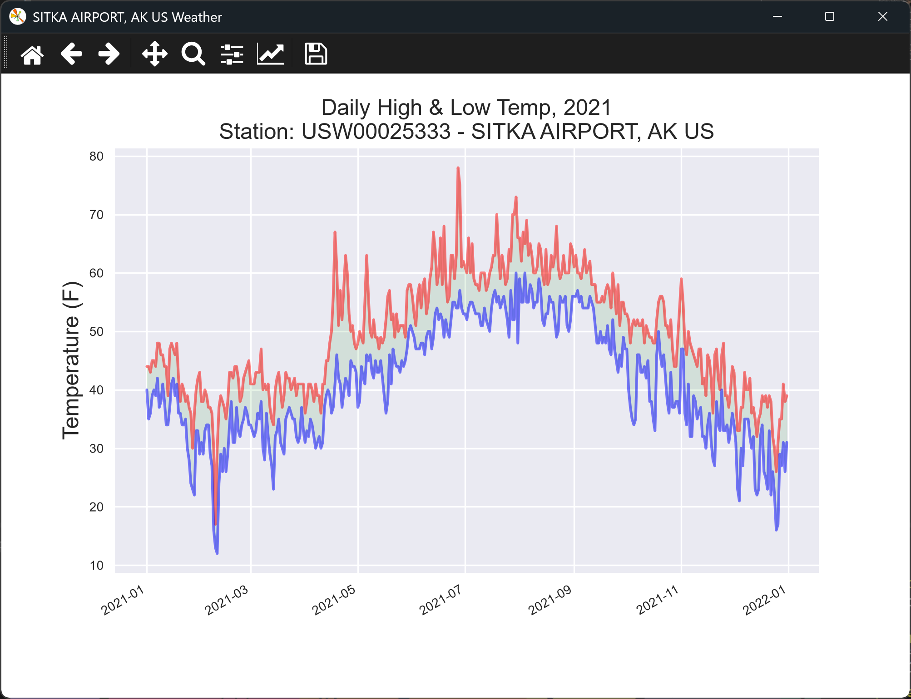
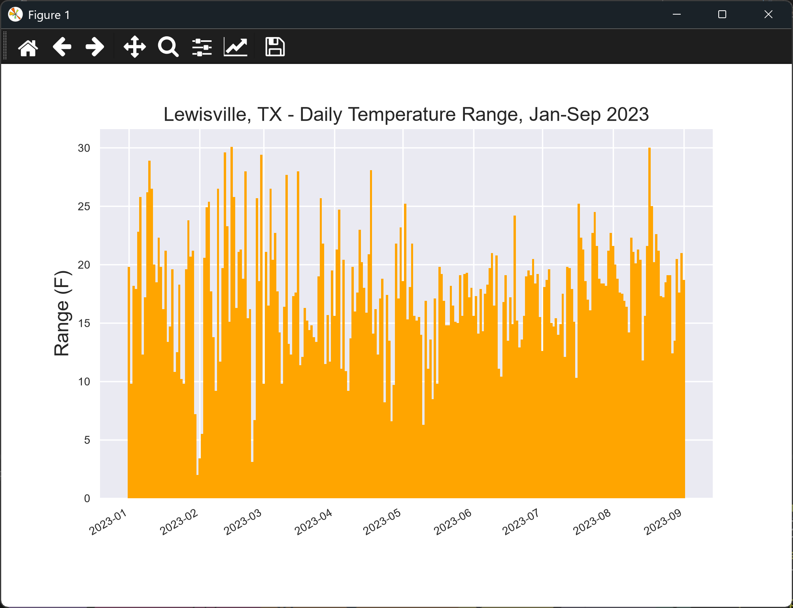
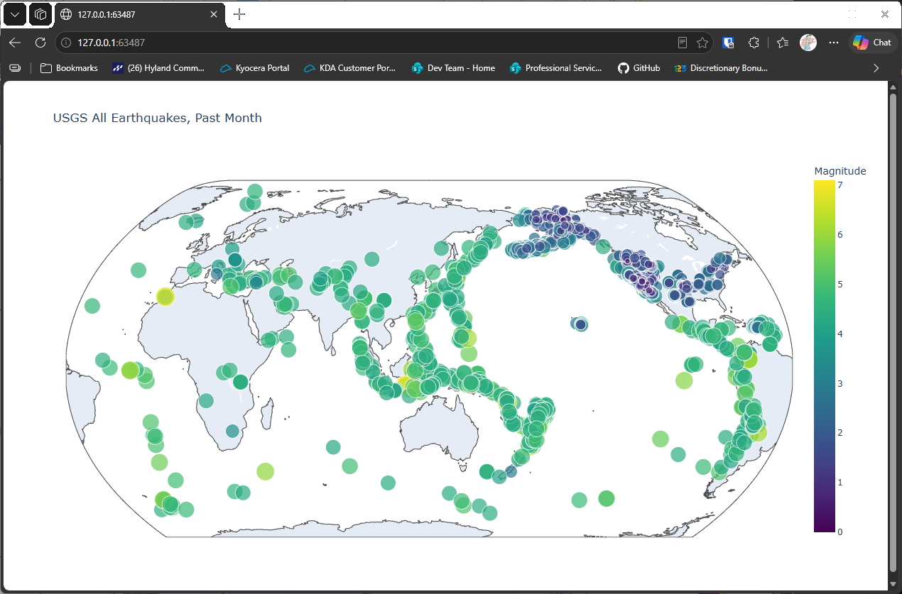
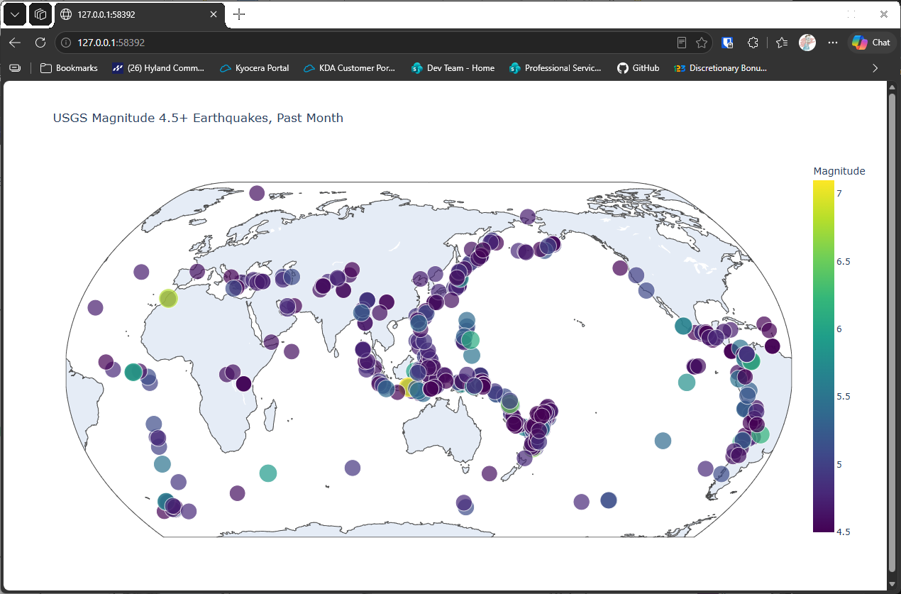
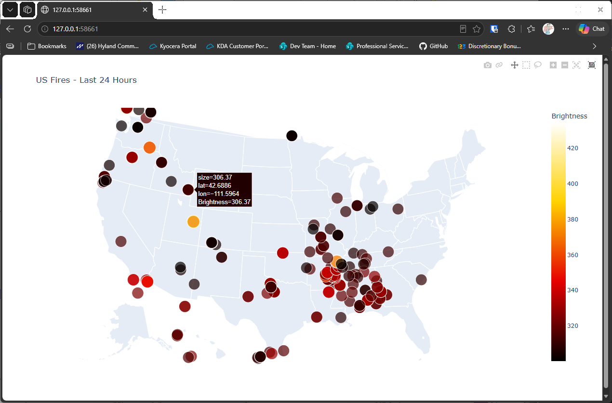

# Chapter 16 Try-it-Yourself Assignments and Solutions

## Introduction

Here are my solutions for the chapter 16 try-it-yourself exercises, from the 3rd edition of the textbook.

The 3rd edition reads its data from files in the `data` folder, and it uses plotly Express for most of its maps. The first exercise asks you to download your own weather data, so the solution uses a file of Lewisville, Texas weather that is already in the `data` folder. The last few exercises download data from the internet, so they need a connection when you run them.

Each exercise shows the full assignment, then a solution with the code and its output. The solution code is hidden until you expand it, so you can attempt each assignment first.

Matplotlib charts open in a window, and you close the window to move on. Plotly maps open in your web browser.

---

### Assignment 16.0 - Download Your Own Data

Download Your Own Data: To obtain data, do the following:

1. Visit the NOAA Climate Data Online site at https://www.ncdc.noaa.gov/cdo-web/. In the Discover Data By section, click Search Tool. In the Select a Dataset box, choose Daily Summaries.
2. Select a date range, and in the Search For section, choose ZIP Codes. Enter the ZIP Code you're interested in, and click Search.
3. On the next page, you'll see a map and some information about the area you're focusing on. Below the location name, click View Full Details, or click the map and then click Full Details.
4. Scroll down and click Station List to see the weather stations that are available in this area. Choose one of the stations, and click Add to Cart. This data is free, even though the site uses a shopping cart icon. In the upper-right corner, click the cart.
5. In Select the Output, choose Custom GHCN-Daily CSV. Make sure the date range is correct, and click Continue.
6. On the next page, you can select the kinds of data you want. You can download one kind of data, for example, focusing on air temperature, or you can download all the data available from this station. Make your choices, and then click Continue.
7. On the last page, you'll see a summary of your order. Enter your email address, and click Submit Order. You'll receive a confirmation that your order was received, and in a few minutes you should receive another email with a link to download your data.

The NOAA data was down on the date the example was extracted, so the solution uses a Lewisville, Texas file from the Open-Meteo historical weather service instead. The solution plots the high and low temperatures for January to September 2023.

Solution:

<details>
<summary>Spoiler Code</summary>
<br>

```python
from pathlib import Path
import csv
from datetime import datetime
import matplotlib.pyplot as plt
from relative_paths import get_path

folder = "data"
file_name = "lewisville_weather_2023_jan_to_sep.csv"
file_path = get_path(file_name, folder)

csv_file = Path(file_path)
lines = csv_file.read_text(encoding="UTF-8").splitlines()

reader = csv.reader(lines)
header_row = next(reader)

dates, highs, lows = [], [], []
for row in reader:
    row_date = datetime.strptime(row[0], "%m/%d/%Y")
    try:
        high = float(row[1])
        low = float(row[2])
    except ValueError:
        print(f"Missing data for {row_date}")
    else:
        # Only append when we have all data for the day
        dates.append(row_date)
        highs.append(high)
        lows.append(low)

# Create the plot
plt.style.use("seaborn-v0_8")
fig, ax = plt.subplots()

# Add plots for both high and low temperatures (alpha is opacity)
ax.plot(dates, highs, color="red", alpha=0.5)
ax.plot(dates, lows, color="blue", alpha=0.5)

# Add shading between the high/low plots (alpha is opacity)
ax.fill_between(dates, highs, lows, facecolor="green", alpha=0.1)

# Format the plot
ax.set_title(
    "Lewisville, TX - Daily High & Low Temperatures, Jan-Sep 2023", fontsize=14)
ax.set_xlabel("", fontsize=8)
ax.set_ylabel("Temperature (F)", fontsize=14)
ax.tick_params(labelsize=8)

# Add date formatting
fig.autofmt_xdate()
fig.canvas.manager.set_window_title("Lewisville, TX Weather")

plt.show()
```

</details>
<br>

<details>
<summary>Output</summary>



</details>
<br>

---

### Assignment 16.1 - Sitka Rainfall

Sitka Rainfall: Sitka is in a temperate rainforest, so it gets a fair amount of rainfall. In the data file sitka_weather_2018_simple.csv is a header called PRCP, which represents daily rainfall amounts. Make a visualization focusing on the data in this column. You can repeat the exercise for Death Valley if you're curious how little rainfall occurs in a desert.

Solution:

<details>
<summary>Spoiler Code</summary>
<br>

```python
from pathlib import Path
import csv
from datetime import datetime
import matplotlib.pyplot as plt
from relative_paths import get_path

folder = "data"
file_name = "sitka_weather_2021_full.csv"
file_path = get_path(file_name, folder)

csv_file = Path(file_path)
lines = csv_file.read_text(encoding="UTF-8").splitlines()

reader = csv.reader(lines)
header_row = next(reader)

dates, prec = [], []
for row in reader:
    row_date = datetime.strptime(row[2], "%Y-%m-%d")
    try:
        rain = float(row[5])
    except ValueError:
        print(f"Missing data for {row_date}")
    else:
        dates.append(row_date)
        prec.append(rain)

# Create the plot
plt.style.use("seaborn-v0_8")
fig, ax = plt.subplots()

# Add plot for rain
ax.plot(dates, prec, color="blue")
# Format the plot
ax.set_title("Sitka, AK - Daily Precipitation, 2021", fontsize=18)
ax.set_xlabel("", fontsize=8)
ax.set_ylabel("Precipitation (in)", fontsize=14)
ax.tick_params(labelsize=8)

# Add date formatting
fig.autofmt_xdate()
fig.canvas.manager.set_window_title("Sitka, AK - Daily Precipitation")

plt.show()
```

</details>
<br>

<details>
<summary>Output</summary>



</details>
<br>

---

### Assignment 16.2 - Sitka-Death Valley Comparison

Sitka-Death Valley Comparison: The temperature scales on the Sitka and Death Valley graphs reflect the different data ranges. To accurately compare the temperature range in Sitka to that of Death Valley, you need identical scales on the y-axis. Change the settings for the y-axis on one or both of the charts in Figures 16-5 and 16-6. Then make a direct comparison between temperature ranges in Sitka and Death Valley (or any two places you want to compare).

Solution:

<details>
<summary>Spoiler Code</summary>
<br>

```python
from pathlib import Path
import csv
from datetime import datetime
import matplotlib.pyplot as plt
from relative_paths import get_path

SH_COLOR = "red"
SL_COLOR = "blue"
DH_COLOR = "orange"
DL_COLOR = "green"

D_LABEL = "DATE"
H_LABEL = "TMAX"
L_LABEL = "TMIN"
labels = [D_LABEL, H_LABEL, L_LABEL]

increment_d = True

folder = "data"
s_file = get_path("sitka_weather_2021_simple.csv", folder)
s_path = Path(s_file)
d_file = get_path("death_valley_2021_simple.csv", folder)
d_path = Path(d_file)

with s_path.open(encoding="utf-8") as sf, d_path.open(encoding="utf-8") as df:
    s_reader, d_reader = csv.reader(sf), csv.reader(df)
    s_header_row, d_header_row = next(s_reader), next(d_reader)

    sd_pos, sh_pos, sl_pos = [s_header_row.index(label) for label in labels]
    dd_pos, dh_pos, dl_pos = [d_header_row.index(label) for label in labels]

    dates, s_highs, s_lows, d_highs, d_lows = [], [], [], [], []

    while True:
        try:
            s_row = next(s_reader)
            d_row = next(d_reader)
        except:
            # If we have run out of rows in either file, stop
            break

        s_date = datetime.strptime(s_row[sd_pos], "%Y-%m-%d")
        d_date = datetime.strptime(d_row[dd_pos], "%Y-%m-%d")

        done = False

        # We only want to list dates that exist in both files
        while s_date != d_date:
            try:
                if s_date < d_date:
                    s_row = next(s_reader)
                else:
                    d_row = next(d_reader)
            except:
                # If we have run out of rows in either file, stop
                done = True
                break

        # If we have run out of rows in either file, stop
        if done:
            break

        try:
            # Get all high/low temps
            s_low = int(s_row[sl_pos])
            s_high = int(s_row[sh_pos])
            d_low = int(d_row[dl_pos])
            d_high = int(d_row[dh_pos])
        except ValueError:
            print(f"Missing data for {s_date}")
        else:
            # Only add to graph if everything had values
            dates.append(s_date)
            s_highs.append(s_high)
            s_lows.append(s_low)
            d_highs.append(d_high)
            d_lows.append(d_low)

    # Create the plot
    plt.style.use("seaborn-v0_8")
    fig, ax = plt.subplots()

    # Add plots for all high and low temperatures
    ax.plot(dates, s_highs, color=SH_COLOR, alpha=0.5)
    ax.plot(dates, s_lows, color=SL_COLOR, alpha=0.5)
    ax.fill_between(dates, s_highs, s_lows, facecolor=SL_COLOR, alpha=0.1)
    ax.plot(dates, d_highs, color=DH_COLOR, alpha=0.5)
    ax.plot(dates, d_lows, color=DL_COLOR, alpha=0.5)
    ax.fill_between(dates, d_highs, d_lows, facecolor=DL_COLOR, alpha=0.1)

    ax.set_title("2021 Daily High and Low Temperatures - Sitka, AK & Death Valley, CA",
                 fontsize = 16)
    ax.set_xlabel("", fontsize=8)
    ax.set_ylabel("Temperature (F)", fontsize=12)
    ax.tick_params(labelsize=8)

    fig.autofmt_xdate()
    fig.canvas.manager.set_window_title("Sitka, AK v Death Valley, CA - Weather Comparison")

    plt.show()
```

</details>
<br>

<details>
<summary>Output</summary>



</details>
<br>

---

### Assignment 16.3 - San Francisco

San Francisco: Are temperatures in San Francisco more like temperatures in Sitka or temperatures in Death Valley? Download some data for San Francisco, and generate a high-low temperature plot for San Francisco to make a comparison.

Solution:

<details>
<summary>Spoiler Code</summary>
<br>

```python
from pathlib import Path
import csv
from datetime import datetime
import matplotlib.pyplot as plt
from relative_paths import get_path

folder = "data"
file_name = "san_francisco_weather_2023_jan_to_sep.csv"
file_path = get_path(file_name, folder)

csv_file = Path(file_path)
lines = csv_file.read_text(encoding="UTF-8").splitlines()

reader = csv.reader(lines)
header_row = next(reader)

dates, highs, lows = [], [], []
for row in reader:
    row_date = datetime.strptime(row[0], "%m/%d/%Y")
    try:
        high = float(row[1])
        low = float(row[2])
    except ValueError:
        print(f"Missing data for {row_date}")
    else:
        # Only append when we have all data for the day
        dates.append(row_date)
        highs.append(high)
        lows.append(low)

# Create the plot
plt.style.use("seaborn-v0_8")
fig, ax = plt.subplots()

# Add plots for both high and low temperatures (alpha is opacity)
ax.plot(dates, highs, color="red", alpha=0.5)
ax.plot(dates, lows, color="blue", alpha=0.5)

# Add shading between the high/low plots (alpha is opacity)
ax.fill_between(dates, highs, lows, facecolor="green", alpha=0.1)

# Format the plot
ax.set_title("San Francisco, CA - Daily High & Low Temperatures, Jan-Sep 2023", fontsize=14)
ax.set_xlabel("", fontsize=8)
ax.set_ylabel("Temperature (F)", fontsize=14)
ax.tick_params(labelsize=8)

# Add date formatting
fig.autofmt_xdate()
fig.canvas.manager.set_window_title("San Francisco, CA Weather")

plt.show()
```

</details>
<br>

<details>
<summary>Output</summary>



</details>
<br>

---

### Assignment 16.4 - Automatic Indexes

Automatic Indexes: In this section, we hardcoded the indexes corresponding to the TMIN and TMAX columns. Use the header row to determine the indexes for these values, so your program can work for Sitka or Death Valley. Use the station name to automatically generate an appropriate title for your graph as well.

Solution:

<details>
<summary>Spoiler Code</summary>
<br>

```python
from pathlib import Path
import csv
from datetime import datetime
import matplotlib.pyplot as plt
from relative_paths import get_path

folder = "data"
file_name = "sitka_weather_2021_full.csv"
file_path = get_path(file_name, folder)

csv_file = Path(file_path)
lines = csv_file.read_text(encoding="UTF-8").splitlines()

reader = csv.reader(lines)
header_row = next(reader)

station_index = header_row.index("STATION")
station = None
name_index = header_row.index("NAME")
name = None

date_index = header_row.index("DATE")
high_index = header_row.index("TMAX")
low_index = header_row.index("TMIN")

dates, highs, lows = [], [], []
for row in reader:
    if station is None:
        station = row[station_index]
    if name is None:
        name = row[name_index]

    row_date = datetime.strptime(row[date_index], "%Y-%m-%d")

    try:
        high = float(row[high_index])
        low = float(row[low_index])
    except ValueError:
        print(f"Missing data for {row_date}")
    else:
        dates.append(row_date)
        highs.append(high)
        lows.append(low)

plt.style.use("seaborn-v0_8")
fig, ax = plt.subplots()
ax.plot(dates, highs,color="red", alpha=0.5)
ax.plot(dates, lows, color="blue", alpha=0.5)
ax.fill_between(dates, lows, highs, color="green", alpha=0.1)
ax.set_title(f"Daily High & Low Temp, 2021\nStation: {station} - {name}", fontsize=14)
ax.set_xlabel("", fontsize=8)
ax.set_ylabel("Temperature (F)", fontsize=14)
ax.tick_params(labelsize=8)
fig.autofmt_xdate()
fig.canvas.manager.set_window_title(f"{name} Weather")

plt.show()
```

</details>
<br>

<details>
<summary>Output</summary>

The terminal prints a line for each day with missing data:

```
Missing data for 2021-04-23 00:00:00
```



</details>
<br>

---

### Assignment 16.5 - Explore

Explore: Generate a few more visualizations that examine any other weather aspect you're interested in for any locations you're curious about.

Solution, which uses the Lewisville data and plots the daily temperature range (the gap between each day's high and low):

<details>
<summary>Spoiler Code</summary>
<br>

```python
from pathlib import Path
import csv
from datetime import datetime
import matplotlib.pyplot as plt
from relative_paths import get_path

folder = "data"
file_name = "lewisville_weather_2023_jan_to_sep.csv"
file_path = get_path(file_name, folder)

csv_file = Path(file_path)
lines = csv_file.read_text(encoding="UTF-8").splitlines()

reader = csv.reader(lines)
header_row = next(reader)

# The daily temperature range is the gap between the high and the low for each day
dates, ranges = [], []
for row in reader:
    row_date = datetime.strptime(row[0], "%m/%d/%Y")
    try:
        high = float(row[1])
        low = float(row[2])
    except ValueError:
        print(f"Missing data for {row_date}")
    else:
        dates.append(row_date)
        ranges.append(high - low)

# Show each day's range as a bar, so the spread of the days is easy to compare
plt.style.use("seaborn-v0_8")
fig, ax = plt.subplots()
ax.bar(dates, ranges, color="orange", width=1.0)
ax.set_title("Lewisville, TX - Daily Temperature Range, Jan-Sep 2023", fontsize=14)
ax.set_xlabel("", fontsize=8)
ax.set_ylabel("Range (F)", fontsize=14)
ax.tick_params(labelsize=8)
fig.autofmt_xdate()

plt.show()
```

</details>
<br>

<details>
<summary>Output</summary>



</details>
<br>

---

### Assignment 16.6 - Refactoring

Refactoring: The loop that pulls data from all_eq_dicts uses variables for the magnitude, longitude, latitude, and title of each earthquake before appending these values to their appropriate lists. This approach was chosen for clarity in how to pull data from a JSON file, but it's not necessary in your code. Instead of using these temporary variables, pull each value from eq_dict and append it to the appropriate list in one line. Doing so should shorten the body of this loop to just four lines.

Solution:

<details>
<summary>Spoiler Code</summary>
<br>

```python
import json
from pathlib import Path
import plotly.express as px
from relative_paths import get_path

folder = "data"
filename = "readable_eq_data_30_day_09102023.json"
filepath = get_path(filename, folder)

contents = Path(filepath).read_text(encoding="utf-8")
all_eq_data = json.loads(contents)
all_eq_dicts = all_eq_data["features"]

# Add a list for the earthquake titles
mags = [eq["properties"]["mag"] for eq in all_eq_dicts]
lons = [eq["geometry"]["coordinates"][0] for eq in all_eq_dicts]
lats = [eq["geometry"]["coordinates"][1] for eq in all_eq_dicts]
titles = [eq["properties"]["title"] for eq in all_eq_dicts]

for i, mag in enumerate(mags):
    if mag < 0:
        mags[i] *= -1

plot_title = "Global Earthquakes"

fig = px.scatter_geo(
    lat=lats,
    lon=lons,
    size=mags,
    title=plot_title,
    color=mags,
    color_continuous_scale="Viridis",
    labels={"color": "Magnitude"},
    projection="natural earth",
    hover_name=titles
)

fig.show()
```

</details>
<br>

<details>
<summary>Output</summary>


</details>
<br>

---

### Assignment 16.7 - Automated Title

Automated Title: In this section, we used the generic title Global Earthquakes. Instead, you can use the title for the dataset in the metadata part of the GeoJSON file. Pull this value and assign it to the variable `title`.

Solution:

<details>
<summary>Spoiler Code</summary>
<br>

```python
import json
from pathlib import Path
import plotly.express as px
from relative_paths import get_path

folder = "data"
filename = "readable_eq_data_30_day_09102023.json"
filepath = get_path(filename, folder)

contents = Path(filepath).read_text(encoding="utf-8")
all_eq_data = json.loads(contents)
all_eq_dicts = all_eq_data["features"]

# Add a list for the earthquake titles
mags = [eq["properties"]["mag"] for eq in all_eq_dicts]
lons = [eq["geometry"]["coordinates"][0] for eq in all_eq_dicts]
lats = [eq["geometry"]["coordinates"][1] for eq in all_eq_dicts]
titles = [eq["properties"]["title"] for eq in all_eq_dicts]

for i in range(len(mags)):
    if mags[i] < 0:
        mags[i] *= -1

plot_title = all_eq_data["metadata"]["title"]

fig = px.scatter_geo(
    lat=lats,
    lon=lons,
    size=mags,
    title=plot_title,
    color=mags,
    color_continuous_scale="Viridis",
    labels={"color":"Magnitude"},
    projection="natural earth",
    hover_name=titles
)

fig.show()
```

</details>
<br>

<details>
<summary>Output</summary>



</details>
<br>

---

### Assignment 16.8 - Recent Earthquakes

Recent Earthquakes: You can find data files containing information about the most recent earthquakes over 1-hour, 1-day, 7-day, and 30-day periods online. Go to https://earthquake.usgs.gov/earthquakes/feed/v1.0/geojson.php and you'll see a list of links to data sets for various time periods, focusing on earthquakes of different magnitudes. Download one of these data sets, and create a visualization of the most recent earthquake activity.

Solution, which uses the saved 30-day file in the `data` folder (no internet connection needed):

<details>
<summary>Spoiler Code</summary>
<br>

```python
import json
from pathlib import Path
import plotly.express as px
from relative_paths import get_path

folder = "data"
filename = "readable_eq_data_30_day_serious_09102023.json"
filepath = get_path(filename, folder)

contents = Path(filepath).read_text(encoding="utf-8")
all_eq_data = json.loads(contents)
all_eq_dicts = all_eq_data["features"]

# Add a list for the earthquake titles
mags = [eq["properties"]["mag"] for eq in all_eq_dicts]
lons = [eq["geometry"]["coordinates"][0] for eq in all_eq_dicts]
lats = [eq["geometry"]["coordinates"][1] for eq in all_eq_dicts]
titles = [eq["properties"]["title"] for eq in all_eq_dicts]

for i in range(len(mags)):
    if mags[i] < 0:
        mags[i] *= -1

plot_title = all_eq_data["metadata"]["title"]

fig = px.scatter_geo(
    lat=lats,
    lon=lons,
    size=mags,
    title=plot_title,
    color=mags,
    color_continuous_scale="Viridis",
    labels={"color": "Magnitude"},
    projection="natural earth",
    hover_name=titles
)

fig.show()
```

</details>
<br>

<details>
<summary>Output</summary>



</details>
<br>

---

### Assignment 16.9 - World Fires

World Fires: In the resources for this chapter, you'll find a file called world_fires_1_day.csv. This file contains information about fires burning in different locations around the globe, including the latitude and longitude, and the brightness of each fire. Using the data processing work from the first part of this chapter and the mapping work from this section, make a map that shows which parts of the world are affected by fires. You can download more recent versions of this data at https://earthdata.nasa.gov/earth-observation-data/near-real-time/firms/active-fire-data/. You can find links to the data in CSV format in the TXT section.

Solution, which uses the saved US and Hawaii fire data in the `data` folder:

<details>
<summary>Spoiler Code</summary>
<br>

```python
from pathlib import Path
import csv
import plotly.express as px
from relative_paths import get_path

folder = "data"
file_name = "MODIS_C6_1_USA_contiguous_and_Hawaii_24h.csv"
file_path = get_path(file_name, folder)

csv_file = Path(file_path)
lines = csv_file.read_text(encoding="UTF-8").splitlines()

reader = csv.reader(lines)
header_row = next(reader)

lat_index = header_row.index("latitude")
lon_index = header_row.index("longitude")
brt_index = header_row.index("brightness")

lats, lons, brts = [], [], []
for row in reader:
    try:
        lat = float(row[lat_index])
        lon = float(row[lon_index])
        brt = float(row[brt_index])
    except ValueError:
        print("Missing data!")
    else:
        lats.append(lat)
        lons.append(lon)
        brts.append(brt)

plot_title = "US Fires - Last 24 Hours"

fig = px.scatter_geo(
    lat=lats,
    lon=lons,
    size=brts,
    title=plot_title,
    color=brts,
    color_continuous_scale="Hot",
    labels={"color": "Brightness"},
    projection="albers usa"
)

fig.show()
```

</details>
<br>

<details>
<summary>Output</summary>



</details>
<br>

---
